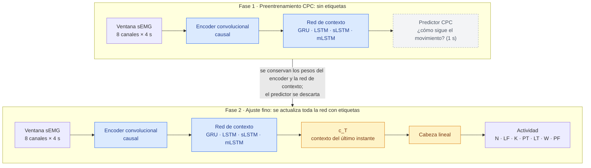
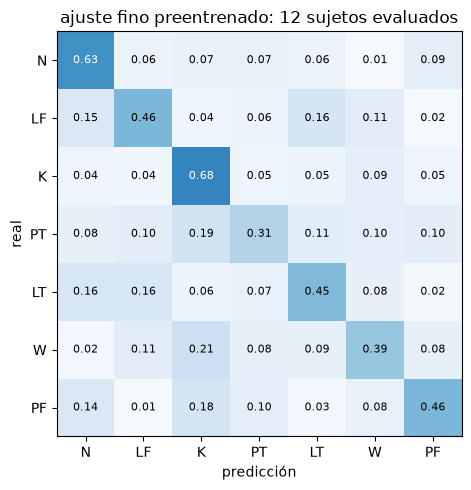
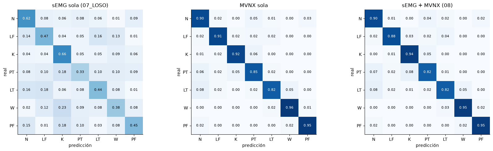
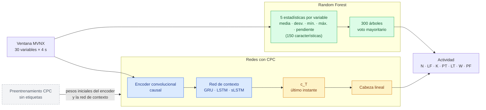
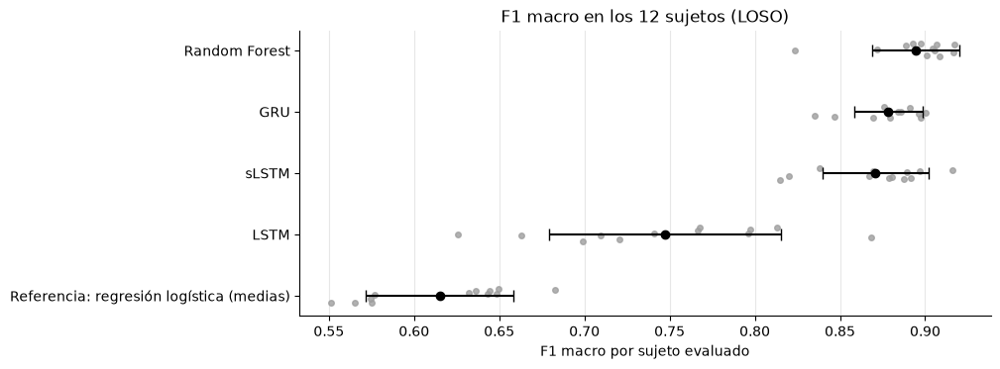
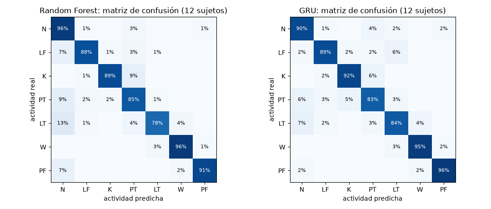
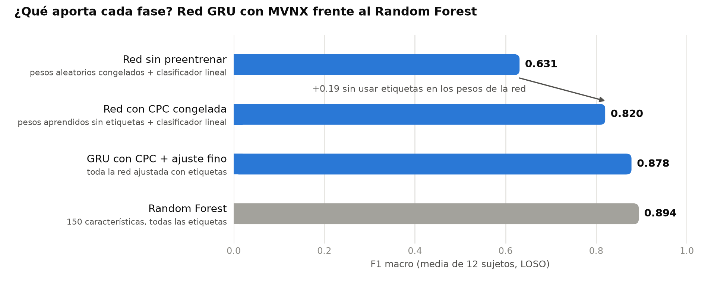

# Reconocimiento de actividades de manejo manual de cargas: avances del proyecto

**Proyecto Integrador · Equipo 1** · 27 de octubre de 2026

## Resumen

- **Objetivo:** reconocer siete actividades de manejo manual de cargas a partir de sensores corporales.
- **Trayectoria:** empezamos con la señal muscular de los brazos (sEMG) y una red con preentrenamiento autosupervisado (CPC). La sEMG se quedó en un F1 macro de ≈ 0.44–0.49. Al incorporar la captura de movimiento de cuerpo completo (MVNX), el desempeño subió a ≈ 0.88, y la sEMG no aportó nada adicional. Desde entonces trabajamos solo con MVNX.
- **Estado actual:** con MVNX, el Random Forest obtiene el mejor F1 macro (0.894), y la red con preentrenamiento CPC queda muy cerca (0.878), con la menor variación entre personas. La red aprende sin etiquetas una representación que ya reconoce las actividades (0.820 con un clasificador lineal); falta evaluar su ventaja cuando las etiquetas son escasas.
- **Evaluación:** en todos los experimentos se deja un sujeto fuera (LOSO) con los sujetos 1–12. Los sujetos 13 y 14 están reservados para la prueba final y no se han usado.

| Código | Actividad |
|---|---|
| N | Postura neutral |
| LF | Levantar desde el piso |
| K | Mantener levantado |
| PT | Colocar en la mesa |
| LT | Levantar desde la mesa |
| W | Caminar / cargar |
| PF | Colocar en el piso |

---

## 1. Exploración y preparación de la sEMG

### Contenido

- **14 sujetos** (12 hombres y 2 mujeres, de 25 a 38 años), con 37 ensayos por sujeto: isocinéticos, bimanuales y unilaterales, con cargas de 2 a 12 kg.
- **643 ensayos sEMG** de 8 canales en el miembro superior: 27.7 millones de muestras, 13.2 h.
- **Etiquetas:** 10,612 segmentos en 7 clases. Solo ≈ 67 % de cada grabación está anotado.

### Hallazgos

- **Calidad:** no hay nulos, huecos ni canales constantes. Hay 3 ensayos con canales dañados (sujeto 7), 2 archivos con etiquetas inconsistentes y falta 1 ensayo del sujeto 12.
- **Frecuencia variable:** entre 367 y 1006 Hz según el archivo. No se pueden combinar los registros por número de muestras.
- **Desbalance:** `N` ocupa el 43 % del tiempo etiquetado; las demás clases, entre el 7 y el 15 % cada una.
- **Capacidad predictiva:** la sEMG separa claramente reposo de actividad y crece con la carga (≈ 3× de 2 a 12 kg), pero **las actividades de esfuerzo se superponen**.

### Preparación

1. Se excluyen los ensayos con canales dañados y con etiquetas inconsistentes.
2. Se usa la envolvente normalizada `Norm_RMS` (%MVC) de los 8 canales.
3. Se aplica un filtro antialias y se remuestrea a **12 Hz**. Rinde igual que 25 Hz con un tercio del costo.
4. Se forman ventanas de **4 s (48 pasos)**, etiquetadas con la actividad de su **instante final**.
5. Se transforma con `clip` por cuantiles, `log1p` y `RobustScaler`, ajustado solo con los sujetos de entrenamiento.
6. Se particiona **por sujeto**, para que una persona nunca aparezca a la vez en entrenamiento y evaluación.

---

## 2. Modelos con sEMG

### Qué se probó

- **Red CPC:** un encoder convolucional y una red de contexto, preentrenados sin etiquetas y luego ajustados para clasificar.
- **Configuraciones:** redes de contexto GRU, LSTM, sLSTM y mLSTM; horizontes de predicción; negativos mezclados o del mismo sujeto; representación del último instante o de toda la ventana; frecuencias de 12 y 25 Hz.
- **Mejor configuración:** sLSTM con horizonte de 1 s y negativos del mismo sujeto. Se evaluó en LOSO con dos semillas.
- **Referencia clásica:** un Random Forest sobre 202 características de la sEMG, estandarizadas por sujeto.

**Arquitectura de la red:**



- **Fase 1 (preentrenamiento CPC):** el encoder y la red de contexto aprenden sin etiquetas.
- **Fase 2 (ajuste fino):** se agrega la cabeza y se entrena **toda la red** con etiquetas. El encoder y la red de contexto parten de los pesos de CPC y cambian poco; la cabeza aprende desde cero.
- **Desde cero:** la misma arquitectura, sin la fase 1.

### Resultados (LOSO, 12 sujetos)

| Modelo | F1 macro |
|---|---|
| Random Forest, características sEMG | **0.485 ± 0.042** |
| sLSTM con CPC + ajuste fino | 0.437 ± 0.066 |
| sLSTM desde cero | 0.421 ± 0.073 |
| Azar estratificado | 0.14 |

**Matriz de confusión del mejor modelo de red (sLSTM con CPC + ajuste fino):**



- Ninguna actividad supera el 68 % de aciertos; `PT` solo llega al 31 %.
- Las confusiones siguen un patrón: `PT`, `W` y `PF` se confunden con `K` (18–21 %), y `LF` y `LT` se confunden entre sí (16 %).

### Conclusión

La sEMG de los brazos **no basta para identificar la actividad**. Mide **cuánto esfuerzo** hace el músculo, pero no **dónde está el cuerpo**. Levantar desde el piso o desde la mesa, y colocar en la mesa o en el piso, activan los mismos músculos; lo que cambia es la altura y la postura. Como el Random Forest y la red se quedan en el mismo rango (≈ 0.44–0.49), **el límite está en la señal, no en el modelo**.

---

## 3. Exploración y preparación de la captura de movimiento (MVNX)

### Contenido

- **517 grabaciones** del traje inercial Xsens MVN (≈ 57 GB en XML), a 240 Hz.
- **Modelo corporal:** 23 segmentos, 17 sensores y 22 articulaciones, con 782 columnas por instante. Incluye posición, velocidad, aceleración, orientación, ángulos articulares y contactos de los pies.
- **Etiquetas propias:** 8,337 segmentos indexados sobre los frames de MVNX, con las mismas 7 clases.

### Preparación

1. **Sincronización con la sEMG:** los relojes difieren ≈ 1 h. Se alinearon por eventos de las etiquetas, con un residuo típico de 0.5 ms. Donde ambas fuentes tienen etiqueta, coinciden en el 100 % de los instantes.
2. **Exclusiones:** 12 ensayos por canales sEMG dañados, etiquetas inconsistentes o saltos de tiempo en el MVNX. Al trabajar solo con MVNX, se recuperaron 3 ensayos excluidos únicamente por la sEMG.
3. **Remuestreo a 12 Hz:** pasa-bajas de fase cero a 4.8 Hz e interpolación, con la misma rejilla que la sEMG.
4. **Selección de variables:** de 782 columnas a **30 variables** con significado físico (tabla siguiente).
5. **Invariancia al laboratorio:** se usan alturas, distancias y rapideces en lugar de coordenadas absolutas, que dependen de dónde está parada la persona y hacia dónde mira.
6. **Escalado robusto** por variable, ajustado en cada ronda solo con los sujetos de entrenamiento.

### Variables elegidas

| Categoría | Variables | Por qué |
|---|---|---|
| **Postura (14)** | Flexión del tronco y del cuello. De cada lado: flexión y abducción del hombro, y flexión de codo, muñeca, cadera y rodilla | Describen cómo está colocado el cuerpo: agacharse, extender los brazos, cargar |
| **Alturas y alcance (6)** | Altura de pelvis, cabeza y cada mano; distancia horizontal de cada mano a la pelvis | Distinguen el piso de la mesa, que es justo lo que la sEMG no podía ver |
| **Velocidades (6)** | Rapidez horizontal y velocidad vertical de la pelvis, rapidez de cada mano, giro de la pelvis, velocidad angular del tronco | Distinguen caminar de estar quieto y la dirección del movimiento (subir o bajar) |
| **Apoyo (4)** | Contacto de talón y punta de cada pie | Marcan la marcha y los cambios de apoyo |

**Variables descartadas:**

- **Aceleraciones:** son derivadas de la velocidad, más ruidosas.
- **Orientaciones y cuaterniones globales:** dependen del rumbo de la persona.
- **Campo magnético:** depende del entorno.
- **Ángulos ergonómicos:** faltan en 3 sujetos.
- **Centro de masa:** r = 0.98 con la altura de la pelvis.

En los experimentos combinados con la sEMG (sección 4), los lados se ordenaban respecto al brazo con sEMG (ipsilateral/contralateral). Al trabajar solo con MVNX se usan lados fijos (izquierdo/derecho).

---

## 4. sEMG sola, sEMG + MVNX y MVNX sola

Se usó la misma red (sLSTM con CPC + ajuste fino), en los mismos ensayos y con LOSO en los 12 sujetos. Solo cambia la entrada.

| Entrada | F1 macro | Comparación |
|---|---|---|
| sEMG sola | 0.433 ± 0.063 | — |
| sEMG + MVNX | 0.880 ± 0.029 | +0.447 frente a la sEMG; mejora en 12 de 12 sujetos (p < 0.001) |
| **MVNX sola** | **0.885 ± 0.033** | Agregarle la sEMG: −0.006; la combinación gana en solo 4 de 12 sujetos (p = 0.15) |



**Decisión: trabajar solo con MVNX.** El movimiento lleva prácticamente toda la información útil, y la sEMG no agrega nada medible. Usar una sola fuente también simplifica la adquisición y elimina la sincronización entre equipos.

---

## 5. Comparación de modelos con MVNX

### Protocolo

- **Entrada:** las 30 variables MVNX en ventanas de 4 s, con la etiqueta del instante final.
- **Condiciones:** las mismas ventanas, las mismas 12 rondas LOSO y la misma métrica (F1 macro) para todos los modelos.
- **Random Forest:** recibe 5 estadísticas por variable (media, desviación, mínimo, máximo y pendiente), es decir, 150 características.
- **Redes:** reciben la ventana completa. Las tres se preentrenan con CPC y luego se ajustan con etiquetas. Comparten el encoder convolucional, el preentrenamiento y la cabeza de clasificación; **lo único que cambia entre ellas es la red de contexto** (GRU, LSTM o sLSTM).

**Arquitectura de los modelos comparados:**



- **Random Forest:** resume cada ventana en estadísticas y no ve el orden temporal dentro de ella.
- **Redes con CPC:** parten de los pesos del preentrenamiento sin etiquetas y luego se ajustan completas con etiquetas. Recorren la ventana paso a paso y clasifican con el contexto del último instante.

### Resultados

| Modelo | F1 macro | Peor sujeto | Min por ronda |
|---|---|---|---|
| **Random Forest** | **0.894 ± 0.026** | 0.823 | 0.2 |
| GRU | 0.878 ± 0.020 | 0.835 | 5.0 |
| sLSTM | 0.871 ± 0.031 | 0.815 | 13.7 |
| LSTM | 0.747 ± 0.068 | 0.626 | 2.9 |
| *Referencia: regresión logística sobre las medias* | *0.615 ± 0.043* | *0.551* | — |

- El tiempo por ronda de las redes incluye el preentrenamiento CPC y el ajuste fino.
- **LSTM:** el preentrenamiento CPC la perjudicó. El ajuste fino deformó la representación aprendida, y en los 12 sujetos quedó por debajo de su versión entrenada sin CPC (0.854). Con la GRU y la sLSTM no ocurrió.
- La mLSTM y una CNN 1D también se probaron, pero solo sin preentrenamiento CPC, por lo que no se incluyen en esta comparación.

**F1 macro por sujeto.** Cada punto es un sujeto evaluado; la barra negra marca la media ± la desviación entre sujetos.



La GRU con CPC queda pegada al Random Forest y con la menor dispersión entre personas. La LSTM con CPC varía mucho entre sujetos, y la referencia lineal queda claramente por debajo.

**Matrices de confusión de los dos mejores modelos** (porcentaje de cada actividad real, con los 12 sujetos juntos):



Los dos modelos aciertan entre 78 y 96 % en todas las actividades; la diagonal contrasta con la dispersión de la sEMG (sección 2). Se complementan: el Random Forest acierta más en `N` y `PT`, y la GRU en `LT` y `PF`. El error más común de los dos es confundir `LT` con `N`.

**Ajuste de hiperparámetros de los dos mejores modelos:**

- Las configuraciones se eligieron con los sujetos 11–12 y después se evaluaron en LOSO.
- El Random Forest ajustado obtuvo 0.893 y la GRU ajustada, 0.879.
- El Random Forest siguió superando a la GRU en 10 de 12 sujetos, así que se conserva con su configuración original como modelo final.

### Cómo interpretar estos resultados

**El Random Forest obtiene el mejor F1, pero la red con CPC queda muy cerca y es la más estable.** La GRU con preentrenamiento CPC alcanza 0.878, a 0.016 del Random Forest. Además tiene la menor variación entre personas (± 0.020) y el mejor resultado en el sujeto más difícil (0.835). El Random Forest se conserva como referencia por su desempeño y su bajo costo, pero la diferencia entre ambos enfoques es pequeña.

**Todos los modelos resuelven la misma tarea:** identificar la actividad que ocurre en este instante, dados los 4 s previos. En CPC, la predicción del movimiento futuro es solo el ejercicio de entrenamiento con el que la red aprende sin etiquetas. Después se descarta.

```
Fase 1 · CPC (sin etiquetas):  movimiento → red → "¿cómo sigue el movimiento?"   (se descarta)
Fase 2 · Clasificación:        movimiento → red → actividad en el instante actual
```

**Lo que la red aprende sin etiquetas ya permite reconocer la actividad.** Con la red preentrenada congelada y solo un clasificador lineal entrenado encima, se obtiene un F1 macro de 0.820. La misma red sin preentrenar se queda en 0.631. Es decir, la fase sin etiquetas construye por sí sola una representación del movimiento que separa las siete actividades y alcanza ≈ 92 % del desempeño del Random Forest.¹



**Por qué el Random Forest gana en este escenario.** Todos los datos de entrenamiento están etiquetados, así que el Random Forest aprovecha toda la información disponible. La ventaja esperada de CPC está en el escenario opuesto: mucho movimiento grabado y pocas anotaciones, que es la situación típica al llevar el sistema a un entorno real. Haresamudram et al. (2020) reportan que, con todas las etiquetas, CPC queda a la par del entrenamiento convencional, y que su ventaja aparece cuando las etiquetas son escasas. Ese escenario todavía no lo hemos evaluado.

¹ *Los pesos de la red se aprendieron sin etiquetas; las etiquetas se usaron solo para elegir la época del preentrenamiento y para entrenar el clasificador lineal.*

### Siguiente paso: experimento con pocas etiquetas

Para comprobar si CPC aporta frente al Random Forest, se replicará el experimento de eficiencia de etiquetas del artículo:

- **CPC:** se preentrena con todos los datos de entrenamiento, ignorando las etiquetas.
- **Modelos comparados:** CPC congelado con un clasificador pequeño, la misma red sin preentrenar, la GRU desde cero y el Random Forest.
- **Datos etiquetados:** cada modelo recibe solo **1, 5, 10, 25, 50 y 100 ventanas etiquetadas por clase**.
- **Evaluación:** se compara el F1 macro en LOSO para cada cantidad de etiquetas.

Si CPC supera al Random Forest con pocas etiquetas, la red se convierte en la opción recomendada para un uso real, donde anotar es costoso. Si no, el Random Forest se mantiene como modelo final.

---

## Referencias

- Haresamudram, H., Essa, I., & Plötz, T. (2020). Contrastive predictive coding for human activity recognition. *arXiv:2012.05333*. https://arxiv.org/abs/2012.05333
