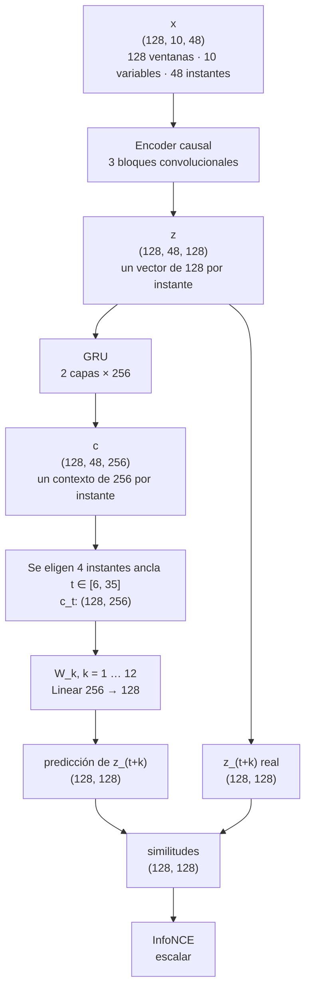
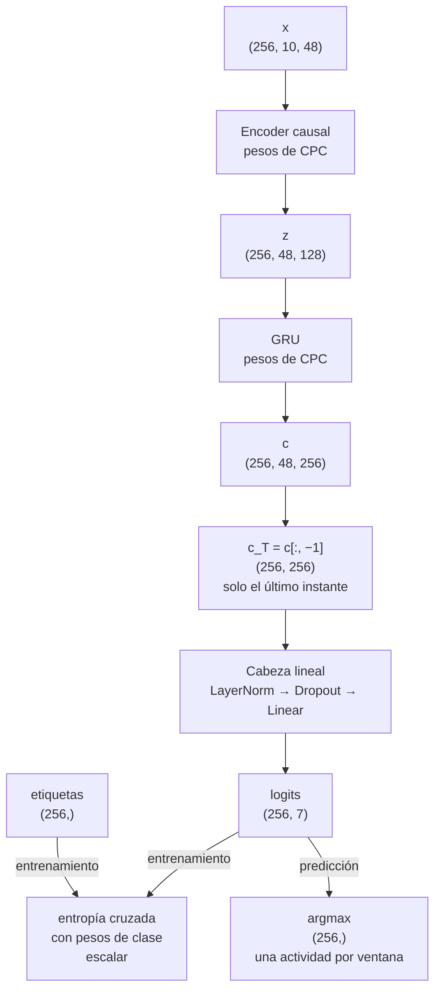

# CPC-GRU paso a paso: qué tensor entra y sale de cada módulo

> Documento en construcción. Por ahora da una vista global de las dos fases; después se irá afinando el detalle de cada módulo.

**Configuración de referencia:** la de los notebooks 11 y 14.

- **Variables:** subconjunto `EML`, 10 variables.
- **Ventanas:** 4 s a 12 Hz, es decir 48 instantes.
- **Clases:** 7 actividades.

**Notación de los tamaños:**

| Símbolo | Significado | Valor |
|---|---|---|
| `B` | ventanas en el lote | 128 en CPC, 256 en clasificación |
| `C` | variables o canales | 10 a la entrada |
| `T` | instantes de la ventana | 48 |

Los tamaños se escriben como en PyTorch: `(B, C, T)` significa *B ventanas × C canales × T instantes*.

---

## Fase 1: preentrenamiento CPC (sin etiquetas)

### Vista global



### Paso a paso

**1. Entrada.** Un lote de 128 ventanas, **todas del mismo sujeto**, sacadas al azar de sus ensayos.

```
x: (128, 10, 48)
     │    │   └── 48 instantes (4 s)
     │    └────── 10 variables (codos, muñecas, caderas, rodillas, rapidez de manos)
     └─────────── 128 ventanas
```

**2. Encoder causal: 3 bloques convolucionales.** Cada bloque hace relleno izquierdo → Conv1d (kernel 3) → ReLU → Dropout 0.2.

| Bloque | Entra | Relleno izquierdo de 2 | Conv1d | Sale |
|---|---|---|---|---|
| 1 | `(128, 10, 48)` | `(128, 10, 50)` | 10 → 32 filtros | `(128, 32, 48)` |
| 2 | `(128, 32, 48)` | `(128, 32, 50)` | 32 → 64 filtros | `(128, 64, 48)` |
| 3 | `(128, 64, 48)` | `(128, 64, 50)` | 64 → 128 filtros | `(128, 128, 48)` |

- **El número de instantes no cambia (48):** el relleno de 2 compensa los 2 instantes que pierde cada convolución con kernel 3.
- **Solo cambia el número de canales:** 10 → 32 → 64 → 128.

**3. Transposición.** La GRU espera `(B, T, características)`, así que se intercambian los ejes 1 y 2:

```
(128, 128, 48)  ──transpose(1, 2)──▶  z: (128, 48, 128)
```

`z[i, t]` es el vector de 128 valores que describe el movimiento local (≈ 0.6 s) de la ventana `i` en el instante `t`.

**4. GRU: 2 capas, 256 unidades.** Recorre los 48 instantes en orden. En cada instante combina el `z_t` nuevo con su memoria del instante anterior.

| Capa | Entra en cada instante | Memoria | Sale (48 instantes) |
|---|---|---|---|
| 1 | `z_t`: `(128, 128)` | `(128, 256)` | `(128, 48, 256)` |
| Dropout 0.2 entre capas | | | `(128, 48, 256)` |
| 2 | salida de la capa 1: `(128, 256)` | `(128, 256)` | **`c: (128, 48, 256)`** |

`c[i, t]` resume los instantes 1 … `t` de la ventana `i`.

**5. Elegir 4 instantes ancla.** Por ejemplo `t = 11, 20, 29, 33`. Para cada ancla se toma:

```
c[:, t]   →  c_t: (128, 256)     el contexto de las 128 ventanas en ese instante
```

**6. Predecir el futuro con cada `W_k`.** Para cada horizonte `k = 1 … 12`:

```
c_t: (128, 256)  ──W_k (Linear 256→128, sin sesgo)──▶  pred: (128, 128)
z[:, t+k]                                          ──▶  real: (128, 128)
```

**7. Comparar cada predicción con todos los futuros reales.**

```
pred @ realᵀ  =  (128, 128) @ (128, 128)  ──▶  similitudes: (128, 128)
```

- La fila `i` compara la predicción de la ventana `i` con el futuro real de las 128 ventanas.
- La **diagonal** es la respuesta correcta: el futuro de la propia ventana.

**8. Pérdida InfoNCE.**

```
cross_entropy(similitudes, objetivo = [0, 1, 2, …, 127])  ──▶  escalar
```

- Se calcula para 4 anclas × 12 horizontes = **48 escalares**, y la pérdida del lote es su promedio.
- El gradiente ajusta los `W_k`, la GRU y el encoder.

### Resumen de tamaños, fase 1

```
x            (128, 10, 48)
 │ bloque 1  (128, 32, 48)
 │ bloque 2  (128, 64, 48)
 │ bloque 3  (128, 128, 48)
 │ transpose
z            (128, 48, 128)
 │ GRU
c            (128, 48, 256)
 │ c[:, t]   × 4 anclas
c_t          (128, 256)
 │ W_k       × 12 horizontes
pred         (128, 128)   ⟷   z[:, t+k] (128, 128)
 │ pred @ zᵀ
similitudes  (128, 128)
 │ InfoNCE, promedio de 48
pérdida      escalar
```

---

## Fase 2: clasificación con LP-FT (con etiquetas)

Se descartan los `W_k` y se agrega la cabeza. Los lotes son de 256 ventanas etiquetadas, de los 10 sujetos de entrenamiento mezclados.

### Vista global



### Paso a paso

**1 a 4. Encoder y GRU.** Son los mismos módulos, con los pesos aprendidos en la fase 1. Solo cambia el tamaño del lote:

```
x (256, 10, 48) → encoder → (256, 128, 48) → transpose → z (256, 48, 128) → GRU → c (256, 48, 256)
```

**5. Tomar solo el último instante.**

```
c[:, -1]  ──▶  c_T: (256, 256)
```

De los 48 contextos de cada ventana se conserva solo `c_48`, que resume los 4 s completos.

**6. Cabeza.**

| Capa | Entra | Sale | Qué hace |
|---|---|---|---|
| LayerNorm(256) | `(256, 256)` | `(256, 256)` | normaliza los 256 valores de cada ventana |
| Dropout 0.2 | `(256, 256)` | `(256, 256)` | apaga valores al azar (solo al entrenar) |
| Linear 256 → 7 | `(256, 256)` | **`(256, 7)`** | un puntaje por actividad |

Con la **cabeza MLP**, el camino es:

```
(256, 256) → LayerNorm → Linear 256→128 → (256, 128) → GELU → Dropout 0.3 → Linear 128→7 → (256, 7)
              0 neuronas   128 neuronas                    sin parámetros         7 neuronas
```

| Capa | Entra | Sale | Neuronas | Parámetros |
|---|---|---|---|---|
| LayerNorm(256) | `(256, 256)` | `(256, 256)` | 0: transformación elemento a elemento | 512 |
| Linear 256 → 128 | `(256, 256)` | `(256, 128)` | **128**: capa oculta | 32,896 |
| GELU | `(256, 128)` | `(256, 128)` | 0: activación de las 128 neuronas anteriores | 0 |
| Dropout 0.3 | `(256, 128)` | `(256, 128)` | 0: solo apaga valores al entrenar | 0 |
| Linear 128 → 7 | `(256, 128)` | `(256, 7)` | **7**: una por actividad | 903 |
| **Total cabeza MLP** | | | **135** | **34,311** |

Para comparar, la cabeza lineal tiene **7 neuronas** (solo la capa `Linear 256 → 7`) y 2,311 parámetros.

**7. Pérdida o predicción.**

```
Entrenamiento:  cross_entropy(logits (256, 7), etiquetas (256,), pesos de clase)  ──▶  escalar
Predicción:     logits.argmax(1)                                                  ──▶  (256,)
```

### Las dos etapas de LP-FT

| | Etapa LP | Etapa FT |
|---|---|---|
| Encoder + GRU | congelados | se ajustan (LR 1e-4) |
| Cabeza | se entrena (LR 1e-3) | se ajusta (LR 1e-3) |
| Qué entra a la cabeza | `c_T` calculado **una sola vez** para todas las ventanas: `(N, 256)`, y luego se toma en lotes de 256 | `c_T` recalculado en cada lote, porque la red cambia |
| Por dónde pasa el gradiente | solo por la cabeza | por toda la red |

En la etapa LP el encoder y la GRU no cambian, así que basta con calcular `c_T` de las `N` ventanas de entrenamiento al inicio. Después se entrena la cabeza sobre esa tabla de `(N, 256)`, como si fuera una regresión logística.

### Resumen de tamaños, fase 2

```
x          (256, 10, 48)
 │ encoder (256, 128, 48)
 │ transpose
z          (256, 48, 128)
 │ GRU
c          (256, 48, 256)
 │ c[:, -1]
c_T        (256, 256)
 │ LayerNorm, Dropout
           (256, 256)
 │ Linear 256→7
logits     (256, 7)
 │ argmax                   │ entropía cruzada con etiquetas (256,)
pred       (256,)           pérdida  escalar
```

### Nota: la cabeza lineal como regresión logística multinomial

Con el encoder y la GRU congelados (etapa LP), la cabeza lineal es matemáticamente una **regresión logística multinomial** sobre `x = LayerNorm(c_T)`.

**Cabeza lineal, entrenada con entropía cruzada:**

$$
s = W x + b, \qquad W \in \mathbb{R}^{7 \times 256},\; b \in \mathbb{R}^{7}
$$

$$
\mathrm{CE} = -\frac{1}{N} \sum_{i=1}^{N} \log \frac{\exp(s_{i,y_i})}{\sum_{j=1}^{7} \exp(s_{ij})}
$$

**Regresión logística multinomial, ajustada por máxima verosimilitud:**

$$
P(y = k \mid x) = \frac{\exp(w_k^\top x + b_k)}{\sum_{j=1}^{K} \exp(w_j^\top x + b_j)}
$$

$$
\mathrm{NLL} = -\frac{1}{N} \sum_{i=1}^{N} \log P(y_i \mid x_i)
$$

**Las dos coinciden** en el modelo (la softmax de una función lineal de `x`) y en la función que se minimiza: con `K = 7`, la entropía cruzada es la log-verosimilitud negativa.

**Precisiones:**
- **La parte afín de la LayerNorm** (`γ`, `β`) se absorbe en `W` y `b`, así que no cambia el tipo de modelo.
- **Los pesos de clase** convierten la pérdida en una verosimilitud ponderada, como `class_weight` en scikit-learn.
- **El weight decay y el dropout** actúan como regularización.
- **Los coeficientes no tienen por qué coincidir** con los de una regresión logística ajustada hasta converger, porque el optimizador y la parada temprana son distintos.
- **En la etapa FT** la equivalencia se mantiene solo para la última capa: las características `x` cambian durante el entrenamiento.

---

## Las dos fases lado a lado

| Paso | Fase 1: CPC | Fase 2: clasificación |
|---|---|---|
| Entrada | `(128, 10, 48)`, un sujeto | `(256, 10, 48)`, 10 sujetos mezclados |
| Encoder | `(128, 128, 48)` → `z (128, 48, 128)` | `(256, 128, 48)` → `z (256, 48, 128)` |
| GRU | `c (128, 48, 256)` | `c (256, 48, 256)` |
| Qué contextos se usan | 4 anclas intermedias: `c_t (128, 256)` | el último: `c_T (256, 256)` |
| Después de la GRU | 12 `W_k` → `(128, 128)` cada uno | cabeza → `(256, 7)` |
| Comparación | predicción contra futuros reales: `(128, 128)` | puntajes contra etiquetas: `(256, 7)` contra `(256,)` |
| Pérdida | InfoNCE (promedio de 48) | entropía cruzada con pesos de clase |

---

*Pendiente de afinar: el interior de cada módulo (la convolución, la celda GRU y sus compuertas, la LayerNorm), con ejemplos numéricos.*
