# Guía completa de la metodología del proyecto

**Proyecto Integrador · Equipo 1** · noviembre de 2026

Este documento explica, paso por paso, cómo se construyó y se evaluó el modelo del proyecto, y por qué se tomó cada decisión. Cada sección responde una pregunta concreta. Las cifras salen de los notebooks y de los resúmenes de `documentacion/`, y lo que se atribuye a Bassani et al. (2025) se cita textualmente de su artículo o de su código público.

Las gráficas se generan con [`figuras/guia/generar_figuras_guia.py`](figuras/guia/generar_figuras_guia.py), que lee los datos reales del proyecto, y los diagramas se dibujan a partir de los archivos `.mmd` de esa misma carpeta.

## Contenido

1. [El panorama completo](#1-el-panorama-completo)
2. [Los datos y su preparación](#2-los-datos-y-su-preparación)
   - 2.1 Submuestreo temporal (240 → 12 Hz)
   - 2.2 Ventanas que se traslapan
   - 2.3 El escalado robusto y los q95
3. [Submuestreo, sobremuestreo, ruido gaussiano y pesos por clase](#3-submuestreo-sobremuestreo-ruido-gaussiano-y-pesos-por-clase)
4. [Cómo se evalúa: LOSO, validación interna y prueba final](#4-cómo-se-evalúa-loso-validación-interna-y-prueba-final)
5. [La arquitectura: CPC-GRU](#5-la-arquitectura-cpc-gru)
6. [El cabezal: qué es, el lineal y la regresión logística](#6-el-cabezal-qué-es-el-lineal-y-la-regresión-logística)
7. [LP-FT: cómo se ajusta la red con etiquetas](#7-lp-ft-cómo-se-ajusta-la-red-con-etiquetas)
8. [Las tres arquitecturas: la nuestra, la de Bassani y la de Haresamudram](#8-las-tres-arquitecturas-la-nuestra-la-de-bassani-y-la-de-haresamudram)
9. [El experimento de pocas etiquetas](#9-el-experimento-de-pocas-etiquetas)
10. [t-SNE: qué es y qué papel juega](#10-t-sne-qué-es-y-qué-papel-juega)
11. [Cómo se construye el F1 macro](#11-cómo-se-construye-el-f1-macro)
12. [Las pruebas estadísticas: Wilcoxon, Holm y bootstrap](#12-las-pruebas-estadísticas-wilcoxon-holm-y-bootstrap)
13. [Nuestra metodología frente a la de Bassani et al.](#13-nuestra-metodología-frente-a-la-de-bassani-et-al)
14. [Por qué su 95.7 % no es comparable y su 90.3 % sí](#14-por-qué-su-957--no-es-comparable-y-su-903--sí)
15. [Glosario rápido](#15-glosario-rápido)

---

## 1. El panorama completo

**Objetivo:** reconocer siete actividades de manejo manual de cargas con sensores que se llevan puestos, y medir si un preentrenamiento **sin etiquetas** (CPC) reduce cuántas etiquetas hacen falta.

| Código | Actividad |
|---|---|
| `N` | Postura neutral |
| `LF` | Levantar la carga del piso |
| `K` | Mantener la carga |
| `PT` | Colocar la carga en la mesa |
| `LT` | Levantar la carga de la mesa |
| `W` | Caminar con la carga |
| `PF` | Colocar la carga en el piso |

Todo el proceso, de los datos crudos a la prueba final:

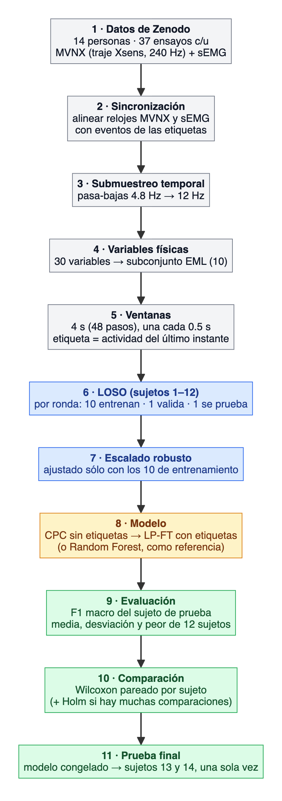

- **Gris (pasos 1–5):** preparación de los datos. Se hace una sola vez.
- **Azul (pasos 6–7):** la partición de la validación cruzada. Se repite en cada una de las 12 rondas.
- **Amarillo (paso 8):** el modelo.
- **Verde (pasos 9–11):** cómo se mide y se compara.

**El modelo final:** CPC-GRU con las 10 variables `EML` (11 sensores), ventanas de 4 s a 12 Hz, cabeza lineal y ajuste LP-FT.

| Evaluación | CPC-GRU | Random Forest |
|---|---|---|
| LOSO, sujetos 1–12 (todas las etiquetas) | 0.873 ± 0.036 | 0.892 ± 0.029 |
| Prueba final, sujetos 13 · 14 | 0.884 · 0.898 | 0.885 · 0.906 |
| Con 10 ventanas etiquetadas por actividad | **0.707** | 0.611 |

---

## 2. Los datos y su preparación

**Fuente:** *Manual Material Handling Dataset* (Bassani, Filippeschi y Avizzano, 2021, Zenodo). Son 14 personas (12 hombres y 2 mujeres, de 25 a 38 años), con 37 ensayos cada una y cargas de 2 a 12 kg, registradas con:

- **MVNX:** un traje Xsens de 17 sensores inerciales a 240 Hz, que entrega ángulos articulares, posiciones, velocidades y contactos de los pies;
- **sEMG:** electromiografía de 8 canales en el brazo.

El proyecto empezó con la sEMG, que se quedó en un F1 macro de 0.44–0.49 porque mide el esfuerzo del músculo pero no la postura del cuerpo. Con el movimiento (MVNX) el F1 sube a ≈ 0.88, y agregar la sEMG no lo mejora. Desde entonces se usa sólo el movimiento.

### 2.1 Submuestreo temporal: de 240 a 12 Hz

El MVNX trae 240 muestras por segundo. Las actividades duran de 1.6 a 4.4 s y el movimiento humano útil para distinguirlas está por debajo de ≈ 5 Hz, así que 240 Hz es mucha más resolución de la necesaria.

**Cómo se hace:**
1. Un **filtro pasa-bajas de fase cero a 4.8 Hz** elimina las oscilaciones más rápidas. "Fase cero" quiere decir que se aplica hacia adelante y hacia atrás, de modo que la señal no se retrasa en el tiempo.
2. La señal filtrada se **interpola a una rejilla de 12 Hz**, una muestra cada 1/12 s.

El filtro va antes porque, según el teorema de Nyquist, a 12 Hz sólo se pueden representar frecuencias de hasta 6 Hz. Si quedaran componentes más rápidas, se "doblarían" y aparecerían como oscilaciones falsas (*aliasing*). El corte de 4.8 Hz (0.8 × 6 Hz) deja un margen.

**Qué quiere decir "pasa-bajas de fase cero".**
- **Frecuencia:** cuántas veces por segundo sube y baja una señal. Levantar una caja dura ≈ 2 s (≈ 0.5 Hz); una vibración del sensor puede ir a 20 o 50 Hz.
- **Pasa-bajas a 4.8 Hz:** deja pasar lo que cambia despacio (por debajo de 4.8 Hz, el movimiento) y elimina lo que cambia rápido (vibraciones y ruido). Es como un promedio móvil muy bien hecho.
- **El problema de filtrar en una pasada:** un filtro que recorre la señal de izquierda a derecha sólo conoce el pasado, así que reacciona con un pequeño **retraso** y la curva filtrada queda desplazada a la derecha.
- **Fase cero:** se filtra una vez hacia adelante y otra vez hacia atrás. El retraso de la primera pasada se cancela con el "adelanto" de la segunda, y la curva queda **en el mismo momento** que el movimiento real. Esto importa porque las etiquetas marcan instantes precisos: una señal desplazada quedaría mal alineada con su etiqueta.

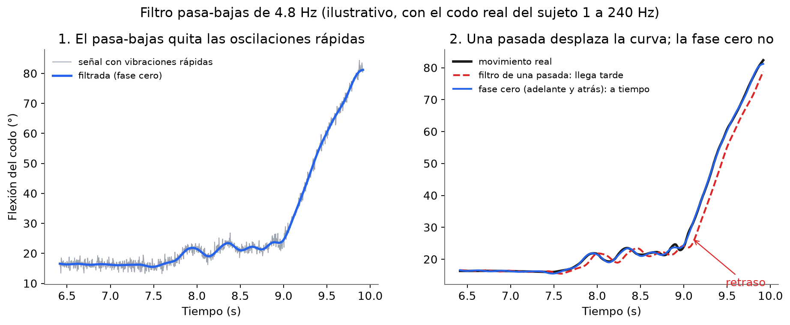

Filtrar hacia atrás requiere conocer el futuro de la señal. En este proyecto se puede porque los ensayos ya están grabados completos; en un sistema en tiempo real habría que usar un filtro de una pasada y aceptar un pequeño retraso.

**Qué es el aliasing.** Cuando una señal se muestrea con muy pocas muestras por segundo, una oscilación rápida puede **disfrazarse de una lenta que no existe**. Con 12 muestras por segundo sólo se pueden representar oscilaciones de hasta 6 por segundo (la mitad, el límite de Nyquist). Una vibración de 10 Hz muestreada a 12 Hz aparece como una onda falsa de |10 − 12| = 2 Hz, que tiene el ritmo de un movimiento humano. Es el mismo efecto por el que, en los videos, las ruedas de un coche a veces parecen girar despacio o hacia atrás.

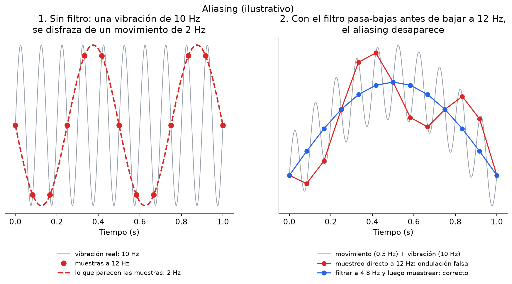

- **Izquierda:** las muestras rojas de una vibración de 10 Hz dibujan una onda de 2 Hz que no está en la señal.
- **Derecha:** si una señal lenta trae encima una vibración y se muestrea directo, aparece una ondulación falsa (rojo). Si primero se filtra a 4.8 Hz, las muestras siguen el movimiento real (azul). Por eso el filtro va **antes** de bajar a 12 Hz.

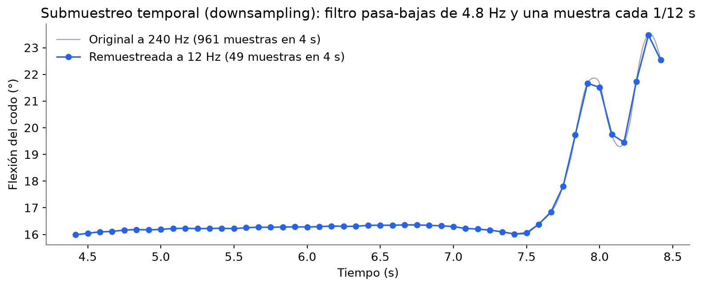

La gráfica usa la flexión real del codo de un ensayo del sujeto 1. La curva a 12 Hz (azul) sigue a la de 240 Hz (gris) con 20 veces menos muestras. En inglés este paso se llama ***downsampling*** o *resampling*.

**Por qué 12 Hz:** con la sEMG, 12 Hz rindió igual que 25 Hz con un tercio del costo. En el notebook 12 se repitió el modelo a 240 Hz con ventanas de 1 s, como Bassani, y no mejoró (0.854–0.874 frente a 0.883).

### 2.2 Ventanas que se traslapan

El modelo no clasifica la grabación completa, sino **ventanas**: trozos de 4 s (48 pasos a 12 Hz). Cada ventana recibe **la etiqueta de su último instante**, porque la pregunta que responde el modelo es *"¿qué está haciendo la persona ahora, dado lo que hizo en los últimos 4 s?"*. Así el modelo puede funcionar en tiempo real.

**Se crea una ventana nueva cada 0.5 s.** Por eso dos ventanas consecutivas **comparten 3.5 de sus 4 s (87.5 %)**: eso es lo que significa que se traslapan.

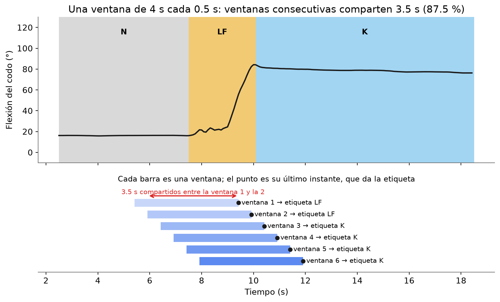

- **Arriba:** un ensayo real (flexión del codo) con las actividades coloreadas.
- **Abajo:** seis ventanas consecutivas. Cada barra cubre 4 s; el punto negro es su último instante, que decide la etiqueta. La ventana 1 termina en `LF` y la 3 ya termina en `K`, aunque las dos contienen casi el mismo movimiento.

**Por qué traslapar:**
- **Más ejemplos:** con una ventana cada 0.5 s hay 8 veces más ventanas que sin traslape (40,944 ventanas etiquetadas en los sujetos 1–12).
- **Predicción continua:** en uso real, el sistema da una actividad cada 0.5 s.

**Dos consecuencias importantes:**
1. **Ventanas que cruzan transiciones.** Como las acciones duran entre 1.6 y 4.4 s, el **89.6 % de las ventanas de 4 s contiene un cambio de actividad**. La ventana trae información de la actividad anterior, pero se etiqueta con la actual. Esto explica la mayoría de los errores del modelo: son *errores de frontera* (adelanta o retrasa el cambio una fracción de segundo).
2. **Fuga si se reparten al azar.** Dos ventanas vecinas son casi idénticas. Si una fuera a entrenamiento y la otra a prueba, el modelo "ya habría visto" la ventana de prueba. Por eso nunca se reparten ventanas al azar: **se reparten personas completas** (sección 4). La sección 14 explica por qué esto importa al comparar con Bassani.

### 2.3 El escalado robusto y los q95

Las variables tienen unidades y rangos muy distintos: los ángulos van de 0 a 150°, la rapidez de la mano de 0 a 1.5 m/s. Las redes aprenden mejor cuando todas las entradas tienen una escala parecida, así que cada variable se **escala** antes de entrar al modelo.

**Qué son los cuantiles.** El cuantil *q* es el valor por debajo del cual queda el *q* % de los datos:
- **q50** es la **mediana**: la mitad de los datos está por debajo;
- **q5** y **q95** dejan fuera el 5 % más bajo y el 5 % más alto: entre ellos está el **90 % central** de los datos;
- **q0.1** y **q99.9** marcan los valores más extremos (el 0.1 % de cada lado).

**La fórmula del proyecto, para cada variable de movimiento:**
1. **Recorte:** los valores por debajo de q0.1 o por encima de q99.9 se reemplazan por esos límites. Esto neutraliza picos raros, por ejemplo un salto del sensor.
2. **Escalado:**

$$x_{\text{escalada}} = \frac{x - \text{mediana}}{q95 - q5}$$

Después del escalado, la mediana queda en 0 y el 90 % central de los datos ocupa un rango de ≈ 1.

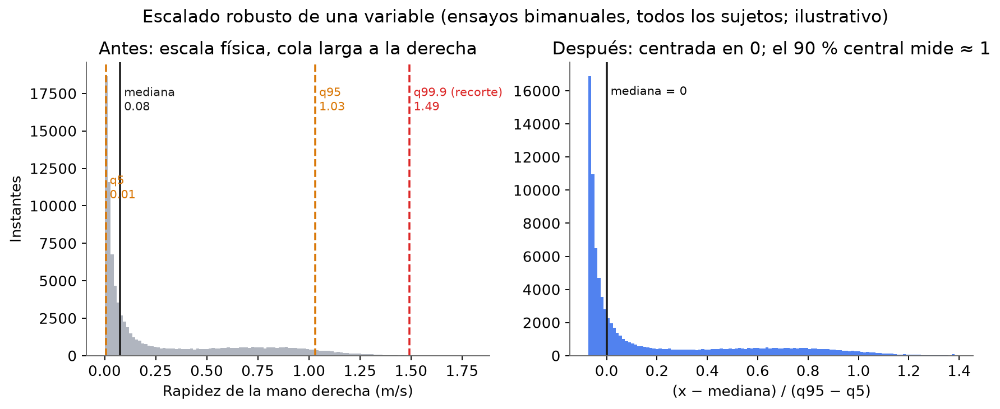

**Por qué "robusto":** el escalado clásico usa la media y la desviación estándar, que se mueven mucho con unos cuantos valores extremos. La mediana y los cuantiles no: un pico aislado no cambia dónde está el 90 % central. La gráfica usa la rapidez real de la mano derecha, que tiene una cola larga hacia la derecha; con media y desviación, esa cola dominaría la escala.

**Detalles:**
- El escalador se **ajusta en cada ronda sólo con los 10 sujetos de entrenamiento**, con una muestra de hasta 250,000 instantes. Si se usaran los datos del sujeto de prueba, se filtraría información sobre él.
- Las variables binarias (contacto del talón y la punta del pie) no se escalan.
- Con la sEMG se usaba además `log1p` y el rango intercuartil (q75 − q25), porque esa señal es todavía más asimétrica.

---

## 3. Submuestreo, sobremuestreo, ruido gaussiano y pesos por clase

### 3.1 El problema: el desbalance de clases

Las actividades no ocurren con la misma frecuencia. En los sujetos 1–12, la postura neutral (`N`) ocupa el **44 %** de las ventanas y las demás actividades entre el 7 y el 15 %.

Si un modelo se entrena así sin corregir nada, aprende que "decir `N`" casi siempre es una apuesta segura, y descuida las actividades pequeñas, que son justamente las que interesan para el análisis ergonómico.

### 3.2 Tres palabras que se confunden

| Término | Qué hace | Dónde aparece |
|---|---|---|
| **Submuestreo (*undersampling*)** | Quita ejemplos de la clase grande hasta igualarla con las demás | Bassani (con `N`); probado en el notebook 12 |
| **Sobremuestreo (*oversampling*)** | Agrega ejemplos de las clases pequeñas, copiándolos (a veces con ruido) | Bassani (copias con ruido gaussiano) |
| **Downsampling** | En español también se traduce "submuestreo", pero tiene **dos usos**: (a) bajar la frecuencia de una señal (240 → 12 Hz, sección 2.1); (b) como sinónimo de *undersampling* de una clase. Bassani lo usa en el segundo sentido: *"we down-sampled the largest class (N-pose)"* | Sección 2.1 y Bassani |

Para no confundirlos, en este documento **"submuestreo temporal"** es bajar la frecuencia, y **"submuestreo de `N`"** es quitar ventanas de la clase neutral.

### 3.3 Las cuatro estrategias, con nuestros datos

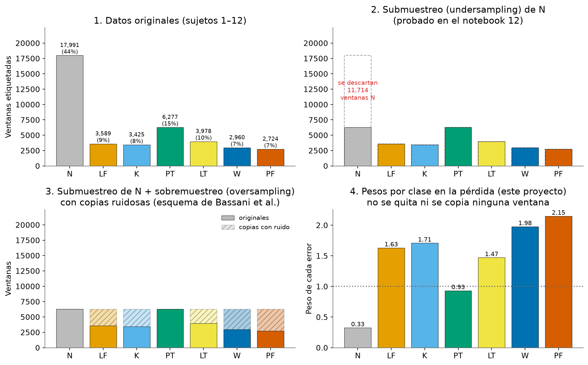

1. **Datos originales:** 17,991 ventanas `N` frente a 2,724–6,277 de las demás actividades.
2. **Submuestreo de `N`:** se toma al azar un subconjunto de `N` del tamaño de la siguiente clase más frecuente (`PT`, 6,277). Se **descartan 11,714 ventanas** de entrenamiento.
3. **Submuestreo + sobremuestreo (esquema de Bassani):** además, las clases pequeñas se rellenan con **copias con ruido gaussiano** hasta igualar el tamaño. Bassani lo describe así: *"we down-sampled the largest class (N-pose) and augmented the classes with fewer examples"* y *"we replicate the class segments, adding white Gaussian noise to prevent overfitting"*. La gráfica muestra el esquema; el artículo no dice cuántas copias hicieron por clase.
4. **Pesos por clase (lo que usa este proyecto):** no se quita ni se copia ninguna ventana. En cambio, **cada error pesa distinto** en la función de pérdida. El peso de la clase *c* es:

$$w_c = \frac{N_{\text{total}}}{7 \cdot N_c}$$

Con nuestros datos, un error en `N` pesa 0.33 y un error en `PF` pesa 2.15. El efecto es que, en conjunto, **las siete clases contribuyen lo mismo a la pérdida**, sin tirar datos ni inventarlos.

### 3.4 ¿Qué es el ruido gaussiano?

El **ruido gaussiano** es un error aleatorio que sigue una **distribución normal** (la "campana de Gauss"):
- su promedio es **0**, así que no sesga la señal hacia arriba ni hacia abajo;
- su tamaño típico es la **desviación estándar σ**: el 68 % de los valores cae dentro de ±1σ y el 95 % dentro de ±2σ;
- "**blanco**" (*white Gaussian noise*, como dice Bassani) significa que el ruido de cada instante es **independiente** del de los demás, sin patrón en el tiempo.

**Para qué sirve en el sobremuestreo.** Si las clases pequeñas se copiaran tal cual, el modelo vería exactamente las mismas ventanas varias veces y tendería a memorizarlas. Al sumar un ruido distinto a cada copia, cada copia es un poco diferente, como si fuera otra repetición del mismo movimiento con pequeñas variaciones. Es una forma sencilla de **aumento de datos** (*data augmentation*).

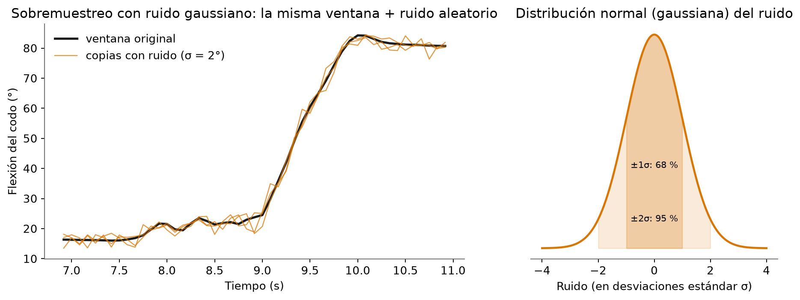

La gráfica es ilustrativa: usa una ventana real del codo y σ = 2°. El artículo de Bassani no reporta qué σ usó.

**Su riesgo:** las copias siguen siendo casi idénticas al original. Si el original queda en entrenamiento y una copia en prueba, el modelo se evalúa con algo que ya vio. Su código muestra que eso pasó (sección 14).

### 3.5 ¿Por qué el submuestreo de `N` no funcionó?

En el notebook 12 se repitieron las rondas con `BALANCEO = "submuestreo"`: en el entrenamiento se dejaron tantas ventanas `N` como tiene la siguiente actividad más frecuente, y se conservaron los pesos por clase. La validación interna y el sujeto de prueba no se tocaron.

| Variante | Submuestreo − pesos | Gana el submuestreo | p |
|---|---|---|---|
| CPC congelado · regresión logística | +0.001 | 7 de 12 | 0.73 |
| CPC congelado · MLP | +0.005 | 10 de 12 | 0.11 |
| **Ajuste fino · lineal (el modelo que usamos)** | **−0.008** | 4 de 12 | 0.08 |
| Ajuste fino · MLP | −0.005 | 5 de 12 | 0.52 |

Ninguna diferencia es significativa; con el mejor modelo, la tendencia es a **empeorar**. Las razones:

1. **Tira datos útiles.** Se pierden ≈ 2 de cada 3 ventanas `N`, y la red con ajuste fino aprovecha muchos datos.
2. **Las ventanas `N` enseñan las fronteras.** Los errores más comunes del modelo son `LT → N` y `PT → N`: actividades breves que empiezan y terminan en la postura neutral. Para aprender dónde termina `N` y empieza otra cosa, hacen falta muchos ejemplos de `N`, sobre todo los que rodean a las transiciones.
3. **El desbalance ya estaba compensado.** Los pesos por clase ya hacen que las siete clases cuenten igual en la pérdida. El submuestreo corrige un problema que ya no existía y sólo agrega pérdida de información.
4. **La prueba no está balanceada.** El sujeto de prueba conserva su `N` dominante. Un modelo que subestima `N` comete falsos positivos en las otras clases, y eso baja su precisión.

Como el submuestreo no ayudó, el sobremuestreo con ruido quedó con prioridad baja y no se probó.

### 3.6 ¿Nuestra metodología ya resuelve el desbalance?

**Sí, por tres vías, sin quitar ni inventar datos:**
1. **Pesos por clase** en la pérdida (entropía cruzada ponderada), tanto en LP como en FT. En las regresiones logísticas y el Random Forest se usa el equivalente `class_weight="balanced"`.
2. **La métrica es el F1 macro** (sección 11), que da el mismo peso a las siete actividades. Un modelo que sólo acierte `N` saca un F1 macro bajo.
3. **La parada temprana y la elección de hiperparámetros** también usan el F1 macro en la validación interna, así que nunca se elige una configuración que descuide las clases pequeñas.

Además, la evaluación respeta la distribución real de cada persona, que es la que el sistema encontraría en uso. Balancear la prueba haría que el resultado pareciera mejor de lo que es.

---

## 4. Cómo se evalúa: LOSO, validación interna y prueba final

### 4.1 La pregunta que debe responder la evaluación

En uso real, el sistema se aplicará a **trabajadores que nunca vio**. Por eso la evaluación tiene que medir el desempeño con **personas nuevas**, no con ventanas nuevas de personas conocidas. Cada persona se mueve distinto (estatura, estilo, velocidad), y un modelo puede aprender esas particularidades en lugar de las actividades.

### 4.2 LOSO: dejar un sujeto fuera

**LOSO** (*Leave-One-Subject-Out*) repite el entrenamiento varias veces, dejando fuera a una persona distinta en cada una:

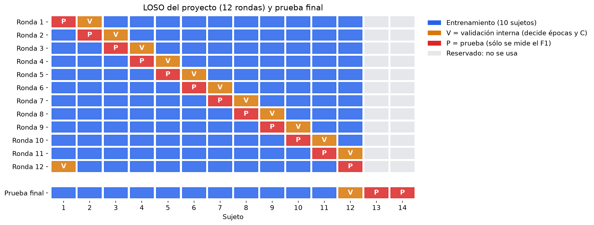

En cada una de las **12 rondas** (una por cada sujeto 1–12):

| Papel | Cuántos | Para qué se usa |
|---|---|---|
| **Prueba (P)** | 1 sujeto | Sólo para medir el F1 al final de la ronda |
| **Validación interna (V)** | 1 sujeto: el siguiente de la lista | Para **todas las decisiones**: cuándo detener el preentrenamiento, cuándo detener el ajuste fino, qué regularización usar |
| **Entrenamiento** | Los 10 restantes | Para ajustar el escalador y entrenar el modelo |

**La regla de oro:** el sujeto de prueba **no participa en ninguna decisión**. Si la parada temprana usara su F1, el resultado sería optimista, porque se habría escogido el modelo que mejor le va a esa persona.

**Qué se reporta:** el F1 macro de cada una de las 12 personas, y de ahí:
- la **media** (0.873 en el modelo final): el desempeño esperado con una persona nueva;
- la **desviación estándar** (± 0.036): cuánto varía de una persona a otra;
- el **peor sujeto** (0.775, el sujeto 2): el caso más desfavorable.

### 4.3 La prueba final

Los **sujetos 13 y 14 se reservaron** durante todo el desarrollo (última fila de la gráfica). Al cerrar el diseño, el modelo final se entrenó con los sujetos 1–11, usó el 12 como validación interna y se evaluó **una sola vez** en el 13 y el 14, con 3 semillas:

| Sujeto | CPC-GRU | Random Forest | Dónde cae en el LOSO |
|---|---|---|---|
| 13 | 0.884 | 0.885 | Percentil 50 |
| 14 | 0.898 | 0.906 | Percentil 83 |

Los dos resultados están dentro del rango que estimó el LOSO, así que **la estimación del desarrollo era honesta**.

**Limitación:** un notebook exploratorio temprano mostró resultados de los sujetos 13 y 14, y la réplica de Bassani del notebook 12 los usó con otras variables, así que no llegaron completamente ciegos a la prueba.

---

## 5. La arquitectura: CPC-GRU

### 5.1 La idea de CPC

**CPC** (*Contrastive Predictive Coding*, van den Oord et al., 2018) es una forma de **aprender sin etiquetas**. La red recibe la primera parte de una señal y tiene que **reconocer cómo continúa**. Para lograrlo, se ve obligada a aprender qué es lo importante del movimiento: postura, dirección, ritmo. Lo aprendido después sirve para clasificar con muy pocas etiquetas.

Es la misma idea que estudiar un idioma leyendo mucho texto sin traducción: no se aprende el significado de cada palabra, pero sí su estructura, y después basta un diccionario pequeño.

### 5.2 Las piezas de la red

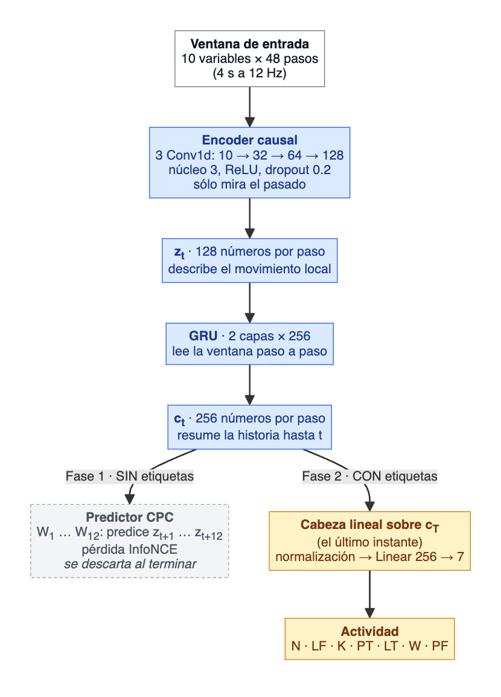

| Pieza | Qué hace | Detalle |
|---|---|---|
| **Encoder causal** | Convierte cada instante en un vector que describe el movimiento local, `z_t` | 3 convoluciones 1D (10 → 32 → 64 → 128 canales), núcleo 3, ReLU, *dropout* 0.2. El relleno va sólo a la izquierda: **ningún `z_t` puede ver el futuro** |
| **GRU** | Recorre la ventana paso a paso y resume la historia en `c_t` | 2 capas de 256. Una GRU es una red recurrente con "compuertas" que deciden qué recordar y qué olvidar |
| **Predictor** (sólo en CPC) | A partir de `c_t`, predice `z_{t+1}`, …, `z_{t+12}` (hasta 1 s adelante) | Una matriz `W_k` por horizonte. **Se descarta al terminar el preentrenamiento** |
| **Cabeza lineal** (sólo al clasificar) | Toma `c_T`, el último estado, y da 7 puntajes, uno por actividad | Sección 6 |

En total son **725,415 parámetros**. Como el encoder y la GRU sólo miran el pasado, el modelo es **causal**: puede funcionar en tiempo real.

### 5.3 La pérdida InfoNCE: cómo aprende sin etiquetas

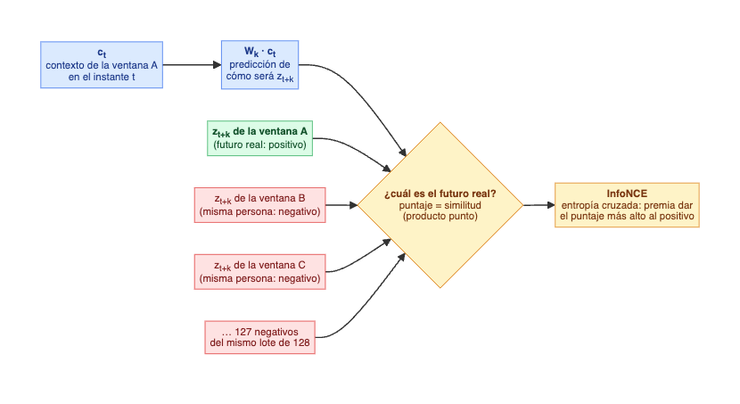

1. Se arma un **lote de 128 ventanas de la misma persona**.
2. En un instante *t* de la ventana A, la red calcula `c_t` y lo transforma en una predicción del futuro, `W_k · c_t`.
3. Esa predicción se compara con 128 candidatos: el **futuro real de A** (el positivo) y los futuros de las otras 127 ventanas (los **negativos**).
4. La pérdida **InfoNCE** es una entropía cruzada que premia que el positivo tenga el puntaje más alto:

$$\mathcal{L}_k = -\log \frac{\exp(z_{t+k}^\top W_k c_t)}{\sum_{j} \exp(z_j^\top W_k c_t)}$$

**Decisión clave del proyecto: negativos de la misma persona.** Si los negativos fueran de otras personas, la red podría acertar reconociendo **quién** se mueve en lugar de **cómo** se mueve. Con negativos de la misma persona, la única forma de acertar es entender el movimiento.

**Configuración del preentrenamiento:** Adam con tasa 5 × 10⁻⁴; en cada lote se toman 4 instantes al azar como puntos de partida (*anclas*); horizontes de 1 a 12 pasos; hasta 20 épocas. La época se elige cada 2 épocas con una **sonda lineal** en el sujeto de validación interna, con paciencia 3: una pérdida contrastiva baja no garantiza una representación útil para clasificar, y la sonda sí lo mide.

---

## 6. El cabezal: qué es, el lineal y la regresión logística

### 6.1 Qué es un cabezal

La red preentrenada produce `c_T`: 256 números que resumen la ventana. Esos números **no son todavía una actividad**. El **cabezal** (*head*) es la parte final que convierte ese resumen en una decisión: 7 puntajes, uno por actividad, y la actividad con el puntaje más alto es la predicción.

Se le llama así porque va "encima" de la red, como la cabeza sobre el cuerpo. El cuerpo (encoder + GRU) aprende a **describir** el movimiento; la cabeza aprende a **nombrarlo**.

### 6.2 Cabezal lineal frente a cabezal MLP

| | Cabezal lineal | Cabezal MLP |
|---|---|---|
| Qué es | Una sola capa: `puntajes = W · c_T + b` | Varias capas con funciones no lineales entre ellas |
| Qué puede separar | Actividades separables con "cortes rectos" (hiperplanos) en el espacio de 256 dimensiones | Fronteras curvas |
| Parámetros | ≈ 1,800 | ≈ 100,000 |

**Con cuál nos quedamos: el lineal.** En los notebooks 12 y 14, el MLP empató con el lineal (diferencias ≤ 0.001, p = 0.97), con la red congelada y con ajuste fino. Eso quiere decir que **`c_T` ya es linealmente separable**: las capas extra no encuentran información que un corte recto no aproveche. El lineal es más simple, tiene 50 veces menos parámetros y es más fácil de interpretar.

### 6.3 El cabezal lineal del modelo final frente a una regresión logística

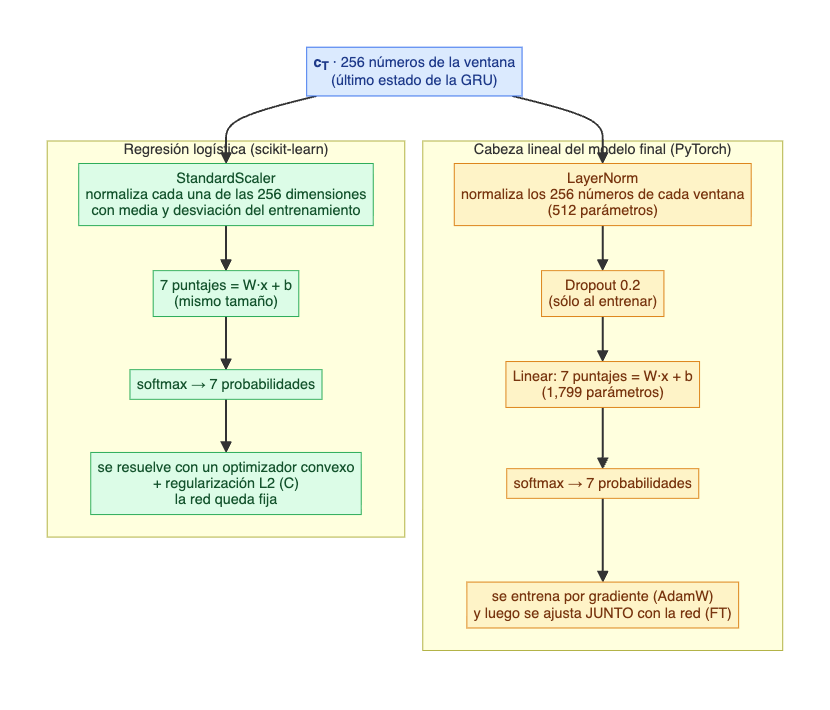

**En el fondo son el mismo modelo.** Una regresión logística multinomial calcula 7 puntajes `W · x + b`, los convierte en probabilidades con softmax y se entrena minimizando la entropía cruzada. Una capa lineal seguida de softmax y entrenada con entropía cruzada hace exactamente lo mismo.

**Las diferencias están en cómo se prepara la entrada y cómo se entrena:**

| | Cabezal lineal del modelo final | Regresión logística (scikit-learn) |
|---|---|---|
| **Normalización de la entrada** | `LayerNorm`: normaliza los 256 números **de cada ventana** entre sí, con una escala y un desplazamiento que se aprenden | `StandardScaler`: normaliza **cada una de las 256 dimensiones** con la media y la desviación del entrenamiento, valores fijos |
| **Regularización** | *Dropout* 0.2 y *weight decay* 10⁻⁴ | Penalización L2 controlada por `C`, que se elige en la validación interna |
| **Cómo se optimiza** | Descenso de gradiente (AdamW), por lotes y épocas, con parada temprana | Un optimizador convexo que encuentra **el óptimo exacto**: no depende de la tasa de aprendizaje ni de la semilla |
| **Qué pasa después** | Se **ajusta junto con toda la red** en la etapa FT | Queda fija; la red no cambia |
| **Pesos por clase** | En la entropía cruzada | `class_weight="balanced"` |

**Dónde se usa cada una:**
- **El modelo final** (notebooks 11 y 18) usa el cabezal lineal de PyTorch: `LayerNorm → Dropout 0.2 → Linear(256 → 7)`.
- **El notebook 12** probó entrenar primero una regresión logística sobre `c_T` congelado y **copiar** su estandarización, sus coeficientes y sus interceptos a la capa lineal; la copia da exactamente las mismas predicciones. El motivo: la capa lineal entrenada por gradiente quedó 0.011 por debajo de la regresión logística (p = 0.003), y arrancar el ajuste fino desde la regresión logística evitó esa pérdida.
- La **regresión logística sobre la red congelada** también se usa como **sonda**: mide qué tan útil es la representación sin tocar la red.

---

## 7. LP-FT: cómo se ajusta la red con etiquetas

**LP-FT** (*Linear Probing, then Fine-Tuning*; Kumar et al., 2022) es el protocolo para pasar de la red preentrenada a un clasificador:

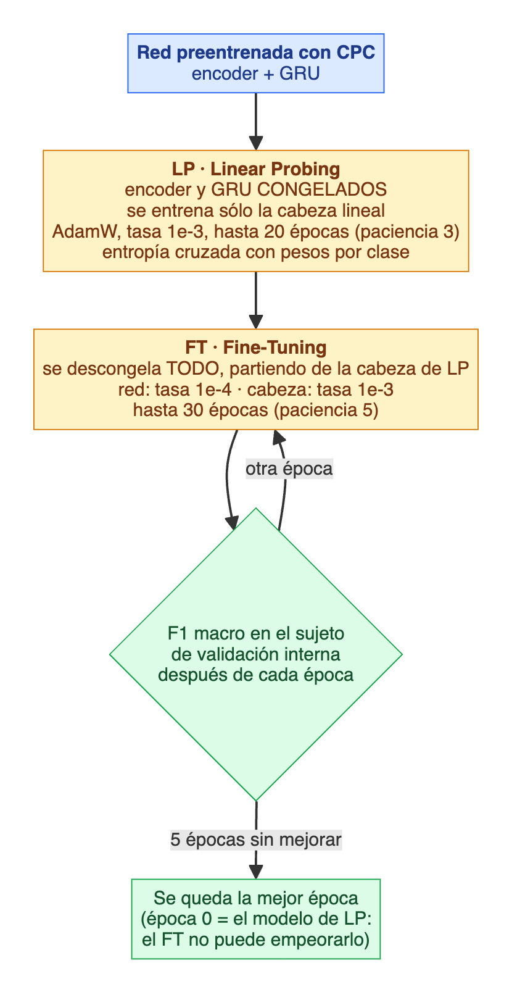

1. **LP (*linear probing*):** con el encoder y la GRU **congelados**, se entrena sólo la cabeza lineal (AdamW, tasa 10⁻³, hasta 20 épocas, paciencia 3).
2. **FT (*fine-tuning*):** se descongela **toda la red** y se sigue entrenando, partiendo de la cabeza de LP. La red usa una tasa de aprendizaje 10 veces menor (10⁻⁴) que la cabeza (10⁻³), para que la representación aprendida sin etiquetas cambie poco. Hasta 30 épocas, con paciencia 5.

**Por qué no ajustar todo desde el principio.** Si la red se ajusta con una cabeza **aleatoria**, los primeros gradientes son grandes y desordenados, y **deforman la representación** que CPC aprendió antes de que la cabeza sepa algo útil. En el proyecto esto pasó con la LSTM: con el ajuste fino directo, quedó en 0.747, **por debajo de su propia versión entrenada desde cero** (0.854). Con LP primero, la cabeza ya es buena cuando empieza el FT, así que el ajuste fino sólo **refina**.

**La época 0.** El modelo de LP cuenta como la "época 0" del FT. Si ninguna época de FT mejora el F1 en la validación interna, se queda el de LP. Por construcción, **el FT no puede empeorar el modelo en validación**.

**Cuánto aporta:** con todas las etiquetas, el FT suma +0.020 sobre la red congelada (gana en 11 de 12 sujetos, p = 0.001). Con muy pocas etiquetas casi no aporta: con 2 ventanas por actividad, la validación eligió 0 épocas de FT en el 76 % de los casos.

---

## 8. Las tres arquitecturas: la nuestra, la de Bassani y la de Haresamudram

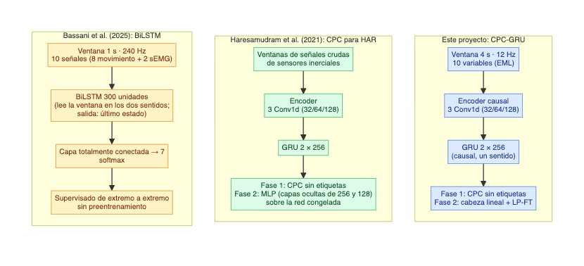

| | **Este proyecto** | **Haresamudram et al. (2021)** (nuestra referencia de CPC para HAR) | **Bassani et al. (2025)** (mismo dataset) |
|---|---|---|---|
| Idea | CPC sin etiquetas + ajuste con etiquetas | CPC sin etiquetas + clasificador con etiquetas | Red supervisada entrenada de extremo a extremo |
| Entrada | 10 variables de movimiento (`EML`), 4 s a 12 Hz | Señales crudas de sensores inerciales | 10 señales (8 de movimiento + 2 de sEMG), 1 s a 240 Hz |
| Encoder | 3 Conv1d (32/64/128), **causal** | 3 Conv1d (32/64/128) | — |
| Red recurrente | GRU, 2 capas × 256, un sentido | GRU, 2 capas × 256 | **BiLSTM** de 300 unidades: lee la ventana en los dos sentidos |
| Clasificador | Cabeza lineal sobre `c_T` + LP-FT | MLP (capas ocultas de 256 y 128, BatchNorm, ReLU, *dropout* 0.2) sobre la red congelada | Capa totalmente conectada (7) + softmax |
| Preentrenamiento | Sí, sin etiquetas | Sí, sin etiquetas | No |

**De dónde salen los datos de Bassani.** Su código público (`BiLSTM.m`) define la red como `sequenceInputLayer(inputSize)`, `bilstmLayer(numHiddenUnits,'OutputMode','last')`, `fullyConnectedLayer(numClasses)`, `softmaxLayer` y `classificationLayer`. El artículo eligió 300 unidades ocultas y 2,500 épocas: *"The best Eps-HUs pair is 300 HUs–2500 Eps with 95.7%"* (sección 4.1.1). También probaron Sp-DAE, Sp-DAE recurrente, RCNN y DeepConvLSTM como referencia.

**Diferencias que importan:**
- **Bidireccional frente a causal.** La BiLSTM lee la ventana también de atrás hacia adelante. Dentro de una ventana de 1 s eso no impide el tiempo real, pero sí cambia lo que el modelo "ve". Nuestra red sólo mira el pasado.
- **Preentrenamiento.** Es la diferencia de fondo: nuestra red y la de Haresamudram aprenden primero sin etiquetas, y por eso rinden mejor con pocas etiquetas (sección 9). La BiLSTM necesita todas las etiquetas.
- **Nuestra arquitectura sigue a Haresamudram** (el encoder y la GRU son iguales). Lo que cambió: el encoder es causal, los negativos son de la misma persona, la cabeza es lineal (el MLP no mejoró) y se agregó LP-FT.

---

## 9. El experimento de pocas etiquetas

Es la pregunta central del proyecto: **cuando hay pocas etiquetas, ¿el preentrenamiento sin etiquetas compensa?** (notebook 17).

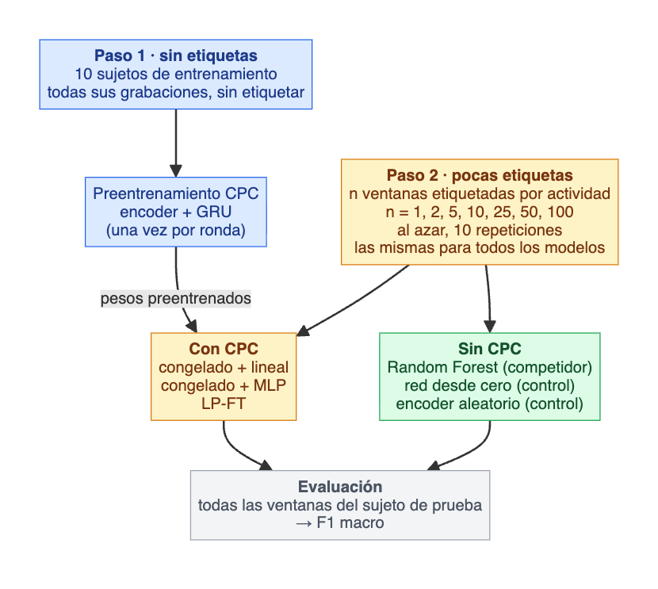

**Cómo se hizo, dentro de cada una de las 12 rondas LOSO:**

1. **Preentrenamiento CPC sin etiquetas, una vez por ronda.** Usa todas las grabaciones de los 10 sujetos de entrenamiento. La época se elige con la pérdida InfoNCE en el sujeto de validación, **sin etiquetas** (a diferencia del modelo final, que usa una sonda con etiquetas).
2. **Se submuestrean las etiquetas.** De las ≈ 34,000 ventanas etiquetadas de los 10 sujetos, se toman al azar **n por actividad**, con n = 1, 2, 5, 10, 25, 50 y 100: de 7 a 700 ventanas en total.
   - Se repite **10 veces por tamaño**, con ventanas distintas cada vez.
   - **Todos los modelos ven exactamente las mismas ventanas**: el sorteo depende sólo del sujeto de prueba, de n y de la repetición.
3. **Se entrenan siete modelos con esas n etiquetas:**
   - **con CPC:** CPC congelado + lineal, CPC congelado + MLP (el de Haresamudram) y CPC + LP-FT;
   - **competidor:** Random Forest con 5 estadísticas por variable;
   - **controles:** la misma red **entrenada desde cero**, y la misma red **con pesos aleatorios y congelada** (con cabeza lineal o MLP).
4. **Los hiperparámetros se eligen con validación cruzada estratificada dentro de las n etiquetas** (k = min(3, n) grupos). Con n = 1 no se puede validar y se usan valores fijados de antemano. Así ningún modelo usa más etiquetas que las n.
5. **Se evalúa** cada modelo con todas las ventanas del sujeto de prueba.

**El criterio se fijó antes de ver los resultados.** CPC es mejor que el Random Forest con n ventanas si (1) su F1 medio es mayor, (2) Wilcoxon con corrección de Holm da p < 0.05, y (3) mejora en al menos 9 de 12 sujetos.

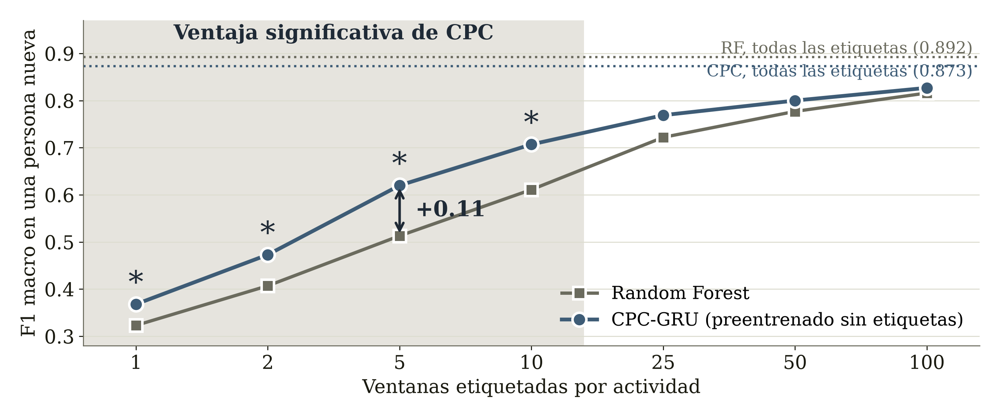

**Resultados:**
- **Con 10 ventanas por actividad o menos, CPC gana** por 0.045 a 0.107 de F1, en 11 o 12 de 12 sujetos (Holm p < 0.02).
- **Necesita la mitad de las etiquetas:** para igualar lo que CPC logra con 5 y 10 ventanas, el Random Forest necesita ≈ 11 y ≈ 22 (2.2 veces más).
- **La ventaja es del preentrenamiento:** la red desde cero queda sobre la curva del Random Forest, y el encoder aleatorio queda 0.07–0.16 por debajo de CPC en los 12 sujetos.
- **Desde 25 ventanas por actividad la ventaja deja de ser significativa**, y con todas las etiquetas el Random Forest es mejor (0.892 frente a 0.873).

**Para qué sirven los controles:** si CPC le gana a la **red desde cero**, la ventaja no viene de la arquitectura; si le gana al **encoder aleatorio**, viene de lo que CPC aprendió. Pasaron las dos pruebas.

---

## 10. t-SNE: qué es y qué papel juega

### 10.1 Qué es

Cada ventana se resume en `c_T`, un vector de **256 números**. No se puede dibujar un espacio de 256 dimensiones, pero sí se puede preguntar: ¿las ventanas de la misma actividad quedan cerca entre sí?

**t-SNE** (*t-distributed Stochastic Neighbor Embedding*) convierte cada vector en **un punto de un plano**, intentando que **los vecinos cercanos en 256 dimensiones sigan siendo vecinos en el plano**. Funciona en dos pasos:
1. En el espacio original, calcula para cada punto qué tan probable es que otro punto sea su vecino (más probable si está más cerca).
2. Busca posiciones en 2 dimensiones que reproduzcan esas probabilidades de vecindad lo mejor posible.

**Cómo se lee:**
- **Grupos de un solo color:** la red reúne las ventanas de esa actividad; las distingue bien.
- **Colores mezclados:** la red confunde esas actividades.
- **Lo que no se debe leer:** el tamaño de los grupos, la distancia entre grupos lejanos y los ejes no significan nada. t-SNE conserva vecindades, no distancias globales, y el dibujo cambia con la semilla y con su parámetro de "perplejidad".

### 10.2 Qué papel juega en el proyecto

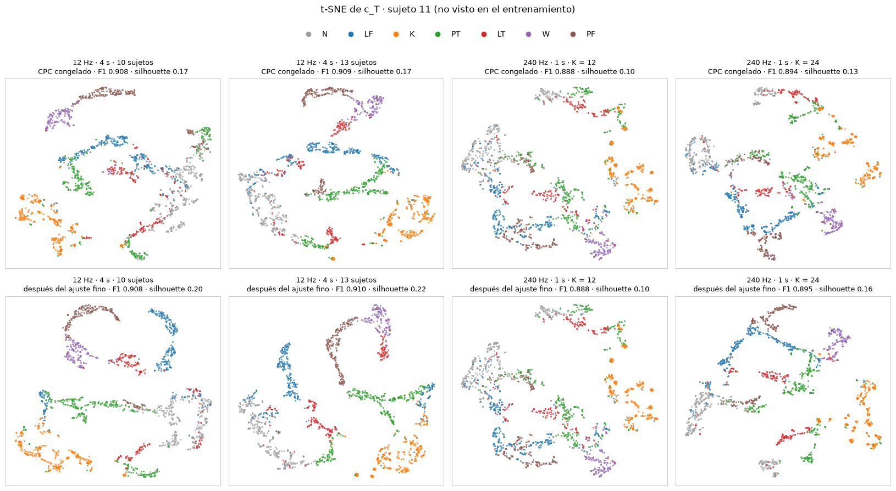

La t-SNE es **descriptiva, no una métrica**: ayuda a entender qué aprendió la red, pero las decisiones se toman con el F1. Para no depender del dibujo, en el notebook 12 la separación también se midió en las 256 dimensiones originales:
- **Silhouette** (de −1 a 1): qué tan separado está cada grupo de los demás;
- **Vecinos de la misma actividad:** qué fracción de las 10 ventanas más cercanas tiene la misma actividad.

**Lo que mostró:**
1. **CPC agrupa las actividades antes de ver una sola etiqueta.** En la fila del CPC congelado, `K`, `PF` y `W` ya forman grupos casi aislados.
2. **El ajuste fino compacta los grupos**, sobre todo `LT` y `PT` (vecinos de la misma actividad: de 0.871 a 0.899 en el mejor modelo).
3. **Las actividades que se mezclan son `N`, `PT` y `LT`**, las mismas que confunde la matriz de confusión.
4. **La separación sigue el mismo orden que el F1** entre los cuatro modelos comparados. El dibujo y la métrica cuentan la misma historia.
5. En el notebook 13, **`c_T` separa las actividades mucho mejor que `z_T`**: la GRU, al resumir la historia de la ventana, es la que convierte el movimiento en actividades.

---

## 11. Cómo se construye el F1 macro

### 11.1 De la matriz de confusión a la precisión y la exhaustividad

La **matriz de confusión** cuenta, para cada actividad real (fila), qué predijo el modelo (columna). La diagonal son los aciertos.

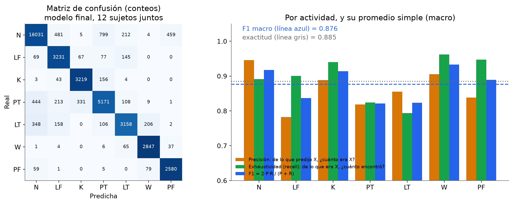

Para cada actividad *X*:
- **Precisión:** de todas las veces que el modelo dijo *X*, ¿cuántas eran *X*? Se calcula como aciertos de *X* ÷ total de la columna *X*.
- **Exhaustividad** (*recall*): de todas las ventanas que eran *X*, ¿cuántas encontró? Se calcula como aciertos de *X* ÷ total de la fila *X*.
- **F1:** la media armónica de las dos:

$$F1_X = \frac{2 \cdot \text{precisión}_X \cdot \text{exhaustividad}_X}{\text{precisión}_X + \text{exhaustividad}_X}$$

La media armónica castiga los desequilibrios: si una de las dos es baja, el F1 es bajo. Un modelo no puede subir su F1 diciendo *X* para todo (exhaustividad alta, precisión baja) ni diciéndolo casi nunca (al revés).

**Ejemplo con `LF` en la matriz real:** la columna `LF` suma 4,131 predicciones, de las que 3,231 eran `LF` (precisión 0.78). La fila `LF` suma 3,589 ventanas, de las que encontró 3,231 (exhaustividad 0.90). Su F1 es 2 × 0.78 × 0.90 / (0.78 + 0.90) ≈ 0.84.

### 11.2 El promedio "macro"

El **F1 macro** es el **promedio simple** de los 7 F1, uno por actividad:

$$F1_{\text{macro}} = \frac{1}{7}\sum_{X} F1_X$$

**Por qué macro y no exactitud.** La exactitud (aciertos ÷ total) está dominada por `N`, que es el 44 % de las ventanas: un modelo que acierte mucho `N` tiene buena exactitud aunque falle las demás. En el F1 macro, **cada actividad pesa 1/7**, sea grande o pequeña.

### 11.3 Cómo se reporta en el proyecto

1. Para cada persona de prueba, se calcula su F1 macro con todas sus ventanas.
2. Se reporta la **media de las 12 personas** (0.873), su desviación y el peor sujeto.

La gráfica junta las predicciones de los 12 sujetos y da un F1 macro "agrupado" de **0.876**. Es parecido, pero no es la cifra oficial: la media por persona responde mejor a la pregunta *"¿cómo le irá a una persona nueva?"* y permite comparar modelos persona por persona.

---

## 12. Las pruebas estadísticas: Wilcoxon, Holm y bootstrap

### 12.1 Por qué hace falta una prueba

Si un modelo da 0.873 y otro 0.892, ¿la diferencia es real o es casualidad de qué personas tocaron? Con sólo 12 personas, una diferencia pequeña puede deberse al azar. Una prueba estadística responde: **si en realidad no hubiera diferencia, ¿qué tan probable sería ver una como esta?** Esa probabilidad es el **valor p**. Si es menor a 0.05, la diferencia se considera **significativa**.

### 12.2 La prueba de Wilcoxon de rangos con signo

**Qué compara:** dos modelos evaluados en **las mismas personas**. Como las personas difíciles son difíciles para los dos modelos, comparar persona por persona (prueba **pareada**) elimina esa variación y deja sólo la diferencia entre modelos.

**Cómo funciona,** con el modelo final frente al Random Forest (datos reales, 12 sujetos):

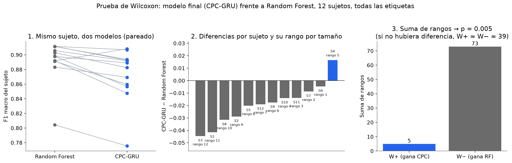

1. **Diferencias:** para cada persona, F1 de CPC-GRU − F1 del Random Forest (panel 2).
2. **Rangos:** se ordenan las diferencias por su **tamaño**, sin importar el signo, y se numeran del 1 (la más pequeña) al 12 (la más grande).
3. **Suma de rangos por signo:** W+ suma los rangos de las personas donde gana CPC; W− los de las personas donde gana el Random Forest. Aquí W+ = 5 (sólo el sujeto 4) y W− = 73.
4. **Comparación con el azar:** si no hubiera diferencia real, cada signo sería como lanzar una moneda, y W+ y W− rondarían 39 (la mitad de 1 + 2 + … + 12 = 78). Un reparto 5 contra 73 es muy improbable por azar: **p = 0.005**.

**Conclusión del ejemplo:** con todas las etiquetas, el Random Forest es mejor que el modelo final de forma consistente (gana en 11 de 12 personas).

**Por qué Wilcoxon y no la prueba t:**
- **No supone que las diferencias sigan una distribución normal.** Con 12 datos no hay forma de comprobarlo.
- **Usa rangos, así que es robusta** a una persona con una diferencia muy grande, que en la prueba t pesaría demasiado.
- **Usa el tamaño, no sólo el signo:** distingue entre ganar por mucho y ganar por poco, a diferencia de contar cuántas personas mejoran.

### 12.3 La corrección de Holm

**El problema de las comparaciones múltiples.** Con p < 0.05, cada comparación tiene un 5 % de probabilidad de dar un "falso positivo" por azar. Si se hacen 21 comparaciones (como en el notebook 17: 3 modelos CPC × 7 tamaños), la probabilidad de que **al menos una** salga significativa por pura suerte es mucho mayor que 5 %.

**Holm-Bonferroni** ajusta los umbrales para que la probabilidad de **cualquier** falso positivo se mantenga en 5 %:
1. Se ordenan los *m* valores p de menor a mayor.
2. El más pequeño se compara con 0.05 / *m*, el segundo con 0.05 / (*m* − 1), y así sucesivamente.
3. Se rechaza la hipótesis nula mientras cada p pase su umbral. **En cuanto uno falla, se detiene**: ese y todos los siguientes se consideran no significativos.

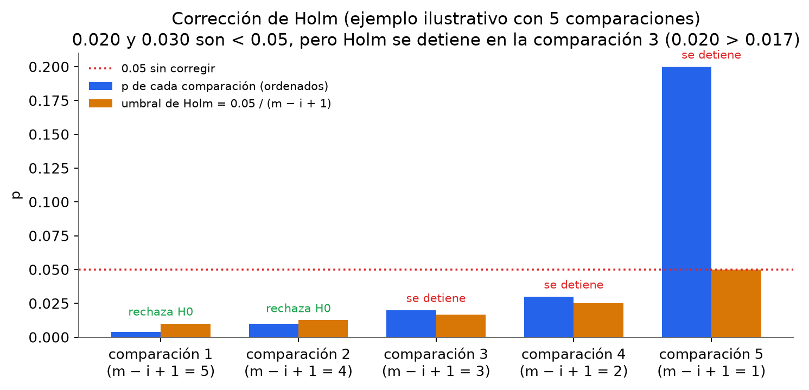

En el ejemplo (ilustrativo), los p de 0.020 y 0.030 son menores a 0.05, pero no sobreviven a la corrección: la tercera comparación tenía que pasar 0.05 / 3 = 0.017. En la práctica, los notebooks reportan el **p ajustado de Holm**, que se compara directamente con 0.05.

Holm es menos estricto que la corrección de Bonferroni simple (que compara **todos** los p con 0.05 / *m*) y da la misma garantía.

### 12.4 Intervalos de confianza por bootstrap

Además del valor p, el notebook 12 reporta un **intervalo de confianza del 95 %** para la diferencia media. Se obtiene por *bootstrap*: se remuestrean las 12 personas con reemplazo miles de veces, se recalcula la diferencia media en cada remuestreo y se toman los percentiles 2.5 y 97.5. **Si el intervalo incluye el 0, no hay evidencia de diferencia.** Por ejemplo, el ajuste fino frente a la red congelada dio +0.020 [+0.010, +0.032]: el intervalo no incluye el 0, así que el ajuste fino sí ayuda.

---

## 13. Nuestra metodología frente a la de Bassani et al.

Las citas de Bassani et al. (2025) son textuales del artículo (PMC12610047) o de su código público (repositorio *GiuliaBassani/Deep-Learning-Algorithms-for-Human-Activity-Recognition-in-Manual-Material-Handling-Tasks.*).

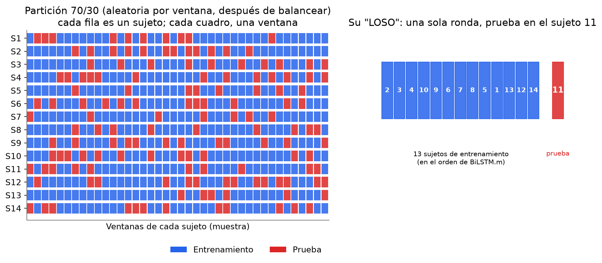

| Aspecto | Bassani et al.: partición 70/30 | Bassani et al.: "LOSO" | Este proyecto |
|---|---|---|---|
| **Cómo se dividen los datos** | Al azar por ventana, con los 14 sujetos juntos. Artículo: *"we took 70% of the dataset for training and the rest 30% for testing"*. Código (`ExtractInfo4Training.m`): carga `DataBalanced`, hace `idx = randperm(n)` y toma `train_ind = idx(1:round(P*n))` | Entrenan con 13 y prueban en 1. Artículo: *"training the two networks with 13 different datasets with increasing subject numerosity (1 to 13) and testing on the fourteenth subject data not considered during training"* | 12 rondas LOSO (sección 4) y prueba final con los sujetos 13 y 14 |
| **Quién es la persona de prueba** | — | El artículo no la nombra. El código la fija: `sbj = '11.mat';` bajo el comentario `% Set the test subject file (sbj)` en `BiLSTM_LOSO.m` y `RCNN_LOSO.m`, y en `BiLSTM.m` el sujeto 11 es el único que no entra en los conjuntos de 1 a 13 | Cada uno de los sujetos 1–12, y después el 13 y el 14 |
| **¿La misma persona en entrenamiento y prueba?** | **Sí** | No | No |
| **Ventanas** | *"short intervals of 1 s length with 1 s stride and no overlap"*, a 240 Hz | Igual | 4 s a 12 Hz, una cada 0.5 s |
| **Etiqueta de cada ventana** | No se especifica | No se especifica | Actividad del último instante |
| **Balanceo de clases** | Submuestreo de `N` y copias con ruido gaussiano; **antes de dividir**, porque el 70/30 se hace sobre `DataBalanced` | La prueba también se carga desde `DataBalanced` (`loadTestData.m`) | Pesos por clase en la pérdida |
| **Elección de hiperparámetros** | *"The best three Eps-HUs pairs were estimated with the grid search approach, optimizing the classification performance"*; no se menciona un conjunto de validación aparte | Se usa la configuración elegida con el 70/30 | Un sujeto de validación interna por ronda, nunca el de prueba |
| **Resultado reportado** | *"The best Eps-HUs pair is 300 HUs–2500 Eps with 95.7%"* | *"the maximum value, reached with 13 subjects, is 90.3% for the BiLSTM"* (en su tabla 5 aparece como 90.6 %) | Media, desviación y peor de 12 personas: 0.873 ± 0.036; prueba final 0.884 y 0.898 |
| **Modelo** | BiLSTM supervisada | Igual | CPC-GRU con preentrenamiento sin etiquetas + LP-FT |

---

## 14. Por qué su 95.7 % no es comparable y su 90.3 % sí

### 14.1 El 95.7 % mide algo distinto

El 95.7 % sale de la partición 70/30, que **revuelve las ventanas de todas las personas** antes de dividirlas. Eso causa tres problemas que inflan el resultado:

**1. Las mismas personas están en entrenamiento y en prueba.** El modelo aprende las particularidades de cada persona y después se evalúa con esas mismas personas. No mide lo que pasará con un trabajador nuevo.

**2. Las ventanas de prueba tienen "gemelas" en entrenamiento.** Momentos consecutivos de un mismo ensayo son casi idénticos. Si se reparten al azar, cada ventana de prueba tiene vecinas muy parecidas en entrenamiento:

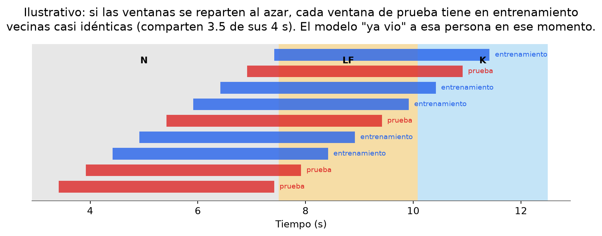

En el notebook 16, con nuestras ventanas, el **90.9 % de las ventanas de prueba tenía en entrenamiento una vecina que comparte el 87.5 % de sus instantes**. Sus ventanas de 1 s no se traslapan, pero su balanceo crea un problema equivalente (punto 3).

**3. Hay copias con ruido de un lado y del otro.** Su código aplica la partición sobre `DataBalanced`, los datos **ya balanceados**. Una ventana original puede quedar en entrenamiento y su copia con ruido en prueba: el modelo se evalúa con una versión ligeramente alterada de algo que ya vio.

Además, **los hiperparámetros se eligieron con ese mismo 30 %**, y se reporta la mejor configuración de la búsqueda: el número es optimista también por selección.

**Comprobación con nuestros datos:** al repetir una partición aleatoria 70/30, nuestros modelos suben de ≈ 0.87–0.89 a **0.90–0.92** (CPC-GRU 0.900; Random Forest 0.919). La partición aleatoria infla el resultado aunque el modelo sea el mismo.

### 14.2 El 90.3 % sí es comparable, con cuidado

El 90.3 % sale de entrenar con 13 personas y probar en una persona que el modelo **no vio** (el sujeto 11). Mide lo mismo que nuestro LOSO: **el desempeño con una persona nueva**.

**Las precauciones:**
- **Es una sola persona.** En nuestro LOSO, el F1 por persona va de 0.775 a 0.908. Su 0.903 debe compararse con **nuestro rango por persona**, no con nuestra media. Para el sujeto 11, nuestro modelo obtuvo 0.910 con sus mismas 10 señales y 13 sujetos de entrenamiento: **el mismo nivel**.
- **Entrenan con 13 personas; nuestro LOSO, con 10.** En el notebook 12, pasar de 10 a 13 sujetos no cambió el F1 (0.880 frente a 0.879), así que esta diferencia no explica nada.
- **Otros detalles siguen siendo distintos:** ventana, frecuencia, balanceo (su prueba también sale de `DataBalanced`) y la configuración, elegida con el 70/30.

**En una frase:** el 95.7 % mide qué tan bien reconoce el modelo a gente que ya conoce; el 90.3 % mide qué tan bien reconoce a una persona nueva, que es lo que mide nuestro proyecto.

---

## 15. Glosario rápido

| Término | Significado |
|---|---|
| **Ventana** | Trozo de 4 s de la señal (48 pasos a 12 Hz) que el modelo clasifica |
| **Traslape** | Parte de la señal que comparten dos ventanas consecutivas (3.5 de 4 s) |
| **Submuestreo temporal** (*downsampling*) | Bajar la frecuencia de muestreo, aquí de 240 a 12 Hz |
| **Submuestreo de clase** (*undersampling*) | Quitar ejemplos de la clase más grande |
| **Sobremuestreo** (*oversampling*) | Agregar copias (a veces con ruido) de las clases pequeñas |
| **Ruido gaussiano** | Error aleatorio con distribución normal, media 0 y desviación σ |
| **Pesos por clase** | Hacer que los errores de clases pequeñas pesen más en la pérdida |
| **Cuantil (q5, q95)** | Valor por debajo del cual queda el 5 % (o el 95 %) de los datos |
| **Escalado robusto** | (x − mediana) / (q95 − q5), tras recortar los extremos |
| **LOSO** | Validación que deja fuera a una persona en cada ronda |
| **Validación interna** | Sujeto que decide la parada temprana y los hiperparámetros; nunca es el de prueba |
| **CPC** | Preentrenamiento sin etiquetas: reconocer cómo continúa el movimiento |
| **InfoNCE** | Pérdida de CPC: distinguir el futuro real entre muchos candidatos |
| **`z_t`, `c_t`, `c_T`** | Vector local del encoder; resumen de la GRU hasta *t*; el resumen del último instante |
| **Cabezal (cabeza)** | Capa final que convierte `c_T` en 7 puntajes, uno por actividad |
| **LP-FT** | Primero se entrena sólo la cabeza (LP) y después toda la red (FT) |
| **t-SNE** | Técnica para dibujar en 2D vectores de muchas dimensiones, conservando vecindades |
| **F1 macro** | Promedio simple del F1 de las 7 actividades |
| **Wilcoxon** | Prueba pareada por persona, basada en rangos |
| **Holm** | Corrección del valor p cuando se hacen muchas comparaciones |
| **`EML`** | Las 10 variables del modelo final: codos (*Elbows*), manos y piernas (*Legs*) |

## Referencias

- Bassani, G., Avizzano, C. A., & Filippeschi, A. (2025). Deep learning algorithms for human activity recognition in manual material handling tasks. *Sensors, 25*(21), 6705. https://doi.org/10.3390/s25216705
- Bassani, G., Filippeschi, A., & Avizzano, C. A. (2021). *Manual material handling dataset for biomechanical and ergonomics analysis* [Conjunto de datos]. Zenodo. https://doi.org/10.5281/zenodo.4633087
- Haresamudram, H., Essa, I., & Plötz, T. (2021). Contrastive predictive coding for human activity recognition. *Proceedings of the ACM on Interactive, Mobile, Wearable and Ubiquitous Technologies, 5*(2), 1–26. https://doi.org/10.1145/3463506
- Kumar, A., Raghunathan, A., Jones, R., Ma, T., & Liang, P. (2022). Fine-tuning can distort pretrained features and underperform out-of-distribution. *International Conference on Learning Representations*.
- van den Oord, A., Li, Y., & Vinyals, O. (2018). *Representation learning with contrastive predictive coding*. arXiv:1807.03748.
