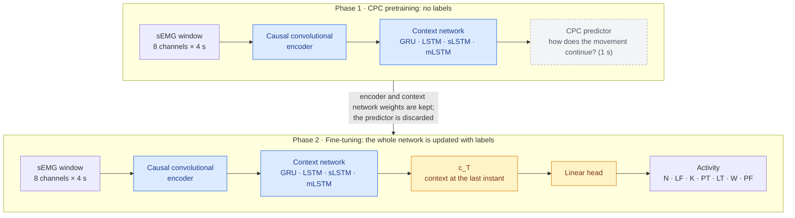
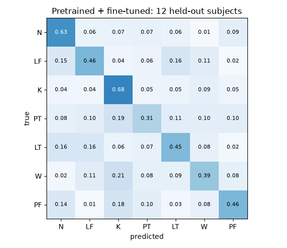
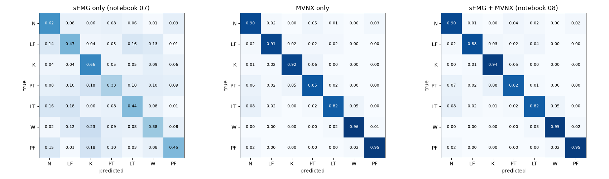
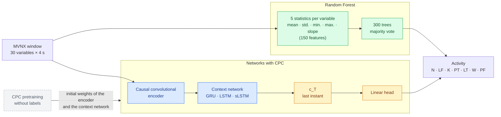
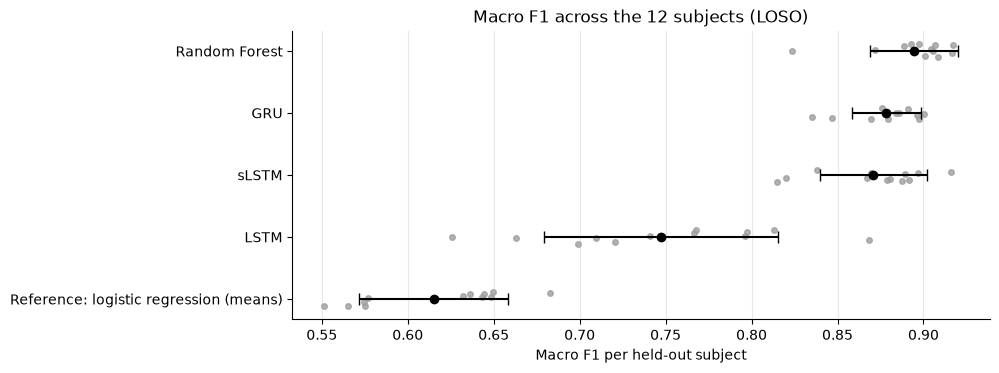
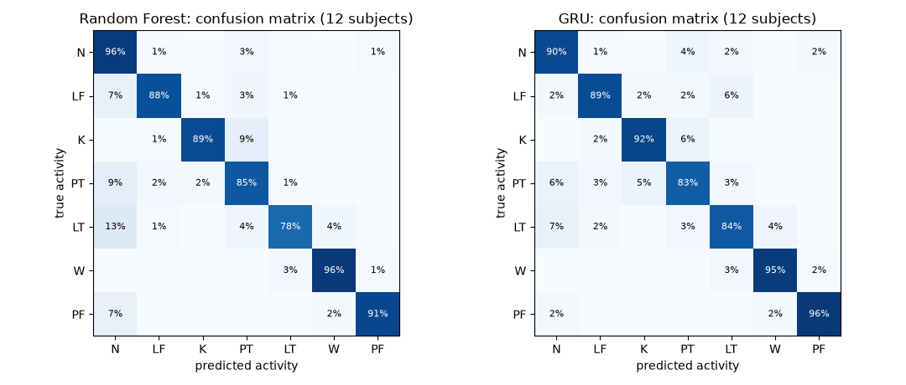
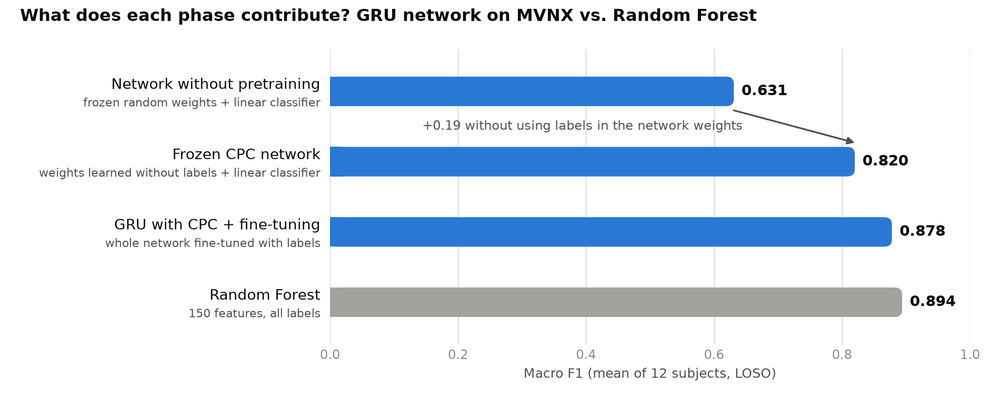

# Recognition of manual material handling activities: project progress

**Integrative Project · Team 1** · October 27, 2026

## Summary

- **Goal:** recognize seven manual material handling activities from body-worn sensors.
- **Path so far:** we started with the muscle signal of the arms (sEMG) and a network with self-supervised pretraining (CPC). The sEMG plateaued at a macro F1 of ≈ 0.44–0.49. Adding full-body motion capture (MVNX) raised performance to ≈ 0.88, and the sEMG added nothing further. Since then we have worked with MVNX only.
- **Current status:** with MVNX, the Random Forest achieves the best macro F1 (0.894), and the network with CPC pretraining comes very close (0.878), with the lowest variation across people. The network learns, without labels, a representation that already recognizes the activities (0.820 with a linear classifier); its advantage when labels are scarce has yet to be evaluated.
- **Evaluation:** every experiment uses leave-one-subject-out (LOSO) validation on subjects 1–12. Subjects 13 and 14 are reserved for the final test and have not been used.

| Code | Activity |
|---|---|
| N | Neutral posture |
| LF | Lift from the floor |
| K | Keep lifted |
| PT | Place on the table |
| LT | Lift from the table |
| W | Walk / carry |
| PF | Place on the floor |

---

## 1. sEMG exploration and preparation

### Contents

- **14 subjects** (12 men and 2 women, aged 25 to 38), with 37 trials per subject: isokinetic, bimanual and one-handed, with loads from 2 to 12 kg.
- **643 sEMG trials** with 8 upper-limb channels: 27.7 million samples, 13.2 h.
- **Labels:** 10,612 segments in 7 classes. Only ≈ 67 % of each recording is annotated.

### Findings

- **Quality:** no missing values, gaps or constant channels. There are 3 trials with damaged channels (subject 7), 2 files with inconsistent labels, and 1 trial missing for subject 12.
- **Variable sampling rate:** between 367 and 1006 Hz depending on the file. Recordings cannot be combined by sample count.
- **Imbalance:** `N` takes up 43 % of the labeled time; the other classes, between 7 and 15 % each.
- **Predictive power:** the sEMG clearly separates rest from activity and grows with the load (≈ 3× from 2 to 12 kg), but **the effort activities overlap**.

### Preparation

1. Trials with damaged channels and inconsistent labels are excluded.
2. The normalized envelope `Norm_RMS` (%MVC) of the 8 channels is used.
3. An anti-aliasing filter is applied and the signal is resampled to **12 Hz**. It performs the same as 25 Hz at a third of the cost.
4. **4 s windows (48 steps)** are built, labeled with the activity at their **final instant**.
5. The data are transformed with quantile `clip`, `log1p` and `RobustScaler`, fitted only on the training subjects.
6. Data are split **by subject**, so a person never appears in training and evaluation at the same time.

---

## 2. Models with sEMG

### What was tested

- **CPC network:** a convolutional encoder and a context network, pretrained without labels and then fine-tuned to classify.
- **Configurations:** GRU, LSTM, sLSTM and mLSTM context networks; prediction horizons; mixed or same-subject negatives; last-instant or whole-window representation; sampling rates of 12 and 25 Hz.
- **Best configuration:** sLSTM with a 1 s horizon and same-subject negatives. It was evaluated with LOSO and two seeds.
- **Classical baseline:** a Random Forest on 202 sEMG features, standardized per subject.

**Network architecture:**



- **Phase 1 (CPC pretraining):** the encoder and the context network learn without labels.
- **Phase 2 (fine-tuning):** the head is added and **the whole network** is trained with labels. The encoder and the context network start from the CPC weights and change little; the head learns from scratch.
- **From scratch:** the same architecture, without phase 1.

### Results (LOSO, 12 subjects)

| Model | Macro F1 |
|---|---|
| Random Forest, sEMG features | **0.485 ± 0.042** |
| sLSTM with CPC + fine-tuning | 0.437 ± 0.066 |
| sLSTM from scratch | 0.421 ± 0.073 |
| Stratified chance | 0.14 |

**Confusion matrix of the best network model (sLSTM with CPC + fine-tuning):**



- No activity exceeds 68 % correct predictions; `PT` reaches only 31 %.
- The confusions follow a pattern: `PT`, `W` and `PF` are confused with `K` (18–21 %), and `LF` and `LT` are confused with each other (16 %).

### Conclusion

Arm sEMG **is not enough to identify the activity**. It measures **how much effort** the muscle makes, but not **where the body is**. Lifting from the floor or from the table, and placing on the table or on the floor, activate the same muscles; what changes is the height and the posture. Since the Random Forest and the network fall in the same range (≈ 0.44–0.49), **the limit lies in the signal, not in the model**.

---

## 3. Motion capture (MVNX) exploration and preparation

### Contents

- **517 recordings** from the Xsens MVN inertial suit (≈ 57 GB of XML), at 240 Hz.
- **Body model:** 23 segments, 17 sensors and 22 joints, with 782 columns per instant. It includes position, velocity, acceleration, orientation, joint angles and foot contacts.
- **Own labels:** 8,337 segments indexed on the MVNX frames, with the same 7 classes.

### Preparation

1. **Synchronization with the sEMG:** the clocks differ by ≈ 1 h. They were aligned using label events, with a typical residual of 0.5 ms. Where both sources have a label, they agree on 100 % of the instants.
2. **Exclusions:** 12 trials due to damaged sEMG channels, inconsistent labels or time jumps in the MVNX. When working with MVNX only, 3 trials excluded solely because of the sEMG were recovered.
3. **Resampling to 12 Hz:** zero-phase low-pass filter at 4.8 Hz and interpolation, on the same grid as the sEMG.
4. **Variable selection:** from 782 columns to **30 variables** with physical meaning (table below).
5. **Invariance to the laboratory:** heights, distances and speeds are used instead of absolute coordinates, which depend on where the person stands and which way they face.
6. **Robust scaling** per variable, fitted in each round only on the training subjects.

### Selected variables

| Category | Variables | Why |
|---|---|---|
| **Posture (14)** | Trunk and neck flexion. On each side: shoulder flexion and abduction, and elbow, wrist, hip and knee flexion | Describe how the body is positioned: bending down, extending the arms, carrying |
| **Heights and reach (6)** | Height of the pelvis, head and each hand; horizontal distance from each hand to the pelvis | Distinguish the floor from the table, which is exactly what the sEMG could not see |
| **Velocities (6)** | Horizontal speed and vertical velocity of the pelvis, speed of each hand, pelvis turning, trunk angular velocity | Distinguish walking from standing still and the direction of movement (up or down) |
| **Support (4)** | Heel and toe contact of each foot | Mark gait and changes of support |

**Discarded variables:**

- **Accelerations:** derivatives of velocity, and noisier.
- **Global orientations and quaternions:** depend on the person's heading.
- **Magnetic field:** depends on the environment.
- **Ergonomic angles:** missing for 3 subjects.
- **Center of mass:** r = 0.98 with pelvis height.

In the experiments combined with the sEMG (section 4), sides were ordered relative to the arm with sEMG (ipsilateral/contralateral). When working with MVNX only, fixed sides (left/right) are used.

---

## 4. sEMG only, sEMG + MVNX and MVNX only

The same network (sLSTM with CPC + fine-tuning) was used, on the same trials and with LOSO on the 12 subjects. Only the input changes.

| Input | Macro F1 | Comparison |
|---|---|---|
| sEMG only | 0.433 ± 0.063 | — |
| sEMG + MVNX | 0.880 ± 0.029 | +0.447 over sEMG; improves in 12 of 12 subjects (p < 0.001) |
| **MVNX only** | **0.885 ± 0.033** | Adding the sEMG: −0.006; the combination wins in only 4 of 12 subjects (p = 0.15) |



**Decision: work with MVNX only.** Movement carries practically all the useful information, and the sEMG adds nothing measurable. Using a single source also simplifies data acquisition and removes the synchronization between devices.

---

## 5. Model comparison with MVNX

### Protocol

- **Input:** the 30 MVNX variables in 4 s windows, labeled at the final instant.
- **Conditions:** the same windows, the same 12 LOSO rounds and the same metric (macro F1) for all models.
- **Random Forest:** receives 5 statistics per variable (mean, standard deviation, minimum, maximum and slope), i.e., 150 features.
- **Networks:** receive the full window. All three are pretrained with CPC and then fine-tuned with labels. They share the convolutional encoder, the pretraining and the classification head; **the only thing that changes between them is the context network** (GRU, LSTM or sLSTM).

**Architecture of the compared models:**



- **Random Forest:** summarizes each window in statistics and does not see the temporal order within it.
- **Networks with CPC:** start from the weights of the label-free pretraining and are then fully fine-tuned with labels. They process the window step by step and classify with the context at the last instant.

### Results

| Model | Macro F1 | Worst subject | Min per round |
|---|---|---|---|
| **Random Forest** | **0.894 ± 0.026** | 0.823 | 0.2 |
| GRU | 0.878 ± 0.020 | 0.835 | 5.0 |
| sLSTM | 0.871 ± 0.031 | 0.815 | 13.7 |
| LSTM | 0.747 ± 0.068 | 0.626 | 2.9 |
| *Reference: logistic regression on the means* | *0.615 ± 0.043* | *0.551* | — |

- The time per round for the networks includes CPC pretraining and fine-tuning.
- **LSTM:** CPC pretraining hurt it. Fine-tuning distorted the learned representation, and in all 12 subjects it fell below its version trained without CPC (0.854). This did not happen with the GRU or the sLSTM.
- The mLSTM and a 1D CNN were also tested, but only without CPC pretraining, so they are not included in this comparison.

**Macro F1 per subject.** Each dot is a held-out subject; the black bar marks the mean ± the standard deviation across subjects.



The GRU with CPC sits right next to the Random Forest, with the lowest spread across people. The LSTM with CPC varies widely across subjects, and the linear reference falls clearly below.

**Confusion matrices of the two best models** (percentage of each true activity, with the 12 subjects pooled):



Both models get between 78 and 96 % right in every activity; the diagonal contrasts with the scatter of the sEMG (section 2). They complement each other: the Random Forest is more accurate on `N` and `PT`, and the GRU on `LT` and `PF`. The most common error for both is confusing `LT` with `N`.

**Hyperparameter tuning of the two best models:**

- Configurations were chosen with subjects 11–12 and then evaluated with LOSO.
- The tuned Random Forest scored 0.893 and the tuned GRU, 0.879.
- The Random Forest still outperformed the GRU in 10 of 12 subjects, so it is kept with its original configuration as the final model.

### How to interpret these results

**The Random Forest achieves the best F1, but the CPC network comes very close and is the most stable.** The GRU with CPC pretraining reaches 0.878, 0.016 below the Random Forest. It also has the lowest variation across people (± 0.020) and the best result on the hardest subject (0.835). The Random Forest is kept as the reference for its performance and low cost, but the difference between the two approaches is small.

**All models solve the same task:** identifying the activity taking place at this instant, given the previous 4 s. In CPC, predicting future movement is only the training exercise through which the network learns without labels. It is discarded afterwards.

```
Phase 1 · CPC (no labels):    movement → network → "how does the movement continue?"   (discarded)
Phase 2 · Classification:     movement → network → activity at the current instant
```

**What the network learns without labels already makes it possible to recognize the activity.** With the pretrained network frozen and only a linear classifier trained on top, the macro F1 is 0.820. The same network without pretraining stays at 0.631. In other words, the label-free phase on its own builds a representation of movement that separates the seven activities and reaches ≈ 92 % of the Random Forest's performance.¹



**Why the Random Forest wins in this scenario.** All training data are labeled, so the Random Forest makes use of all the available information. The expected advantage of CPC lies in the opposite scenario: lots of recorded movement and few annotations, which is the typical situation when deploying the system in a real setting. Haresamudram et al. (2020) report that, with all labels available, CPC performs on par with conventional training, and that its advantage appears when labels are scarce. We have not yet evaluated that scenario.

¹ *The network weights were learned without labels; labels were used only to choose the pretraining epoch and to train the linear classifier.*

### Next step: experiment with few labels

To test whether CPC adds value over the Random Forest, we will replicate the label-efficiency experiment from the paper:

- **CPC:** pretrained on all the training data, ignoring the labels.
- **Compared models:** frozen CPC with a small classifier, the same network without pretraining, the GRU from scratch, and the Random Forest.
- **Labeled data:** each model receives only **1, 5, 10, 25, 50 and 100 labeled windows per class**.
- **Evaluation:** macro F1 under LOSO is compared for each amount of labels.

If CPC outperforms the Random Forest with few labels, the network becomes the recommended option for real-world use, where annotating is costly. If not, the Random Forest remains the final model.

---

## References

- Haresamudram, H., Essa, I., & Plötz, T. (2020). Contrastive predictive coding for human activity recognition. *arXiv:2012.05333*. https://arxiv.org/abs/2012.05333
