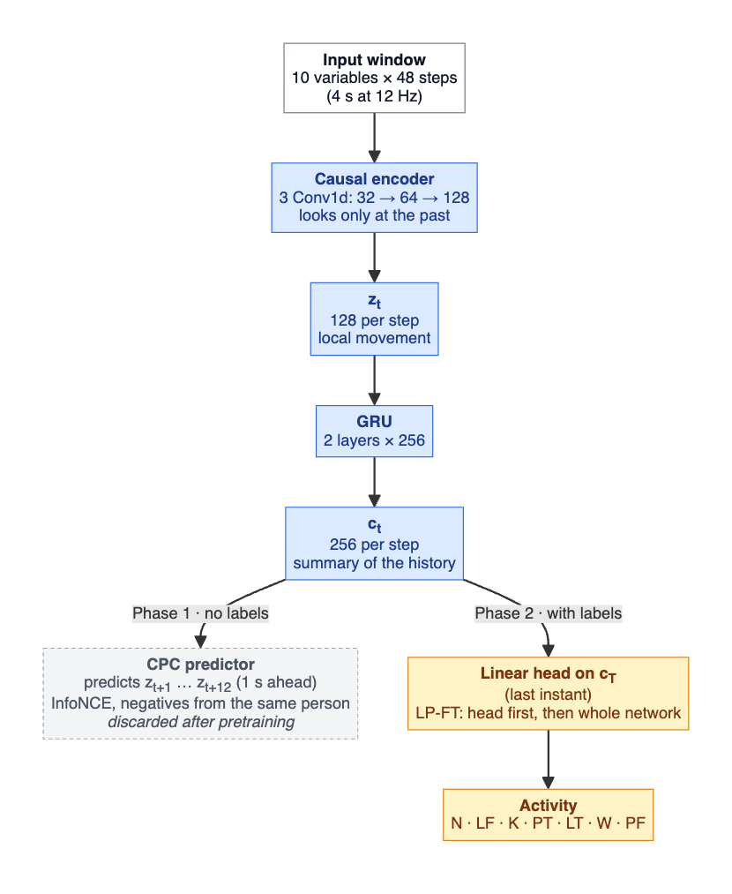

# Recognition of manual material handling activities: project progress update

**Integrative Project · Team 1** · November 17, 2026

## Where we stand

**Goal.** Recognize seven manual material handling activities (from neutral posture to lifting, carrying and placing loads on the floor or a table) from body-worn sensors, as the first step toward assessing ergonomic risk. The research question is whether self-supervised pretraining with **Contrastive Predictive Coding (CPC)**, which learns from unlabeled recordings, reduces the need for labels, the most expensive part of deploying such a system. Every model is evaluated on people it has never seen (leave-one-subject-out validation).

**Previous progress** ([project_progress.md](project_progress.md), October 27, 2026):

- **Arm muscle activity (sEMG) is not enough:** every model plateaued at a macro F1 of ≈ 0.44–0.49, because it measures effort but not body posture.
- **Full-body motion capture (MVNX) solves it:** F1 rose to ≈ 0.88, and adding the sEMG (all 8 channels) brought no further gain, so the project moved to motion only (30 physical variables at 12 Hz).
- **With all labels, the Random Forest is slightly better** (0.894) than the CPC network with a GRU (0.878), which is the most stable across people. *Note: "all labels" means that every annotated window of the training subjects is used to train the classifier (≈ 34,000 windows per round), the standard supervised setting. The opposite case, with only a few annotated windows, is the one CPC targets.* Without any labels, CPC already learned a representation that recognizes the activities (0.820 with a linear classifier).
- **Open question at that point:** does CPC pay off when labels are scarce? Section 2 answers it.

This update continues [project_progress.md](project_progress.md) (October 27, 2026) and covers four new lines of work. Only the main conclusions are included; each section links to the notebook and its detailed summary.

## Summary

- **Minimal sensors:** 10 of the 30 motion variables, measurable with **11 of the 17 sensors**, keep the performance of the full set. We call this subset **`EML`**, after its three sensor groups: **E**lbows (elbow flexion), hands (**M**anos in Spanish: wrist flexion and hand speed) and **L**egs (hip and knee flexion), always on both sides. Computing them from the 11 sensors alone, without Xsens' full-body model, costs nothing for the CPC network.
- **Few labels (the central question of the project):** with **10 labeled windows per activity or fewer**, the CPC network beats the Random Forest by **+0.04 to +0.11** macro F1 in 11–12 of 12 people. The Random Forest needs **≈ 2.2× more labels** to match it, and the advantage comes from the label-free pretraining.
- **Windows, latent dimensions and t-SNE:** windows of 2, 4 or 6 s, prediction horizons and larger latent vectors all land within **0.871–0.887**. No configuration clearly beats the current one; the t-SNE maps show that the context vector `c_T` separates the activities much better than the local vector `z_T` (appendix B).
- **Variables of the reference article (Bassani et al., 2025):** with their 10 signals, the CPC network matches our 30 variables (0.880 vs. 0.878) and reaches the article's level on its test subject (**0.910 vs. 0.903**). A linear head is enough, and more training subjects or their 240 Hz time scale do not help.
- **Final model:** CPC-GRU with the 10 `EML` variables (11 sensors), 4 s windows at 12 Hz, linear head with LP-FT: **0.873 ± 0.036** in LOSO (Random Forest: 0.892). In the final test on the held-out subjects 13 and 14 (notebook 18) it scored **0.884 and 0.898**, within the LOSO range (Random Forest: 0.885 and 0.906).

Unless stated otherwise, every result uses leave-one-subject-out (LOSO) validation on subjects 1–12, with macro F1 per subject (mean ± standard deviation across subjects) and paired Wilcoxon tests.

---

## 1. Minimal variables and sensors

Notebooks: [`11_LOSO_variables_minimas_fs12`](../notebooks/11_LOSO_variables_minimas_fs12.ipynb) and [`12_LOSO_sensores_minimos_fs12`](../notebooks/12_LOSO_sensores_minimos_fs12.ipynb) · Summary: [resumen_notebooks_11_12_sensores_minimos.md](resumen_notebooks_11_12_sensores_minimos.md)

### Questions

1. Which variables does the model actually need to recognize the activity?
2. Those variables are computed by Xsens from all 17 sensors. Do we get the same result computing them **only from the sensors that remain**?

### Method

- The 30 variables were grouped **by the sensors they depend on** (e.g., the elbow angle needs the upper arm and forearm sensors). Left and right sides are always kept together.
- **Backward elimination with the Random Forest:** at each step, the group whose removal keeps the highest F1 is dropped. The Random Forest is deterministic and fast, so it was used to *search*; the CPC-GRU was then used to *measure* every point of the path.
- For question 2, the 8 joint angles were recomputed from each sensor's own orientation, and the hand speed was replaced by the **hand acceleration** measured by its sensor (integrating speed from a single sensor would drift).

### Results

| Step | Variables | Sensors | RF | CPC-GRU |
|---|---|---|---|---|
| All variables | 30 | 17 | 0.894 | 0.878 |
| **Elbows, hands and legs (`EML`)** | **10** | **11** | **0.892** | **0.873** |
| Elbows and legs | 6 | 9 | 0.860 | 0.861 |
| Elbows only | 2 | 4 | 0.714 | 0.740 |

| Same 10 variables, computed with… | RF | CPC-GRU |
|---|---|---|
| Xsens full-body model (17 sensors) | 0.892 | 0.873 |
| **Only the 11 sensors** (angles + hand acceleration) | 0.883 | **0.870** |

### Main conclusions

1. **The minimum without loss is elbows, hands and legs:** 10 variables and 11 sensors (pelvis and, on each side, upper arm, forearm, hand, thigh and lower leg). Up to this point no difference is significant.
2. **The elbows are the only irreplaceable group:** removing them always drops the F1 to ≈ 0.81. Pelvis, trunk, head, shoulders and feet add nothing that the other groups do not already carry. The cut-off point is removing the hands.
3. **The angles do not need the full-body model.** Angles from the individual sensors differ from Xsens by only 1–4° (95th percentile) and do not change the F1.
4. **Swapping hand speed for acceleration only costs the Random Forest** (−0.009, in 10 of 12 subjects). The CPC-GRU does not lose, plausibly because it reads the window step by step and can "integrate" the acceleration.
5. **Practical implication:** an 11-IMU system that computes 8 angles and the hand accelerations recognizes the 7 activities with F1 ≈ 0.87–0.88, ≈ 0.01 below the full 17-sensor suit.

*Limitation:* the orientations come from Xsens' per-sensor fusion and calibration was estimated per trial, which is more favorable than a real per-session calibration.

---

## 2. Few labels: CPC-GRU vs. Random Forest

Notebook: [`17_pocas_etiquetas_fs12`](../notebooks/17_pocas_etiquetas_fs12.ipynb) · Summary: [resumen_notebook_17_pocas_etiquetas.md](resumen_notebook_17_pocas_etiquetas.md)

### Question

When only a few windows are labeled, does the CPC network, pretrained **without labels**, recognize a new person's activities better than a Random Forest trained on the same labels?

### Method

- In each LOSO round, CPC is pretrained once on the **unlabeled** data of the 10 training subjects.
- Then only **n labeled windows per activity**, n ∈ {1, 2, 5, 10, 25, 50, 100}, are drawn from those subjects, with 10 repetitions per size. All models see exactly the same windows.
- Three CPC variants (frozen + linear, frozen + MLP, LP-FT) are compared with the Random Forest and with two controls: the **same network trained from scratch** and a **random frozen encoder**.
- Hyperparameters are chosen by cross-validation *within* the n labels. The criterion was fixed before running: higher mean F1, Holm-corrected p < 0.05 and improvement in ≥ 9 of 12 subjects.

**Flow of one LOSO round:**

- **Step 1** uses only unlabeled recordings: CPC learns how movement evolves, without knowing the activities.
- **Step 2** gives every model the same handful of labels. Only the CPC variants start from what was learned in step 1; the others learn from the labels alone.
- **The controls** isolate the cause: if CPC beats the network from scratch, the gain is not the architecture; if it beats the random encoder, the gain is what CPC learned.

### Results

| Windows per activity | 1 | 2 | 5 | 10 | 25 | 50 | 100 | all |
|---|---|---|---|---|---|---|---|---|
| **CPC-GRU (LP-FT)** | **0.368** | **0.473** | **0.620** | **0.707** | **0.769** | **0.800** | **0.827** | 0.873 |
| Random Forest | 0.323 | 0.407 | 0.513 | 0.611 | 0.722 | 0.777 | 0.816 | **0.892** |
| Difference | +0.045 | +0.066 | +0.107 | +0.096 | +0.047 | +0.023 | +0.011 | −0.019 |
| Subjects where CPC wins | 12/12 | 11/12 | 11/12 | 11/12 | 10/12 | 10/12 | 9/12 | — |
| CPC better by the criterion? | **yes** | **yes** | **yes** | **yes** | no | no | no | no |

### Main conclusions

1. **With 10 windows per activity or fewer, CPC wins** (between 7 and 70 labeled windows in total, < 0.2 % of the available labels), in 11–12 of 12 subjects.
2. **Label efficiency:** to match what CPC achieves with 5 and 10 windows per activity, the Random Forest needs ≈ 11 and ≈ 22, i.e., **≈ 2.2× more labels**.
3. **The advantage comes from the pretraining, not from the architecture.** The same network trained from scratch falls on the Random Forest curve (0.615 vs. 0.611 with 10 windows), and CPC beats the random encoder by 0.07–0.16 in all 12 subjects.
4. **Freezing CPC is enough:** linear head, MLP and full fine-tuning differ by ≤ 0.016 at every size.
5. **Where it wins:** with 10 windows per activity, mostly in `K` (+0.26), `PT` (+0.22) and `LT` (+0.13), activities defined by how the movement evolves. The Random Forest is better in `PF` (−0.04).
6. **From 25 windows per activity the advantage is no longer significant**, and with all labels the order reverses.

*Limitations:* CPC hit the 20-epoch cap in 10 of 12 rounds, and the sampling is idealized (balanced across activities and spread over 10 subjects).

---

## 3. Summary of the model: variables, architecture and best results

### 3.1 Variables

| Category | 30 variables (previous update) | `EML`, 10 variables (this update) | Bassani et al., 10 signals |
|---|---|---|---|
| **Posture** | Trunk and neck flexion. On each side: shoulder flexion and abduction, and elbow, wrist, hip and knee flexion (14) | Elbow, wrist, hip and knee flexion, both sides (8) | Trunk flexion, shoulder and elbow flexion of one arm, right knee flexion (4) |
| **Heights and reach** | Height of the pelvis, head and each hand; distance from each hand to the pelvis (6) | — | Pelvis height, forward position of the hand (2) |
| **Velocities** | Pelvis horizontal and vertical velocity, speed of each hand, pelvis turning, trunk angular velocity (6) | Speed of each hand (2) | Pelvis horizontal speed, forward acceleration of the hand (2) |
| **Support** | Heel and toe contact of each foot (4) | — | — |
| **sEMG** | — | — | Biceps and brachioradialis (2) |
| **Sensors** | 17 | **11** | 17 + sEMG |
| **Macro F1, CPC-GRU** | 0.878 | 0.873 | 0.880 |
| **Macro F1, Random Forest** | **0.894** | 0.892 | — |

*All F1 values: LOSO on subjects 1–12 with 10 training subjects. The three sets perform practically the same; `EML` is the cheapest to measure. The full list of variables is in [appendix A](#appendix-a-complete-list-of-variables).*

### 3.2 Architecture of the CPC-GRU

- **Phase 1 (no labels):** the encoder and the GRU learn by predicting how the movement continues over the next second. Each prediction must be told apart from windows of the same person (InfoNCE), so the network cannot win by recognizing who is moving. The predictor is then discarded.
- **Phase 2 (with labels):** a linear head classifies `c_T`, the context at the last instant. LP-FT first trains only the head on the frozen network and then fine-tunes the whole network with a smaller learning rate.
- **Causal and compact:** it only looks at the past, so it can run in real time, and it has ≈ 725,000 parameters.

### 3.3 Best macro F1 of the CPC-GRU

| Model | Variables | Evaluation | CPC-GRU macro F1 | Random Forest macro F1 |
|---|---|---|---|---|
| Previous update | 30 motion variables (17 sensors) | LOSO, subjects 1–12 | 0.878 ± 0.020 | 0.894 ± 0.026 |
| Variables of Bassani et al. | 10 signals (8 motion + 2 sEMG) | LOSO, subjects 1–12 | 0.880 ± 0.033 | — |
| **Final model** | **`EML`, 10 variables (11 sensors)** | LOSO, subjects 1–12 | **0.873 ± 0.036** | 0.892 ± 0.029 |
| **Final test** | **`EML`, 10 variables (11 sensors)** | Subjects 13 · 14 | **0.884 · 0.898** | 0.885 · 0.906 |

*Note: all models were developed with leave-one-subject-out validation (LOSO) on subjects 1–12. Subjects 13 and 14 were held out during the whole project and used only once, for the final test of the final model (trained on subjects 1–11, with subject 12 for early stopping; mean of 3 seeds).*

---

## 4. CPC-GRU with the variables of the reference article

Notebook: [`12_LOSO_CPC_GRU_variables_articulo_fs12`](../notebooks/12_LOSO_CPC_GRU_variables_articulo_fs12.ipynb) · Summary: [resumen_notebook_12_CPC_GRU_variables_articulo.md](resumen_notebook_12_CPC_GRU_variables_articulo.md)

### Context

Bassani et al. (2025) use **the same dataset** and the same 7 activities with only **10 signals** (2 sEMG + 8 motion). They report a macro F1 of **0.903** with a BiLSTM trained on 13 subjects and tested on **subject 11**. Their protocol differs from ours: one test person instead of a LOSO mean, 1 s windows at 240 Hz instead of 4 s at 12 Hz, and resampling of the classes instead of class weights.

### Differences in methodology

| Aspect | Bassani et al.: 70/30 split | Bassani et al.: "LOSO" | This project: LOSO |
|---|---|---|---|
| **How the data are split** | All windows of the 14 subjects, shuffled: 70 % train, 30 % test | Train on 13 subjects, test on 1 held-out subject¹ | 12 rounds: each of subjects 1–12 is tested once; 10 train and 1 is used for internal validation |
| **Same person in training and test?** | **Yes** | No | No |
| **Reported result** | One F1 over the test windows: **0.957** | F1 of one person: **0.903** | Mean ± standard deviation over 12 people (and the worst one) |
| **Hyperparameter selection** | Grid search scored on the same 30 % test set | Configuration chosen from test results | One internal validation subject per round, never the evaluated one |
| **Untouched final test** | — | — | Subjects 13 and 14, used once at the end |
| **Windows** | 1 s at 240 Hz, no overlap | 1 s at 240 Hz, no overlap | 4 s at 12 Hz, one every 0.5 s, labeled with the activity at the last instant |
| **Class imbalance** | Undersampling of `N` and noisy copies of the small classes² | Same | Class weights in the loss |
| **Input** | 8 motion + 2 sEMG signals | 8 motion + 2 sEMG signals | `EML`: 10 motion variables |
| **Model** | Supervised BiLSTM | Supervised BiLSTM | CPC pretraining without labels + LP-FT |

¹ The article only says that the networks were trained with "1 to 13" subjects and tested "on the fourteenth subject data not considered during training" (Section 3.3), without naming it. The authors' public code identifies it as **subject 11**: `BiLSTM_LOSO.m` and `RCNN_LOSO.m` set `sbj = '11.mat'` as "the test subject file", and `BiLSTM.m` adds the training subjects in the order 2, 3, 4, 10, 9, 6, 7, 8, 5, 1, 13, 12, 14, with 11 only in the 14-subject set.
² The class distribution of their test set suggests that the balancing was applied before the split, so the test set also contains noisy copies of training windows.

*Why the 70/30 figure is not comparable: windows of the same person, and even noisy copies of the same window, fall in both training and test, so it measures how well the model recognizes people it has already seen. With our data, the same kind of split raises the F1 to 0.90–0.92. The comparable figure is their held-out subject (0.903).*

### Method

- The 10 variables were reconstructed and checked against the input file the authors published for subject 11 (correlation ≥ 0.989 for all of them).
- Same CPC-GRU and LP-FT as the rest of the project. Variants: linear vs. MLP head, number of training subjects (4 to 13), and the article's time scale (240 Hz, 1 s windows).
- **Replication of their protocol:** LOSO over the 14 subjects with 13 training subjects.
- **t-SNE of `c_T`** on subject 11 for four models, with the separation also measured in the original 256 dimensions (silhouette and fraction of the 10 nearest neighbors with the same activity).

### Results

| Model | Training subjects | Mean F1 | Subject 11 |
|---|---|---|---|
| BiLSTM (Bassani et al., 2025) | 13 | — | 0.903 |
| CPC-GRU, 12 Hz · 4 s (LOSO 1–12) | 10 | 0.880 ± 0.033 | 0.908 |
| **CPC-GRU, 12 Hz · 4 s (LOSO 1–14)** | **13** | **0.883 ± 0.033** | **0.910** |
| CPC-GRU, 240 Hz · 1 s · 1 s horizon | 13 | 0.874 ± 0.026 | 0.895 |
| CPC-GRU, 240 Hz · 1 s · 0.5 s horizon | 13 | 0.854 ± 0.060 | 0.888 |

### Main conclusions

1. **The article's 10 variables are enough:** 0.880 vs. 0.878 with our 30 motion variables, with a third of the inputs.
2. **We reach the article's level:** 0.910 vs. 0.903 on subject 11. With one person and one seed, this means matching the article, not beating it. The more reliable estimate is the **mean over the 14 subjects (0.883 ± 0.033)**, which the article does not report.
3. **A linear head is enough:** the MLP ties with it (differences ≤ 0.001), so `c_T` is already linearly separable. Fine-tuning adds +0.020 over the frozen network (11 of 12 subjects).
4. **More subjects no longer help:** the curve rises from 4 to 10 training subjects (0.826 → 0.880) and then flattens (0.882 with 12 and 0.879 with 13).
5. **The article's time scale does not help:** 240 Hz with 1 s windows scores 0.854–0.874 at a much higher cost. Losing context (1 s vs. 4 s) probably matters more than the higher sampling rate, so we keep **12 Hz with 4 s**.
6. **t-SNE: the separation of `c_T` follows the same order as the F1**, and CPC already groups the activities **before seeing any label**. Fine-tuning compacts the groups, especially `LT` and `PT`. `N`, `PT` and `LT` are again the activities that mix. At 12 Hz each group forms continuous trajectories; at 240 Hz with 1 s windows, scattered fragments.

| Model (subject 11) | Silhouette: frozen → fine-tuned | Same-activity neighbors: frozen → fine-tuned |
|---|---|---|
| **12 Hz · 4 s · 13 subjects** | **0.172 → 0.219** | **0.871 → 0.899** |
| 12 Hz · 4 s · 10 subjects | 0.165 → 0.203 | 0.848 → 0.878 |
| 240 Hz · 1 s · 1 s horizon | 0.129 → 0.160 | 0.835 → 0.862 |
| 240 Hz · 1 s · 0.5 s horizon | 0.101 → 0.101 | 0.794 → 0.794 |

*Limitations:* one seed, a single internal validation subject per round, and a comparison with the article on a single person and under a different protocol.

---

## References

- Bassani, G., Avizzano, C. A., & Filippeschi, A. (2025). Deep learning algorithms for human activity recognition in manual material handling tasks. *Sensors, 25*(21), 6705. https://doi.org/10.3390/s25216705

---

## Appendix A: complete list of variables

✓ = included. L/R = one variable per side (left and right).

| Group | Variable | Unit | 30 variables | `EML` | Bassani et al. |
|---|---|---|:---:|:---:|:---:|
| Posture | Trunk flexion | ° | ✓ | | ✓ |
| | Neck flexion | ° | ✓ | | |
| | Shoulder flexion (L/R) | ° | ✓ | | one arm¹ ² |
| | Shoulder abduction (L/R) | ° | ✓ | | |
| | Elbow flexion (L/R) | ° | ✓ | ✓ | one arm¹ |
| | Wrist flexion (L/R) | ° | ✓ | ✓ | |
| | Hip flexion (L/R) | ° | ✓ | ✓ | |
| | Knee flexion (L/R) | ° | ✓ | ✓ | right only |
| Heights and reach | Pelvis height | m | ✓ | | ✓ |
| | Head height | m | ✓ | | |
| | Hand height (L/R) | m | ✓ | | |
| | Horizontal distance from the hand to the pelvis (L/R) | m | ✓ | | |
| | Hand position along the pelvis' forward axis | m | | | one arm¹ |
| Velocities | Pelvis horizontal speed | m/s | ✓ | | ✓ |
| | Pelvis vertical velocity | m/s | ✓ | | |
| | Hand speed (L/R) | m/s | ✓ | ✓ | |
| | Hand acceleration along the pelvis' forward axis | m/s² | | | one arm¹ |
| | Pelvis turning rate | rad/s | ✓ | | |
| | Trunk angular velocity | rad/s | ✓ | | |
| Support | Heel contact (L/R) | 0/1 | ✓ | | |
| | Toe contact (L/R) | 0/1 | ✓ | | |
| sEMG | Biceps RMS | %MVC | | | ✓ |
| | Brachioradialis RMS | %MVC | | | ✓ |
| | **Total** | | **30** | **10** | **10** |

¹ The arm that carries the sEMG electrodes; in bimanual trials, each arm is used as a separate example.
² Same joint as our shoulder flexion, computed by Xsens with a different rotation sequence.

---

## Appendix B: window length, latent dimensions and t-SNE

Notebook: [`13_Experimentos_ventanas_latentes_tSNE_fs12`](../notebooks/13_Experimentos_ventanas_latentes_tSNE_fs12.ipynb)

### Question

Do a longer window, a different CPC prediction horizon or larger latent vectors (`z_t`: encoder output, `c_t`: GRU context) improve the CPC-GRU? And what do these representations look like?

### Method

- `EML` variables, LOSO on subjects 1–12, one seed, LP-FT with a classifier on `c_T`.
- **Temporal sweep:** windows of 2, 4 and 6 s × horizons of 0.5, 1 and 2 s.
- **Dimension sweep** on the best window (6 s, 0.5 s horizon): `z_t` ∈ {128, 256} × `c_t` ∈ {256, 512}.
- **t-SNE** of `z_T` and `c_T` (the vectors at the last instant) for subject 1, and of `c_T` for subjects 1–5 across the four dimension combinations, using the fine-tuned networks.

### Results

| Configuration | Window | Horizon | dim `z` / `c` | Macro F1 | Worst subject |
|---|---|---|---|---|---|
| Best | 6 s | 0.5 s | 128 / 512 | **0.887 ± 0.024** | 0.828 |
| | 6 s | 0.5 s | 128 / 256 | 0.885 ± 0.025 | 0.824 |
| | 6 s | 0.5 s | 256 / 256 | 0.883 ± 0.028 | 0.822 |
| | 6 s | 0.5 s | 256 / 512 | 0.883 ± 0.028 | 0.822 |
| | 4 s | 0.5 s | 128 / 256 | 0.881 ± 0.025 | 0.820 |
| Current design | 4 s | 1 s | 128 / 256 | 0.878 ± 0.024 | 0.815 |
| | 2 s | 0.5 s | 128 / 256 | 0.876 ± 0.026 | 0.811 |
| Worst | 6 s | 2 s | 128 / 256 | 0.871 ± 0.036 | 0.786 |

*This notebook loads the trials of subjects 1–12 without the 3 recovered trials of subject 7, so its current-design value (0.878) differs slightly from notebook 11 (0.873).*

### Main conclusions

1. **All configurations fall within 0.871–0.887.** The spread (0.016) is of the same order as the seed noise (± 0.01), so with one seed no configuration clearly beats the current one (4 s, 1 s horizon, 128/256).
2. **Short horizons work slightly better.** With 4 and 6 s windows, the 0.5 s horizon gives the highest mean; 2 s horizons give the weakest worst subjects (0.782–0.786).
3. **Larger latent vectors do not help.** Doubling `z_t` or `c_t` changes the F1 by ≤ 0.004.
4. **t-SNE: `c_T` separates the activities much better than `z_T`.** In `z_T` (the local encoder output) the activities are scattered and mixed, except `K`; in `c_T` (which summarizes the history of the window) `K`, `LF`, `PF` and `W` form clearly separated groups. This shows that the context network, not the encoder, is what turns movement into activities.
5. **t-SNE: the same activities mix as in the confusion matrices:** `N`, `PT` and `LT`, the shortest actions, which begin and end in the neutral posture. Across subjects 1–5, the groups are similar for the four dimension combinations, consistent with the flat F1.
6. **Next step:** confirm the finalist configurations (e.g., 6 s with a 0.5 s horizon) with three seeds before changing the design. Until then, the final model keeps 4 s windows.

*The t-SNE maps are descriptive: their layout changes with the seed and the perplexity, so they support but do not replace the F1.*
