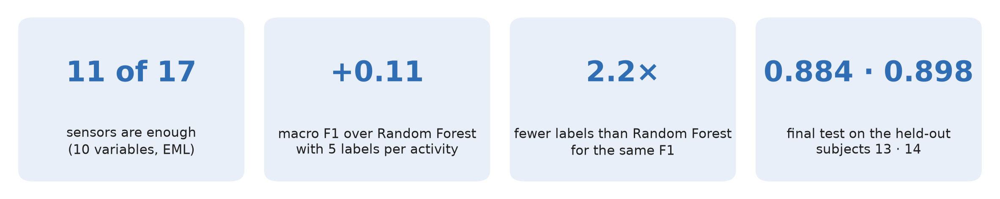
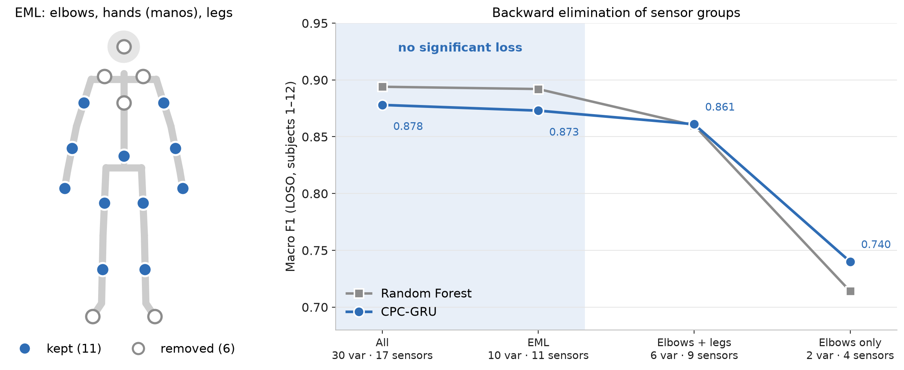
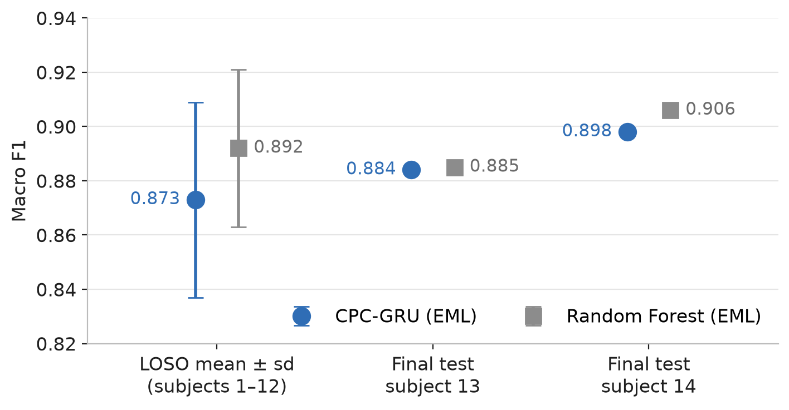
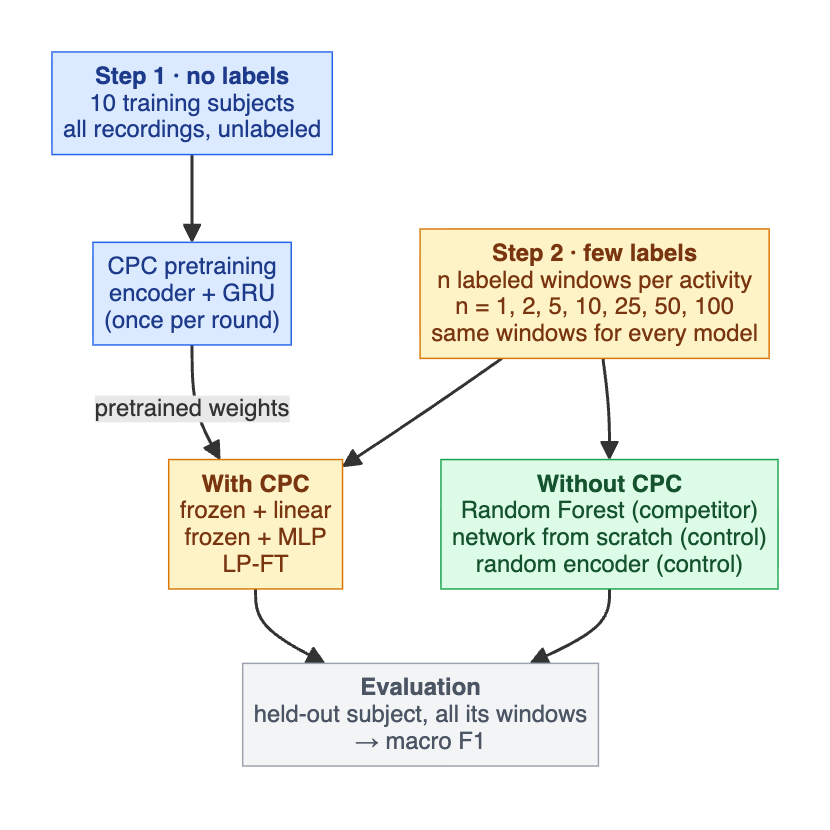
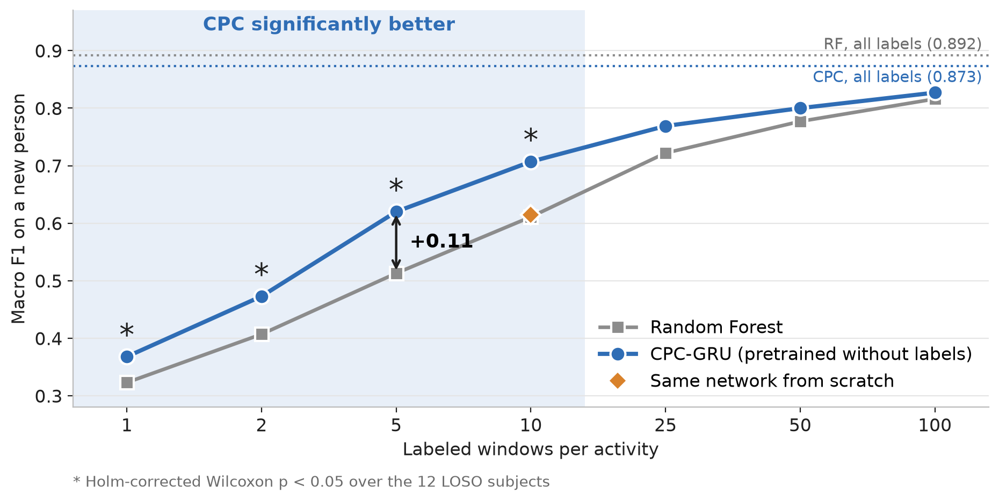
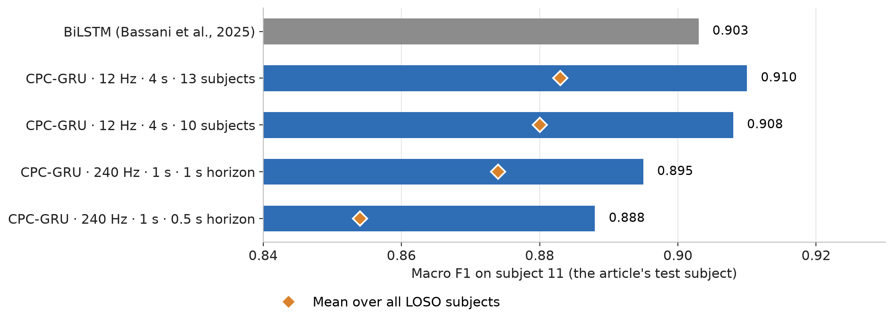
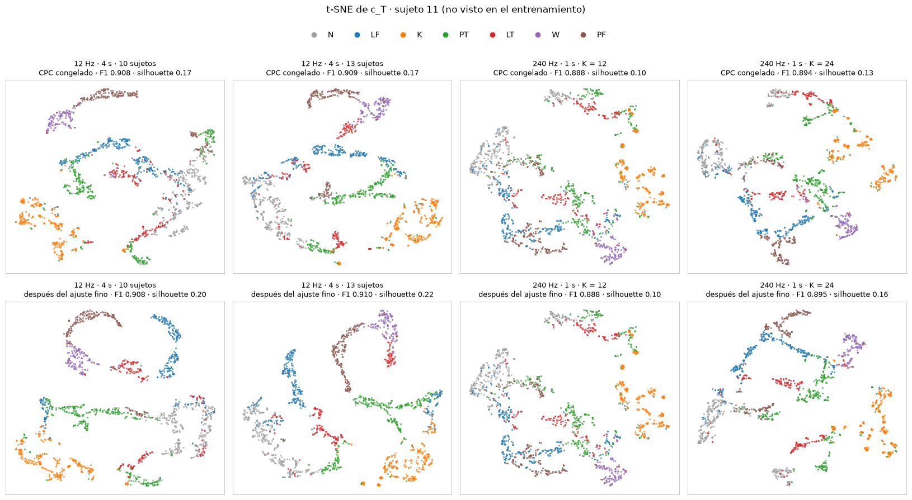
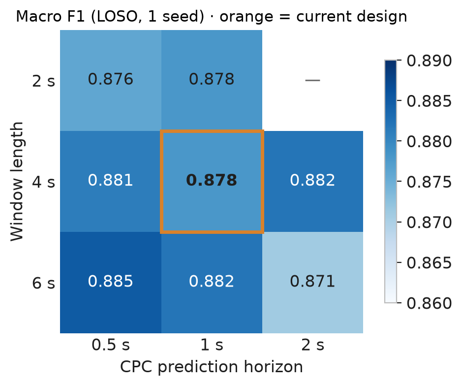

# Recognition of manual material handling activities: project progress update

**Integrative Project · Team 1** · November 17, 2026

## Where we stand

**Goal.** Recognize seven manual material handling activities from body-worn sensors, as a first step toward ergonomic risk assessment. **Research question:** does self-supervised pretraining with **Contrastive Predictive Coding (CPC)**, which learns from unlabeled recordings, reduce the need for labels? Every model is evaluated on people it has never seen (leave-one-subject-out, LOSO).

| Code | N | LF | K | PT | LT | W | PF |
|---|---|---|---|---|---|---|---|
| **Activity** | Neutral | Lift from floor | Keep lifted | Place on table | Lift from table | Walk / carry | Place on floor |

**Previous progress** ([project_progress.md](project_progress.md), October 27):

- **sEMG alone is not enough** (F1 ≈ 0.44–0.49); **full-body motion (MVNX) is** (≈ 0.88). sEMG adds nothing on top, so we use motion only.
- **With all labels, the Random Forest is slightly better** (0.894 vs. 0.878 for CPC-GRU).
- **Open question:** does CPC pay off when labels are scarce?

## This update at a glance

| # | Line of work | Answer in one sentence |
|---|---|---|
| 1 | Minimal sensors | 10 variables from **11 of 17 sensors** (`EML`) keep the performance. |
| 2 | Final model | CPC-GRU · `EML` · linear head: **0.873** in LOSO and **0.884 · 0.898** on the held-out subjects. |
| 3 | Few labels | With **≤ 10 labeled windows per activity**, CPC beats the Random Forest by +0.04 to +0.11 and needs **2.2× fewer labels**. |
| 4 | Reference article | With the variables of Bassani et al. we reach their level on their test subject (**0.910 vs. 0.903**). |
| B | Windows and latents | No configuration clearly beats the current one (all within 0.871–0.887). |

*Unless stated otherwise: LOSO on subjects 1–12, macro F1 per subject (mean ± sd), paired Wilcoxon tests. Subjects 13–14 were used only once, for the final test.*

---

## 1. Minimal variables and sensors

[`11_LOSO_variables_minimas_fs12`](../notebooks/11_LOSO_variables_minimas_fs12.ipynb) · [`12_LOSO_sensores_minimos_fs12`](../notebooks/12_LOSO_sensores_minimos_fs12.ipynb) · [detailed summary](resumen_notebooks_11_12_sensores_minimos.md)

**Question.** Which variables does the model really need, and can they be computed from the remaining sensors alone, without Xsens' full-body model?

**Method.** Variables grouped by the sensors they depend on (both sides together); **backward elimination** with the Random Forest to search, CPC-GRU to measure each step.

**Conclusions**

- **`EML` = Elbows, hands (*Manos*) and Legs:** 10 variables, 11 sensors, no significant loss.
- **The elbows are irreplaceable:** without them F1 drops to ≈ 0.81. Trunk, head, shoulders and feet add nothing.
- **No full-body model needed:** angles from the individual sensors differ by only 1–4°, and swapping hand speed for hand acceleration costs CPC nothing (**0.870** vs. 0.873).

*Limitation:* calibration was estimated per trial, more favorable than a real per-session calibration.

---

## 2. Final model

### Variables

| | 30 variables (previous) | **`EML` (final)** | Bassani et al. |
|---|---|---|---|
| **Posture** | 14 angles (trunk, neck, shoulders, elbows, wrists, hips, knees) | Elbow, wrist, hip, knee flexion (8) | 4 angles |
| **Other** | Heights, velocities, foot contact (16) | Hand speed (2) | Heights/velocities (4) + sEMG (2) |
| **Sensors** | 17 | **11** | 17 + sEMG |
| **CPC-GRU · RF** | 0.878 · **0.894** | 0.873 · 0.892 | 0.880 · — |

*The three sets perform practically the same; `EML` is the cheapest to measure. Full list in [appendix A](#appendix-a-complete-list-of-variables).*

### Architecture

1. **No labels:** encoder + GRU learn to predict the next second of movement, telling it apart from windows of the same person (InfoNCE).
2. **With labels:** a linear head classifies the context `c_T`; LP-FT trains the head first, then fine-tunes everything.
3. **Causal and compact:** only looks at the past (real-time capable), ≈ 725,000 parameters.

### Results

The final test (trained on subjects 1–11, mean of 3 seeds) falls **within the LOSO range**: the model generalizes to people never used during development.

---

## 3. Few labels: CPC-GRU vs. Random Forest

[`17_pocas_etiquetas_fs12`](../notebooks/17_pocas_etiquetas_fs12.ipynb) · [detailed summary](resumen_notebook_17_pocas_etiquetas.md)

**Question.** With only a few labeled windows, does CPC, pretrained **without labels**, recognize a new person better than a Random Forest trained on the same labels?

**Method.** In each LOSO round, CPC is pretrained on the unlabeled data; then every model gets the **same n labeled windows per activity** (n = 1 … 100, 10 repetitions). To check that the advantage comes from pretraining, we also compared CPC with **the same network without pretraining** and with **a frozen network of random weights**; neither matches CPC.

**Conclusions**

- **CPC wins with ≤ 10 windows per activity** (7–70 labels in total), in 11–12 of 12 people. From 25 windows on, the difference is no longer significant; with all labels, the order reverses.
- **≈ 2.2× fewer labels:** the Random Forest needs ≈ 11 and ≈ 22 windows to match CPC with 5 and 10.
- **The gain comes from pretraining, not from the architecture:** the same network from scratch falls on the Random Forest curve (orange point).
- **Where it wins:** in activities that differ in the order of the movement rather than in posture, such as `K` (+0.26), `PT` (+0.22) and `LT` (+0.13); placing on the table and lifting from it look alike but run in opposite directions.

---

## 4. Comparison with the reference article

[`12_LOSO_CPC_GRU_variables_articulo_fs12`](../notebooks/12_LOSO_CPC_GRU_variables_articulo_fs12.ipynb) · [detailed summary](resumen_notebook_12_CPC_GRU_variables_articulo.md)

**Context.** Bassani et al. (2025) use the same dataset with 10 signals (8 motion + 2 sEMG) and report **0.903** with a BiLSTM trained on 13 subjects and tested on one held-out subject: **subject 11**, as identified in their public code.

| | Bassani et al. | This project |
|---|---|---|
| **Evaluation** | One held-out person (subject 11) | Mean over 12 people + untouched final test |
| **Windows** | 1 s at 240 Hz | 4 s at 12 Hz |
| **Imbalance** | Resampling of classes | Class weights |
| **Model** | Supervised BiLSTM | CPC pretraining + LP-FT |

*Their 70/30 result (0.957) mixes windows of the same person in training and test, so it is not comparable; with our data that split also raises F1 to 0.90–0.92.*

**What we did.** Rebuilt their 10 variables (correlation ≥ 0.989 with their published file), trained our CPC-GRU on them, and replicated their protocol (13 training subjects).

**Conclusions**

- **We reach the article's level** on subject 11 (0.910 vs. 0.903). With one person and one seed, this is a match, not an improvement; the more reliable figure is our **mean over 14 subjects (0.883)**, which the article does not report.
- **Their time scale does not help:** 240 Hz with 1 s windows scores lower at a much higher cost; context (4 s) matters more than sampling rate.
- **A linear head is enough** (MLP ties), and more than 10 training subjects no longer help (0.880 → 0.879 with 13).
- **t-SNE:** CPC already groups the activities **before seeing any label**; fine-tuning compacts them. `N`, `PT` and `LT` are the ones that mix.

---

## References

- Bassani, G., Avizzano, C. A., & Filippeschi, A. (2025). Deep learning algorithms for human activity recognition in manual material handling tasks. *Sensors, 25*(21), 6705. https://doi.org/10.3390/s25216705

---

## Appendix A: complete list of variables

✓ = included. L/R = one variable per side.

| Group | Variable | Unit | 30 var. | `EML` | Bassani |
|---|---|---|:---:|:---:|:---:|
| Posture | Trunk flexion | ° | ✓ | | ✓ |
| | Neck flexion | ° | ✓ | | |
| | Shoulder flexion (L/R) | ° | ✓ | | one arm¹ |
| | Shoulder abduction (L/R) | ° | ✓ | | |
| | Elbow flexion (L/R) | ° | ✓ | ✓ | one arm¹ |
| | Wrist flexion (L/R) | ° | ✓ | ✓ | |
| | Hip flexion (L/R) | ° | ✓ | ✓ | |
| | Knee flexion (L/R) | ° | ✓ | ✓ | right only |
| Heights and reach | Pelvis height | m | ✓ | | ✓ |
| | Head height | m | ✓ | | |
| | Hand height (L/R) | m | ✓ | | |
| | Horizontal hand–pelvis distance (L/R) | m | ✓ | | |
| | Hand position along the pelvis' forward axis | m | | | one arm¹ |
| Velocities | Pelvis horizontal speed | m/s | ✓ | | ✓ |
| | Pelvis vertical velocity | m/s | ✓ | | |
| | Hand speed (L/R) | m/s | ✓ | ✓ | |
| | Hand forward acceleration | m/s² | | | one arm¹ |
| | Pelvis turning rate | rad/s | ✓ | | |
| | Trunk angular velocity | rad/s | ✓ | | |
| Support | Heel and toe contact (L/R) | 0/1 | ✓ (4) | | |
| sEMG | Biceps and brachioradialis RMS | %MVC | | | ✓ (2) |
| | **Total** | | **30** | **10** | **10** |

¹ The arm with the sEMG electrodes; in bimanual trials each arm is a separate example.

---

## Appendix B: window length, latent dimensions and t-SNE

[`13_Experimentos_ventanas_latentes_tSNE_fs12`](../notebooks/13_Experimentos_ventanas_latentes_tSNE_fs12.ipynb)

**Question.** Do longer windows, another prediction horizon or larger latent vectors (`z_t` encoder, `c_t` GRU context) improve the CPC-GRU?

- **All configurations fall within 0.871–0.887**, a spread similar to seed noise (± 0.01). Short horizons (0.5 s) are slightly better.
- **Larger latents do not help:** doubling `z_t` or `c_t` changes F1 by ≤ 0.004 (best: 6 s, 0.5 s, 128/512 → 0.887).
- **t-SNE:** `c_T` separates the activities much better than `z_T`, so the context network, not the encoder, turns movement into activities.
- **Next step:** confirm the 6 s / 0.5 s finalist with three seeds; until then the final model keeps 4 s windows.

*This sweep excludes the 3 recovered trials of subject 7, so its current-design value (0.878) differs slightly from section 1 (0.873).*
