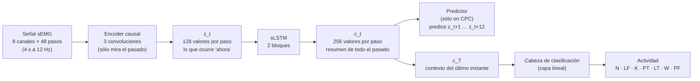
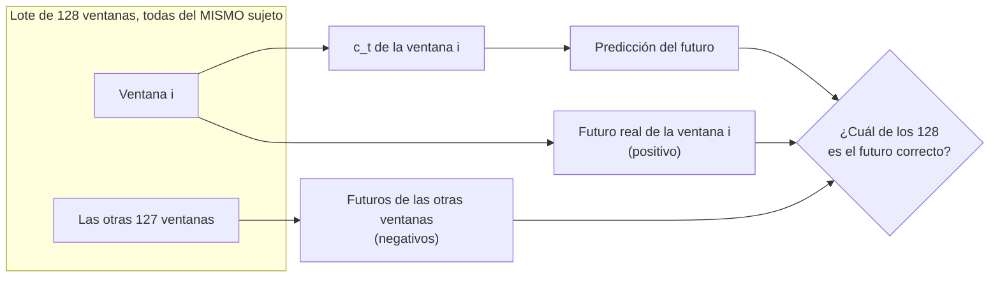
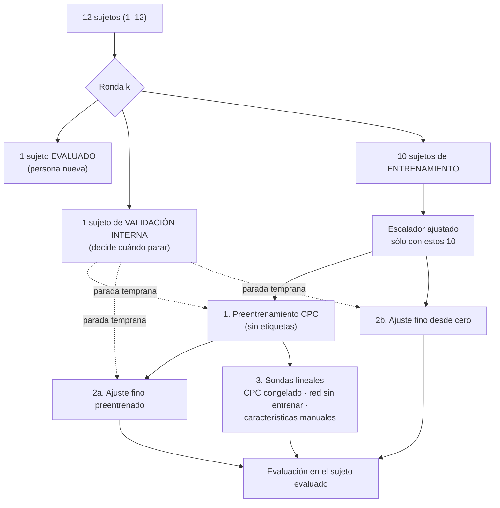
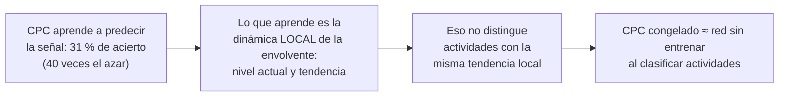

# Resumen: validación cruzada dejando un sujeto fuera (notebook 07)

Notebook: [`notebooks/07_LOSO_CPC_fs12.ipynb`](../notebooks/07_LOSO_CPC_fs12.ipynb)
Ejecución: 13–14 de octubre de 2026 · 24 entrenamientos (12 sujetos × 2 semillas) · 9.7 h en una Mac con Apple Silicon (MPS)

## 1. Qué se quería responder

En el notebook 06 se eligió la mejor configuración de CPC–xLSTM evaluando con **solo dos sujetos de validación** (11 y 12). El desempeño cambia mucho entre personas, así que con dos sujetos no se podía saber cuánto rendiría el modelo con otras personas, ni si diferencias de 0.02–0.03 de F1 entre modelos eran reales.

El notebook 07 **no busca una configuración nueva**: toma la ganadora del 06 y la evalúa con **12 personas**, una a la vez, para responder:

1. ¿Qué desempeño se espera en una **persona nueva**, y cuánto varía entre personas?
2. ¿El **preentrenamiento CPC** mejora de forma consistente, o la ventaja del 06 dependía de los dos sujetos de validación?
3. ¿Cuánto supera el modelo a las **características manuales** y a la misma red **sin entrenar**?
4. ¿Qué sujetos y qué actividades son los más difíciles?

## 2. Datos y configuración

| Elemento | Valor |
|---|---|
| Señal | `Norm_RMS` de 8 canales sEMG (miembro superior), exportada por el Avance 2 |
| Frecuencia | 12 Hz (con filtro antialias); ventanas de 4 s = 48 pasos |
| Etiqueta de cada ventana | La actividad de su **último instante** |
| Sujetos | 1–12 en la validación cruzada; **13 y 14 no se usan** (prueba final, sigue cerrada) |
| Red (`g_ar`) | **sLSTM**, 2 bloques |
| Horizonte de CPC | 1 s (12 pasos de 83 ms) |
| Negativos de InfoNCE | **Del mismo sujeto** (cada lote, de una sola persona) |
| Ventanas de CPC | Recortes aleatorios de la serie continua |
| Representación para clasificar | `c_T`, el contexto del último instante |
| Semillas | 0 y 1 |

## 3. Arquitectura

### 3.1 La red

- El **encoder** describe cada instante a partir de unos pocos pasos (≈ 330 ms).
- La **sLSTM** recorre esos vectores en orden y produce el **contexto** `c_t`, que acumula lo ocurrido desde el inicio de la ventana.
- En el **preentrenamiento CPC**, `c_t` se usa para predecir cómo seguirá la señal; en la **clasificación**, el contexto del último instante (`c_T`) entra a la cabeza que decide la actividad.

### 3.2 Cómo aprende CPC (sin etiquetas)

El modelo debe reconocer el futuro de su propia ventana entre 128 candidatos. Si los candidatos fueran de distintas personas, podría acertar reconociendo **de quién** es la señal en lugar de **qué** está haciendo; por eso todos los candidatos son del mismo sujeto.

### 3.3 Qué pasa en cada ronda

- Cada sujeto es evaluado **una vez** y sirve de validación interna **una vez** (el siguiente de la lista, de forma circular).
- El sujeto evaluado **nunca** influye en el entrenamiento: ni en los pesos, ni en el escalador, ni en la parada temprana.
- Se usan 10 sujetos para entrenar, igual que en el notebook 06, para que los resultados sean comparables.

### 3.4 Los cinco métodos comparados

| Método | Qué es |
|---|---|
| **Ajuste fino preentrenado** | La red completa entrenada con etiquetas, **partiendo de los pesos de CPC** |
| **Ajuste fino desde cero** | La misma red entrenada con etiquetas, **partiendo de pesos aleatorios** (control para medir el aporte de CPC) |
| **CPC congelado (sonda)** | La red preentrenada sin modificar; una regresión logística clasifica a partir de `c_T` |
| **Red sin entrenar (sonda)** | La misma red con pesos aleatorios; misma regresión logística (control para CPC congelado) |
| **Características manuales (sonda)** | Las 202 características del Avance 2 con la misma regresión logística (línea base clásica) |

## 4. Resultados

### 4.1 F1 macro por sujeto (media de las 2 semillas)

| Sujeto | Ajuste fino preentrenado | Ajuste fino desde cero | CPC congelado | Red sin entrenar | Características manuales |
|---|---|---|---|---|---|
| 1 | 0.428 | 0.423 | 0.414 | 0.407 | 0.391 |
| 2 | 0.365 | 0.319 | 0.317 | 0.322 | 0.363 |
| 3 | 0.533 | 0.497 | 0.467 | 0.465 | 0.456 |
| 4 | 0.424 | 0.393 | 0.364 | 0.372 | 0.379 |
| 5 | 0.424 | 0.391 | 0.375 | 0.372 | 0.357 |
| 6 | 0.369 | 0.394 | 0.326 | 0.310 | 0.339 |
| 7 | 0.338 | 0.288 | 0.376 | 0.285 | 0.317 |
| 8 | 0.473 | 0.468 | 0.416 | 0.434 | 0.405 |
| 9 | 0.457 | 0.445 | 0.411 | 0.394 | 0.366 |
| 10 | 0.405 | 0.434 | 0.320 | 0.376 | 0.346 |
| 11 | 0.559 | 0.554 | 0.506 | 0.465 | 0.439 |
| 12 | 0.468 | 0.450 | 0.424 | 0.396 | 0.426 |
| **Media** | **0.437** | 0.421 | 0.393 | 0.383 | 0.382 |
| Desv. entre sujetos | 0.066 | 0.073 | 0.058 | 0.057 | 0.043 |
| Mínimo / máximo | 0.338 / 0.559 | 0.288 / 0.554 | 0.317 / 0.506 | 0.285 / 0.465 | 0.317 / 0.456 |

**Desempeño esperado en una persona nueva: F1 ≈ 0.44 ± 0.07** con el ajuste fino preentrenado.

### 4.2 Comparaciones emparejadas (los mismos 12 sujetos)

| Comparación | Diferencia media | IC 95 % (bootstrap) | Sujetos en que gana | p (Wilcoxon) | Lectura |
|---|---|---|---|---|---|
| Preentrenado − características manuales | **+0.055** | [+0.038, +0.073] | **12 de 12** | 0.0005 | Ventaja robusta |
| Desde cero − características manuales | +0.039 | [+0.014, +0.064] | 10 de 12 | 0.021 | Ventaja robusta |
| Preentrenado − desde cero | +0.016 | [+0.001, +0.029] | 10 de 12 | 0.043 | Ventaja pequeña, en el límite |
| CPC congelado − red sin entrenar | +0.010 | [−0.009, +0.029] | 8 de 12 | 0.38 | Sin diferencia |
| CPC congelado − características manuales | +0.011 | [−0.007, +0.030] | 7 de 12 | 0.42 | Sin diferencia |

### 4.3 F1 por actividad (12 sujetos juntos)

| Método | N | LF | K | PT | LT | W | PF | F1 macro |
|---|---|---|---|---|---|---|---|---|
| Ajuste fino preentrenado | 0.71 | 0.42 | 0.49 | 0.36 | 0.40 | 0.39 | 0.38 | 0.45 |
| Ajuste fino desde cero | 0.72 | 0.39 | 0.44 | 0.35 | 0.41 | 0.39 | 0.34 | 0.43 |
| Características manuales | 0.64 | 0.34 | 0.47 | 0.28 | 0.36 | 0.32 | 0.35 | 0.39 |

Confusiones principales del ajuste fino preentrenado (porcentaje de cada actividad real):

| Actividad real | Acierto | Se confunde sobre todo con |
|---|---|---|
| K (sostener) | 0.68 | — |
| N (neutral) | 0.63 | PF (9 %) |
| LF (levantar del piso) | 0.46 | LT (16 %), N (15 %) |
| PF (colocar en el piso) | 0.46 | K (18 %), N (14 %) |
| LT (levantar de la mesa) | 0.45 | LF (16 %), N (16 %) |
| W (caminar con la carga) | 0.39 | **K (21 %)** |
| PT (colocar en la mesa) | 0.31 | **K (19 %)** |

### 4.4 Variación por azar y coherencia con el notebook 06

- Entre la semilla 0 y la 1, el F1 de un mismo sujeto cambió en promedio **0.028**. Diferencias menores que eso, medidas con una sola semilla, no son distinguibles del azar.
- Los sujetos 11 y 12 dieron 0.559 y 0.468, frente a 0.603 y 0.483 en el notebook 06: valores cercanos y algo menores, como se esperaba al entrenar con otros sujetos y sin haber elegido la configuración con ellos.

### 4.5 ¿Qué tan bien predice CPC la señal? (sección 10 del notebook)

Las secciones anteriores miden la clasificación de actividades. Aquí se mide la **tarea propia de CPC**: reconocer el futuro real de la señal entre 128 candidatos. Se evaluaron los 24 modelos guardados en el **sujeto evaluado** de su ronda, con 40 lotes de 128 recortes aleatorios de ese sujeto (todos los candidatos de la misma persona, como en el entrenamiento).

| | Pérdida InfoNCE | Accuracy (futuro correcto entre 128) |
|---|---|---|
| Azar | 4.85 | 0.8 % |
| Red sin entrenar | 4.87 | 0.8 % |
| **CPC entrenado** | **2.68 ± 0.40** | **31 % ± 10 %** |

Accuracy por horizonte de predicción:

| 83 ms | 167 ms | 250 ms | 333 ms | 500 ms | 750 ms | 1 s |
|---|---|---|---|---|---|---|
| **63 %** | 56 % | 47 % | 38 % | 27 % | 19 % | 16 % |

- **CPC sí aprende su tarea y la generaliza a personas nuevas**: 31 % de acierto frente a 0.8 % del azar; 63 % a 83 ms y todavía 16 % a 1 s (unas 20 veces el azar).
- **Predecir bien la señal no se traduce en clasificar mejor.** La accuracy de CPC por sujeto (de 24 % a 43 %) no se relaciona claramente con el F1 de clasificación (ρ = 0.43, p = 0.17 con el ajuste fino; ρ = 0.15, p = 0.63 con CPC congelado). El sujeto 12 es de los más difíciles de predecir y de los mejor clasificados.
- **Interpretación:** para anticipar los próximos cientos de milisegundos de una envolvente que cambia lentamente basta con información local (nivel y tendencia). CPC aprende muy bien esa "inercia", pero eso no exige saber qué actividad se está haciendo.

## 5. Conclusiones

1. **El desempeño realista en una persona nueva es F1 ≈ 0.44 ± 0.07**, no el 0.556 del notebook 06. Aquella cifra era optimista: el sujeto 11, uno de los dos de validación, resultó ser el más fácil de los 12, y la configuración se había elegido con esos mismos sujetos.
2. **Entrenar la red con la señal supera al enfoque clásico.** El ajuste fino preentrenado gana a las características manuales en los **12 sujetos** (+0.055, p = 0.0005). Es la conclusión más firme del experimento.
3. **El preentrenamiento CPC aporta poco.** Mejora +0.016 y gana en 10 de 12 sujetos, pero el intervalo de confianza apenas excluye el 0 y el efecto es menor que la variación entre semillas. Además, el ajuste fino desde cero usó la misma tasa de aprendizaje baja del preentrenado (pensada para no "borrar" lo aprendido por CPC), lo que podría desfavorecerlo; parte de la ventaja podría deberse a eso.
4. **CPC predice bien la señal, pero eso no lo convierte en una buena representación de actividades.** En su propia tarea acierta el futuro el 31 % de las veces en personas nuevas (40 veces el azar), pero congelado no supera a la misma red sin entrenar al clasificar (p = 0.38): lo que aprende es la dinámica local de la envolvente, que casi no distingue actividades (sección 4.5). Su valor está en servir como punto de partida para el ajuste fino.
5. **La diferencia entre personas domina.** La distancia entre el mejor sujeto (11: 0.56) y el peor (7: 0.34) es unas 10 veces mayor que el efecto del preentrenamiento. Los sujetos 2 y 7 son difíciles con **todos** los métodos, lo que apunta a sus datos y no a un modelo. Ambos tuvieron archivos excluidos en la limpieza (señal saturada en el 7, etiquetas inconsistentes en el 2), una pista que vale la pena revisar.
6. **Las confusiones restantes son de postura y movimiento del cuerpo.** K absorbe a las actividades con carga (W, PT y PF se predicen como K en un 18–21 % de los casos), y LF y LT se confunden entre sí: son actividades en las que los músculos del brazo trabajan de forma parecida y lo que cambia es cómo se mueve el resto del cuerpo.

## 6. Siguientes pasos para cerrar este experimento

- Reportar **F1 ≈ 0.44 ± 0.07** como desempeño esperado en personas nuevas.
- Mantener el preentrenamiento en el modelo final (no empeora y gana en la mayoría de los sujetos), presentándolo como una mejora modesta.
- Opcional: repetir el ajuste fino desde cero con una tasa de aprendizaje más alta para confirmar si la ventaja del preentrenamiento se sostiene.
- Entrenar el modelo final con los 12 sujetos (o usar como ensamble los 24 modelos de las rondas) y **abrir la prueba (sujetos 13–14) una sola vez**.

---

> **Nota — próximos pasos:** el siguiente paso será **explorar los datos de captura de movimiento (MVNX)** que también proporciona el dataset y que hasta ahora no se han utilizado. La sEMG sólo mide el esfuerzo de cuatro músculos del miembro superior; el MVNX registra, con 17 sensores inerciales en todo el cuerpo, la posición, orientación, velocidad y ángulos articulares de cada segmento. Esa información de **postura y movimiento** es justamente la que falta para separar las actividades que hoy se confunden (levantar o colocar en el piso frente a la mesa, caminar frente a sostener). Antes de combinar ambas fuentes habrá que extraer las variables relevantes de los archivos `.mvnx`, remuestrearlas a 12 Hz y **sincronizarlas por eventos con la sEMG**, porque sus relojes no están alineados.
