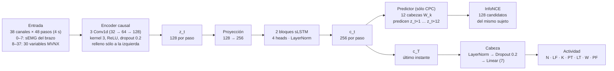
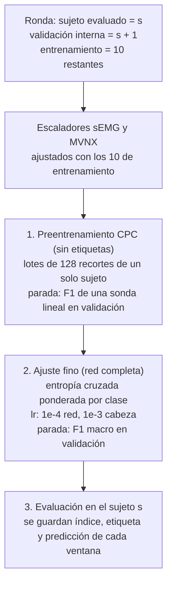

# Resumen: LOSO con sEMG + captura de movimiento (notebook 08)

Notebook: [`notebooks/08_LOSO_CPC_sEMG_MVNX_fs12.ipynb`](../notebooks/08_LOSO_CPC_sEMG_MVNX_fs12.ipynb)
Ejecución: 19 de octubre de 2026 · 12 entrenamientos (12 sujetos × semilla 0) · 3.4 h en una Mac con Apple Silicon (MPS)

## 1. Qué hace

- Toma la **configuración ganadora del 07_LOSO** (sLSTM, horizonte de 1 s, negativos del mismo sujeto, `c_T`, ajuste fino preentrenado) y la reentrena con la **sEMG más 30 variables de captura de movimiento (MVNX)** como entrada.
- Usa la exportación sincronizada del `07_Sincronizacion_sEMG_MVNX.ipynb` (sEMG y MVNX en una rejilla común de 12 Hz).
- Evalúa con el mismo **LOSO** del 07: 12 rondas, en cada una un sujeto se evalúa, otro decide la parada temprana y 10 entrenan. Los sujetos 13 y 14 no se usan.
- Compara sujeto por sujeto con la **sEMG sola**, usando las predicciones guardadas del 07_LOSO, filtradas a los mismos ensayos, sin reentrenar.

## 2. Preparación de los datos

| Paso | Qué se hace | Por qué |
|---|---|---|
| Ensayos por brazo | Cada ensayo bimanual (16 canales sEMG) se parte en dos ensayos de 8 canales, uno por brazo, que comparten el MVNX | Mantener la entrada de 8 canales sEMG del 07_LOSO |
| Selección | De 782 columnas MVNX se quedan 30 variables | Las 782 son redundantes (el 55 % tiene \|r\| > 0.95 con otra), algunas dependen del laboratorio y 24 tienen NaN |
| Relativas al cuerpo | Se usan alturas, distancias a la pelvis y normas de velocidad; no la posición x–y ni las orientaciones globales | La posición y el rumbo dependen del lugar en el laboratorio, no de la actividad |
| Ipsi / contra | Las variables de extremidades se ordenan respecto al brazo con sEMG: **ipsi** = mismo lado, **contra** = lado opuesto | El mismo canal significa lo mismo sea cual sea el brazo que hace la tarea |
| Escalado (reajustado en cada ronda) | **sEMG:** recorte en q0.1–q99.9 %, `log1p`, (x − mediana) / IQR, igual que el 07. **MVNX:** recorte en q0.1–q99.9 %, (x − mediana) / (q95 − q5). **Contactos:** sin cambio | La sEMG es muy asimétrica. En MVNX, varias velocidades tienen un IQR ≈ 0 y escalarían hasta ±289 |
| Ventanas | 48 pasos (4 s); CPC cada 24 pasos; supervisadas cada 6, con la etiqueta sEMG del instante final | Las mismas reglas del 07_LOSO |

Resultado: **627 ensayos por brazo**, 426 026 instantes, **38 canales** (8 sEMG + 30 MVNX) y 51 814 ventanas supervisadas de los sujetos 1–12 (alrededor del 98 % de las del 07_LOSO).

## 3. Las 30 variables MVNX

**Ipsi** es el lado del brazo con sEMG y **contra** el lado opuesto (por ejemplo, con sEMG izquierda, `ipsi_*` lee las columnas `Left*`). Las columnas son las de la exportación MVNX de Xsens. En los ángulos, `c1`, `c2` y `c3` son las tres componentes de la secuencia de Euler; `c3` es la flexión/extensión.

### Ángulos articulares (14) — copia directa, en grados

| # | Variable | Columna MVNX |
|---|---|---|
| 1 | `tronco_flexion` | `jointAngle__jL5S1__c3` |
| 2 | `cuello_flexion` | `jointAngle__jC1Head__c3` |
| 3–4 | `ipsi_hombro_flexion`, `contra_hombro_flexion` | `jointAngleXZY__j{Lado}Shoulder__c3` |
| 5–6 | `ipsi_hombro_abduccion`, `contra_hombro_abduccion` | `jointAngleXZY__j{Lado}Shoulder__c1` |
| 7–8 | `ipsi_codo_flexion`, `contra_codo_flexion` | `jointAngle__j{Lado}Elbow__c3` |
| 9–10 | `ipsi_muneca_flexion`, `contra_muneca_flexion` | `jointAngle__j{Lado}Wrist__c3` |
| 11–12 | `ipsi_cadera_flexion`, `contra_cadera_flexion` | `jointAngle__j{Lado}Hip__c3` |
| 13–14 | `ipsi_rodilla_flexion`, `contra_rodilla_flexion` | `jointAngle__j{Lado}Knee__c3` |

Los hombros usan la secuencia **XZY**: con la ZXY habitual, los ángulos se vuelven inestables cerca de 90° de elevación del brazo (bloqueo de cardán). La flexión T9T8 del tronco se descartó porque es idéntica a la L5S1 (r = 1.00).

### Alturas y alcance (6) — en metros

| # | Variable | Origen | Cálculo |
|---|---|---|---|
| 15 | `pelvis_altura` | `position__Pelvis__z` | Copia directa (altura sobre el suelo) |
| 16 | `cabeza_altura` | `position__Head__z` | Copia directa |
| 17–18 | `ipsi_mano_altura`, `contra_mano_altura` | `position__{Lado}Hand__z` | Copia directa |
| 19–20 | `ipsi_mano_alcance`, `contra_mano_alcance` | `position__{Lado}Hand__x,y` y `position__Pelvis__x,y` | Distancia horizontal mano–pelvis: √((x_mano − x_pelvis)² + (y_mano − y_pelvis)²) |

### Velocidades (6)

| # | Variable | Unidad | Origen | Cálculo |
|---|---|---|---|---|
| 21 | `pelvis_vel_horizontal` | m/s | `velocity__Pelvis__x,y` | Norma horizontal: √(vx² + vy²) |
| 22 | `pelvis_vel_vertical` | m/s | `velocity__Pelvis__z` | Copia directa (con signo: sube o baja) |
| 23–24 | `ipsi_mano_rapidez`, `contra_mano_rapidez` | m/s | `velocity__{Lado}Hand__x,y,z` | Norma 3D: √(vx² + vy² + vz²) |
| 25 | `pelvis_giro` | rad/s | `angularVelocity__Pelvis__z` | Valor absoluto: \|ωz\| (cuánto gira, sin importar hacia dónde) |
| 26 | `tronco_vel_angular` | rad/s | `angularVelocity__T8__x,y,z` | Norma 3D: √(ωx² + ωy² + ωz²) |

### Contactos con el suelo (4) — 0/1, copia directa

| # | Variable | Columna MVNX |
|---|---|---|
| 27–28 | `ipsi_talon`, `contra_talon` | `footContacts__{Lado}Foot_Heel` |
| 29–30 | `ipsi_punta`, `contra_punta` | `footContacts__{Lado}Foot_Toe` |

### Descartadas

| Campo MVNX | Motivo |
|---|---|
| `acceleration`, `angularAcceleration` | Derivadas de las velocidades: redundantes y más ruidosas |
| `sensorFreeAcceleration`, `sensorOrientation` | Redundantes con la cinemática de los segmentos |
| `sensorMagneticField` | Depende del entorno magnético |
| `orientation` (cuaterniones) | Globales: dependen del rumbo; la postura relativa ya está en los ángulos |
| `centerOfMass` | Su altura es casi igual a la de la pelvis (r = 0.98) |
| `jointAngleErgo*` | NaN en los sujetos 1, 11 y 13; redundante con `jointAngle` |
| `position` x, y absolutas | Dependen del lugar en el laboratorio |

## 4. Arquitectura

### 4.1 La red

- Es la misma red del 07_LOSO. **Lo único que cambia es la primera convolución**, que recibe 38 canales en lugar de 8.
- Toda la red es **causal**: `c_t` solo depende de los instantes ≤ t. Se verifica en la sección 7 del notebook.

### 4.2 Entrenamiento de cada ronda

## 5. Resultados

| | sEMG sola (07_LOSO) | sEMG + MVNX (08) |
|---|---|---|
| F1 macro, media de 12 sujetos | 0.433 | **0.880** |
| Desviación entre sujetos | 0.063 | 0.029 |
| Peor sujeto | 0.334 | 0.807 |

- **Diferencia:** +0.447 (IC 95 % [+0.411, +0.480]). Mejora en **12 de 12** sujetos, con p de Wilcoxon = 0.0005.
- **Por actividad:** todas suben a 0.82–0.94. Las que más mejoran son W (+0.57) y PF (+0.52).
- **Por tarea:** MMH_One 0.896, MMH_Bim 0.883 e **Isokin 0.664**, el punto débil.
- **Ensayos marcados por la sincronización:** rinden igual (0.886 contra 0.883 en los no marcados), así que la mejora no depende de posibles errores de alineación.

**Nota (notebook 09):** con **MVNX sola**, sin sEMG, el F1 es 0.885, igual al de sEMG + MVNX (diferencia −0.006, IC [−0.012, +0.000]). Con la fusión temprana, toda la mejora viene del movimiento.
