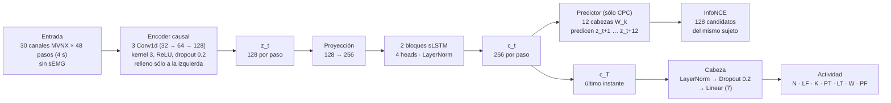
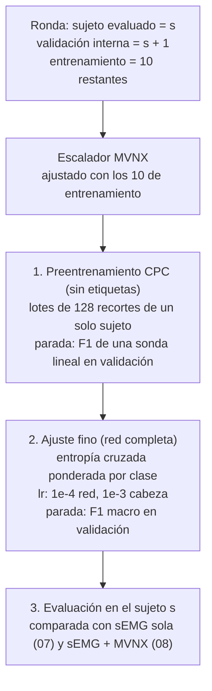

# Resumen: LOSO con captura de movimiento (MVNX) sola (notebook 09)

Notebook: [`notebooks/09_LOSO_CPC_MVNX_fs12.ipynb`](../notebooks/09_LOSO_CPC_MVNX_fs12.ipynb)
Ejecución: 19–20 de octubre de 2026 · 12 entrenamientos (12 sujetos × semilla 0) · 3.2 h en una Mac con Apple Silicon (MPS)

## 1. Qué hace

- En el notebook 08, agregar 30 variables MVNX a la sEMG subió el F1 macro de 0.433 a 0.880. El 09 responde **de dónde viene esa mejora**: entrena el **mismo modelo con solo las 30 variables MVNX**, sin sEMG.
- Usa la misma configuración (sLSTM, horizonte de 1 s, negativos del mismo sujeto, `c_T`, ajuste fino preentrenado), las mismas 12 rondas LOSO y la misma semilla. Los sujetos 13 y 14 no se usan.
- Compara tres modelos en los mismos sujetos:
  - **sEMG sola:** las predicciones del 07_LOSO, filtradas a los ensayos sincronizados;
  - **MVNX sola:** este notebook;
  - **sEMG + MVNX:** las predicciones guardadas del 08.
- Las ventanas evaluadas son **idénticas a las del 08**, lo que se verifica ronda por ronda. La comparación con el 08 es ventana por ventana.

## 2. Preparación de los datos

Es la misma del 08: ensayos por brazo, 30 variables relativas al cuerpo y ordenamiento ipsi/contra. Al final se **descarta la sEMG**:

| Paso | Qué se hace |
|---|---|
| Ensayos | Los mismos 627 ensayos por brazo del 08. Los bimanuales siguen partidos en dos, aunque sin sEMG los dos tienen el mismo MVNX (solo cambia el orden ipsi/contra), para que las ventanas coincidan con las del 08 |
| Entrada | **30 canales** MVNX; sin sEMG |
| Etiqueta | La etiqueta **sEMG** del instante final de cada ventana, la misma del 07_LOSO y el 08 |
| Escalado (reajustado en cada ronda) | Recorte en q0.1–q99.9 %, luego (x − mediana) / (q95 − q5); contactos sin cambio |
| Ventanas | 48 pasos (4 s); CPC cada 24 pasos; supervisadas cada 6. Son 51 814 ventanas supervisadas de los sujetos 1–12 |

Los gráficos de antes y después de cada transformación están en la sección 3 del 08.

## 3. Las 30 variables MVNX

**Ipsi** es el lado del brazo con sEMG (el brazo que hace la tarea) y **contra** el lado opuesto. `{Lado}` es `Left` o `Right` según el caso. En los ángulos, `c3` es la flexión/extensión y `c1` la abducción/aducción.

| # | Variable | Unidad | Origen (columna MVNX) | Cálculo |
|---|---|---|---|---|
| 1 | `tronco_flexion` | ° | `jointAngle__jL5S1__c3` | Copia directa |
| 2 | `cuello_flexion` | ° | `jointAngle__jC1Head__c3` | Copia directa |
| 3–4 | `ipsi/contra_hombro_flexion` | ° | `jointAngleXZY__j{Lado}Shoulder__c3` | Copia directa (secuencia XZY, que evita el bloqueo de cardán del hombro) |
| 5–6 | `ipsi/contra_hombro_abduccion` | ° | `jointAngleXZY__j{Lado}Shoulder__c1` | Copia directa |
| 7–8 | `ipsi/contra_codo_flexion` | ° | `jointAngle__j{Lado}Elbow__c3` | Copia directa |
| 9–10 | `ipsi/contra_muneca_flexion` | ° | `jointAngle__j{Lado}Wrist__c3` | Copia directa |
| 11–12 | `ipsi/contra_cadera_flexion` | ° | `jointAngle__j{Lado}Hip__c3` | Copia directa |
| 13–14 | `ipsi/contra_rodilla_flexion` | ° | `jointAngle__j{Lado}Knee__c3` | Copia directa |
| 15 | `pelvis_altura` | m | `position__Pelvis__z` | Copia directa |
| 16 | `cabeza_altura` | m | `position__Head__z` | Copia directa |
| 17–18 | `ipsi/contra_mano_altura` | m | `position__{Lado}Hand__z` | Copia directa |
| 19–20 | `ipsi/contra_mano_alcance` | m | `position__{Lado}Hand__x,y`, `position__Pelvis__x,y` | √((x_mano − x_pelvis)² + (y_mano − y_pelvis)²) |
| 21 | `pelvis_vel_horizontal` | m/s | `velocity__Pelvis__x,y` | √(vx² + vy²) |
| 22 | `pelvis_vel_vertical` | m/s | `velocity__Pelvis__z` | Copia directa (con signo) |
| 23–24 | `ipsi/contra_mano_rapidez` | m/s | `velocity__{Lado}Hand__x,y,z` | √(vx² + vy² + vz²) |
| 25 | `pelvis_giro` | rad/s | `angularVelocity__Pelvis__z` | \|ωz\| |
| 26 | `tronco_vel_angular` | rad/s | `angularVelocity__T8__x,y,z` | √(ωx² + ωy² + ωz²) |
| 27–28 | `ipsi/contra_talon` | 0/1 | `footContacts__{Lado}Foot_Heel` | Copia directa |
| 29–30 | `ipsi/contra_punta` | 0/1 | `footContacts__{Lado}Foot_Toe` | Copia directa |

Lo descartado y el motivo de cada descarte están en el resumen del notebook 08.

## 4. Arquitectura

### 4.1 La red

Es la misma red del 07_LOSO y el 08. Lo único que cambia es que la primera convolución recibe **30 canales**: eran 8 en el 07 y 38 en el 08.

### 4.2 Entrenamiento de cada ronda

## 5. Resultados

| | sEMG sola (07_LOSO) | **MVNX sola (09)** | sEMG + MVNX (08) |
|---|---|---|---|
| F1 macro, media de 12 sujetos | 0.433 | **0.885** | 0.880 |
| Desviación entre sujetos | 0.063 | 0.033 | 0.029 |
| Peor sujeto | 0.334 | 0.794 | 0.807 |

| Comparación | Diferencia | IC 95 % | Gana en | p (Wilcoxon) |
|---|---|---|---|---|
| MVNX sola − sEMG sola | +0.452 | [+0.416, +0.487] | 12 de 12 | 0.0005 |
| **sEMG + MVNX − MVNX sola** | **−0.006** | **[−0.012, +0.000]** | **4 de 12** | **0.15** |

- **Por actividad:** el aporte de la sEMG sobre MVNX va de −0.018 a +0.008 en las siete actividades; ninguna mejora con sEMG.
- **Por tarea:**

  | Tarea | MVNX sola | sEMG + MVNX |
  |---|---|---|
  | Isokin | 0.684 | 0.664 |
  | MMH_One | 0.896 | 0.896 |
  | MMH_Bim | 0.889 | 0.883 |

  Los isocinéticos siguen siendo el punto débil, y la sEMG tampoco ayuda ahí.
- **Ensayos marcados por la sincronización:** rinden igual que los no marcados (0.883 contra 0.890).

## 6. Conclusiones

- **Toda la mejora del 08 viene del movimiento.** MVNX sola y sEMG + MVNX rinden igual: la diferencia (~0.006) es menor que la variación típica entre semillas del 07_LOSO (~0.028).
- **Con la fusión temprana, la sEMG no aporta.** No significa que la sEMG no tenga información (por sí sola llega a 0.43, muy por encima del azar), sino que esa información ya está en el movimiento o que esta arquitectura no la aprovecha.
- **Antes de decidir la integración, faltan tres cosas:**
  1. probar una **fusión tardía**, con un encoder por modalidad y concatenación de los `c_T`, o un *dropout* por modalidad, para ver si la sEMG aporta cuando no compite con MVNX en la misma capa;
  2. analizar los **isocinéticos**, la única tarea con margen claro de mejora;
  3. agregar la **semilla 1**.
- **Una limitación para el uso real.** El ordenamiento ipsi/contra necesita saber qué brazo hace la tarea, y sin sEMG ese dato sale de los metadatos del ensayo. Si se elige MVNX sola, conviene compararlo con variables izquierdo/derecho o simétricas, que no necesitan ese dato.
