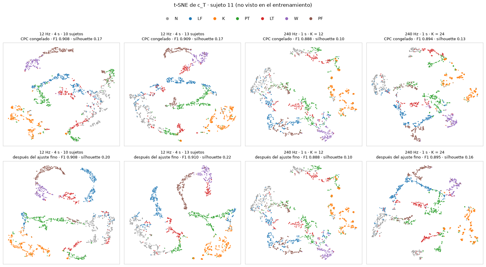

# Resumen: CPC-GRU con las 10 variables de Bassani et al. (2025) (notebook 12)

Notebook: [`notebooks/12_LOSO_CPC_GRU_variables_articulo_fs12.ipynb`](../notebooks/12_LOSO_CPC_GRU_variables_articulo_fs12.ipynb)
Ejecución: 9–12 de noviembre de 2026 · cinco corridas, todas con la semilla 0 · Mac con Apple Silicon (MPS)

Artículo de referencia: Bassani, Avizzano y Filippeschi (2025), *Deep Learning Algorithms for Human Activity Recognition in Manual Material Handling Tasks*, Sensors 25(21):6705 ([PMC12610047](https://pmc.ncbi.nlm.nih.gov/articles/PMC12610047/)). Usa **el mismo dataset** y las mismas 7 actividades, con sólo **10 señales**, y reporta un F1 de **0.903 en el sujeto 11** (BiLSTM entrenada con 13 sujetos).

## Takeaways principales

1. **Las 10 variables del artículo bastan.** Con 2 sEMG + 8 de movimiento, el CPC-GRU da el mismo F1 que con las 30 variables MVNX del proyecto: **0.880 frente a 0.878** (+0.002 [−0.009, +0.012]). Es un tercio de las variables con el mismo desempeño.
2. **Estamos en el nivel del artículo.** En el sujeto 11, con 13 sujetos de entrenamiento como el artículo, obtenemos **0.910 frente a 0.903**. Con una sola persona y una semilla, eso dice que alcanzamos el nivel, no que lo superemos. La mejor estimación es la **media de los 14 sujetos: 0.883 ± 0.033**, un dato que el artículo no reporta.
3. **El cabezal lineal es suficiente.** El MLP empata con el lineal, con o sin ajuste fino (diferencias de −0.000 y −0.001). `c_T` ya es linealmente separable. Se recomienda el lineal: es el del artículo y tiene ~1 800 parámetros frente a ~100 000.
4. **El ajuste fino sí ayuda: +0.020** sobre la regresión logística con el CPC congelado (gana en 11 de 12 sujetos), siempre que arranque desde la regresión logística.
5. **Más sujetos ya no ayudan.** La curva de aprendizaje sube de 4 a 10 sujetos (0.826 → 0.880) y luego se aplana: con 12 y 13 sujetos el ajuste fino da 0.882 y 0.879.
6. **La escala temporal del artículo no mejora el modelo.** A 240 Hz con ventanas de 1 s se obtiene 0.854 (K = 12) y 0.874 (K = 24), frente a 0.883 a 12 Hz con ventanas de 4 s, y cuesta mucho más. **Se mantiene 12 Hz con 4 s.**
7. **El submuestreo de `N` no mejora** frente a los pesos por clase (−0.008 con el ajuste fino lineal).
8. **La t-SNE de `c_T` confirma el orden de los modelos.** En el sujeto 11, la separación de las actividades sigue el mismo orden que el F1, y el CPC agrupa las actividades incluso sin etiquetas. `PT`, `LT` y `N` son las que se mezclan.
9. **Los sujetos reservados 13 y 14 generalizan** (0.902 y 0.913). El diseño se eligió sólo con los sujetos 1–12, así que esta fue la prueba final; desde ahora ya no son una prueba limpia.

**Configuración recomendada:** CPC-GRU con las 10 variables del artículo, a 12 Hz con ventanas de 4 s; ajuste fino con cabezal lineal que arranca de la regresión logística, y pesos por clase. F1 macro **0.883 ± 0.033** en LOSO con los 14 sujetos (13 de entrenamiento).

## 1. Las preguntas

| # | Pregunta | Sección del notebook | Respuesta corta |
|---|---|---|---|
| 1 | ¿Funciona el CPC-GRU con las 10 variables del artículo tan bien como con las 30 del proyecto? | 6–8 | **Sí:** 0.880 frente a 0.878 |
| 2 | Sobre `c_T`, ¿un MLP clasifica mejor que un clasificador lineal? | 6–8 | **No:** empatan |
| 3 | ¿Ayudarían más sujetos de entrenamiento? | 9 | Hasta 10 sí; después, no |
| 4 | Con 13 sujetos de entrenamiento como el artículo, ¿cómo queda el sujeto 11? | 10 | **0.910 frente a 0.903** |
| 5 | ¿Y con la frecuencia y la ventana del artículo (240 Hz, 1 s)? | 11 | No mejora: 0.874 en el mejor caso |
| 6 | ¿Qué aprendió cada modelo? (t-SNE de `c_T`) | 12 | La separación sigue el orden del F1; `PT`, `LT` y `N` se mezclan |

## 2. Las 10 variables

El artículo describe las variables en la sección 3.1 sin nombrar columnas ni canales. Para no adivinar, cada variable se comparó con el archivo de entrada que publican los autores para el sujeto 11 (`11.mat`). Todas coinciden con correlación ≥ 0.989.

| # | Variable | Cálculo | Coincidencia con `11.mat` |
|---|---|---|---|
| 1 | `biceps_rms` | sEMG RMS, canal 8 | 0.997–0.998 |
| 2 | `braquiorradial_rms` | sEMG RMS, canal 4 | 0.989–0.998 |
| 3 | `pecho_flexion` | `jointAngle__jL5S1__c3` | 1.000 |
| 4 | `hombro_flexion` | `jointAngle__j{brazo}Shoulder__c3` | 1.000 |
| 5 | `codo_flexion` | `jointAngle__j{brazo}Elbow__c3` | 1.000 |
| 6 | `rodilla_flexion` | `jointAngle__jRightKnee__c3` (siempre la derecha) | 1.000 |
| 7 | `mano_posicion_frontal` | Posición de la mano respecto a la pelvis, eje frontal de la pelvis | 1.000 |
| 8 | `mano_aceleracion_frontal` | Aceleración de la mano, eje frontal de la pelvis | 0.998 |
| 9 | `pelvis_vel_horizontal` | √(vx² + vy²) de la pelvis | 0.999 |
| 10 | `pelvis_altura` | `position__Pelvis__z` | 1.000 |

## 3. Protocolo

| Elemento | Decisión |
|---|---|
| Ensayos | Los del notebook 08: 627 ensayos por brazo (cada bimanual se parte en dos) |
| Etiqueta | `label_mvnx` del instante final de la ventana |
| Ventanas | 4 s (48 pasos a 12 Hz); una etiquetada cada 0.5 s |
| Modelo | Encoder causal Conv1d (32/64/128) + **GRU** de 2 capas (256); CPC con horizontes de 1 a 12 pasos (1 s) y negativos del mismo sujeto |
| Cabezal | Lineal sobre `c_T` (el último estado del GRU) |
| Ajuste fino | LP-FT: primero la regresión logística sobre el CPC congelado; luego se copia a la capa lineal y se ajusta toda la red |
| Balanceo | Pesos por clase en la pérdida |
| Evaluación | LOSO: cada ronda evalúa un sujeto que el modelo no vio. Se reporta el F1 macro por sujeto (media, desviación y peor sujeto) |
| Selección de valores | Un sujeto de **validación interna** (el siguiente de la lista) elige la época del CPC, la `C` de la regresión logística y la época del ajuste fino. El sujeto evaluado no participa en ninguna decisión |
| Comparaciones | Emparejadas por sujeto: diferencia media con IC 95 % bootstrap y prueba de Wilcoxon |

Dos protocolos de LOSO:
- **Secciones 6–9:** sujetos 1–12; 10 de entrenamiento + 1 de validación interna. Los sujetos 13 y 14 quedaron reservados.
- **Secciones 10–11, como el artículo:** los 14 sujetos, 13 de entrenamiento. Primero se eligen los valores con 12 sujetos + 1 de validación; luego se reentrena con los 13 con esos valores fijos.

## 4. Resultados de las rondas principales (sujetos 1–12, 10 de entrenamiento)

| Variante | Media | Desv. | Peor sujeto |
|---|---|---|---|
| CPC congelado · regresión logística | 0.860 | 0.034 | 0.790 |
| CPC congelado · MLP | 0.860 | 0.027 | 0.795 |
| **Ajuste fino · lineal** | **0.880** | 0.033 | 0.796 |
| Ajuste fino · MLP | 0.879 | 0.034 | 0.795 |

- **10 frente a 30 variables:** +0.002 [−0.009, +0.012], p = 0.57.
- **MLP − lineal:** −0.000 (congelado) y −0.001 (ajuste fino), p = 0.97 en ambos.
- **Ajuste fino − regresión logística:** +0.020 [+0.010, +0.032], gana en 11 de 12 (p = 0.001).
- **Submuestreo de `N` − pesos:** −0.008 [−0.016, −0.000] con el ajuste fino lineal.
- **Actividades difíciles:** las de la mesa, `PT` (0.838) y `LT` (0.849).

## 5. Cantidad de sujetos (secciones 9 y 10)

| Sujetos de entrenamiento | 4 | 6 | 8 | 10 | 12 | 13 |
|---|---|---|---|---|---|---|
| Ajuste fino · lineal (sujetos 1–12) | 0.826 | 0.852 | 0.868 | 0.880 | 0.882 | 0.879 |
| CPC congelado · regresión logística | 0.807 | 0.840 | 0.846 | 0.860 | 0.870 | 0.871 |

- La ganancia por cada 2 sujetos baja de +0.026 a +0.016, luego +0.012, y finalmente a cero. **13 − 10 = −0.001** (p = 0.85) con el ajuste fino.
- La regresión logística sí sigue subiendo (+0.011, p = 0.016), pero el ajuste fino ya obtenía esa ganancia con 10 sujetos.
- **LOSO con los 14 sujetos (13 de entrenamiento):** 0.883 ± 0.033 con ajuste fino lineal; 0.873 con regresión logística.

**Sujeto 11 frente al artículo**, F1 por actividad:

| | N | LF | K | PT | LT | W | PF | F1 macro |
|---|---|---|---|---|---|---|---|---|
| Este notebook (12 Hz, 13 sujetos) | 0.960 | 0.864 | 0.951 | 0.868 | 0.905 | 0.904 | 0.916 | **0.910** |
| Artículo (BiLSTM, Tabla 4) | 0.891 | 0.903 | 0.923 | 0.840 | 0.945 | 0.934 | 0.888 | 0.903 |

Somos mejores en `N`, `K`, `PT` y `PF`, y peores en `LF`, `LT` y `W`. El sujeto 11 es de los fáciles para este modelo: con 10 sujetos ya daba 0.908.

## 6. La escala temporal del artículo: 240 Hz con ventanas de 1 s (sección 11)

Es el mismo LOSO con 14 sujetos de la sección 10, pero con ventanas de 1 s a 240 Hz, como el artículo. El encoder reduce de 240 a 24 Hz, y el CPC se preentrena con tramos de 4 s. Se probaron dos horizontes de predicción del CPC: **K = 12** (0.5 s) y **K = 24** (1 s).

| Escala | Regresión logística | Ajuste fino · lineal | Frente a 12 Hz (ajuste fino) | Sujeto 11 |
|---|---|---|---|---|
| **12 Hz · 4 s** | 0.873 | **0.883** | — | **0.910** |
| 240 Hz · 1 s · K = 12 | 0.833 | 0.854 | −0.029 [−0.055, −0.009], p = 0.009 | 0.888 |
| 240 Hz · 1 s · K = 24 | 0.864 | 0.874 | −0.009 [−0.019, +0.002], p = 0.15 | 0.895 |

- **K = 24 es mejor que K = 12:** +0.030 con la regresión logística, en los 14 sujetos. Además, K = 24 tiene la menor dispersión entre sujetos de todo el notebook (0.026).
- **Ninguna versión supera a 12 Hz con 4 s.** Con K = 24 la pérdida es pequeña y no está establecida, pero tampoco hay ganancia.
- **`W` (caminar) empeora en el sujeto 11:** 0.82–0.84 frente a 0.904 a 12 Hz. Esperábamos que la aceleración de la mano a 240 Hz la mejorara y no fue así.
- La comparación cambia a la vez la frecuencia y la longitud de la ventana. Lo más probable es que pese más perder contexto (1 s frente a 4 s).
- **Costo:** ~8.6 min por ronda con K = 12 y ~14 min con K = 24; la corrida completa tardó 5.1 h.

## 7. Representaciones `c_T` con t-SNE (sección 12)

La t-SNE convierte cada `c_T` (256 números por ventana) en un punto de un plano, de modo que las ventanas parecidas queden cerca. Se aplicó a los cuatro modelos en el **sujeto 11**, que ninguno vio durante el entrenamiento. Hay dos filas: el CPC congelado (sin etiquetas) y la red después del ajuste fino. No se entrenó ningún modelo nuevo; sólo se cargaron los guardados.

La posición y la distancia entre grupos no se comparan de un panel a otro. Por eso la separación también se mide en las 256 dimensiones originales:

| Modelo | F1 ajuste fino | Silhouette (congelado → ajuste fino) | Vecinos de la misma actividad (congelado → ajuste fino) |
|---|---|---|---|
| 12 Hz · 4 s · 10 sujetos | 0.908 | 0.165 → 0.203 | 0.848 → 0.878 |
| **12 Hz · 4 s · 13 sujetos** | **0.910** | **0.172 → 0.219** | **0.871 → 0.899** |
| 240 Hz · 1 s · K = 12 | 0.888 | 0.101 → 0.101 | 0.794 → 0.794 |
| 240 Hz · 1 s · K = 24 | 0.895 | 0.129 → 0.160 | 0.835 → 0.862 |

**Silhouette** (de −1 a 1) mide qué tan separados están los grupos. **Vecinos** es la fracción de las 10 ventanas más cercanas que tienen la misma actividad.

- **La separación sigue el mismo orden que el F1:** 12 Hz con 13 sujetos > 12 Hz con 10 > 240 Hz con K = 24 > 240 Hz con K = 12.
- **El CPC sin etiquetas ya agrupa las actividades.** `K`, `PF` y `W` quedan casi aisladas en todos los modelos.
- **El ajuste fino compacta los grupos**, sobre todo `LT` (0.76 → 0.84 de vecinos) y `PT`.
- **`LT`, `PT` y `N` son las que se mezclan**, igual que en la matriz de confusión, y la mezcla es mayor a 240 Hz.
- **A 12 Hz los grupos son trayectorias continuas; a 240 Hz, trozos sueltos.** Las ventanas de 4 s se traslapan y comparten contexto; las de 1 s no.
- **De 10 a 13 sujetos el F1 casi no cambia, pero la representación congelada mejora:** `N` pasa de 0.82 a 0.89 de vecinos.

**Nota técnica.** En las secciones 10 y 11, lo guardado como CPC congelado de 13 sujetos (`cpc_13`) es en realidad el CPC después del ajuste fino, porque los dos comparten capas. Los F1 reportados no cambian. Para la t-SNE se volvió a preentrenar ese CPC del sujeto 11, con las mismas épocas y semilla, y reproduce el 100 % de las predicciones de la regresión logística guardada.

## 8. Limitaciones

- **Una sola semilla** (0) en todo el notebook. Las diferencias de ±0.01 necesitan más semillas para confirmarse.
- **Un solo sujeto de validación interna** por ronda para elegir épocas y `C`. Es barato, pero la elección es ruidosa; probablemente explica rondas como el sujeto 10 con K = 12 (0.738).
- **La comparación con el artículo es en un solo sujeto** (el 11), con otro modelo (BiLSTM), otra escala temporal y otro balanceo.
- **Los sujetos 13 y 14 ya se usaron** como prueba final (sección 10). Cualquier cambio de diseño posterior debe evaluarse con LOSO sobre los 14 o con personas nuevas.

## 9. Siguientes pasos

1. **Aporte de la sEMG:** las 8 variables de movimiento solas, frente a las 10.
2. **Más semillas** para confirmar las diferencias pequeñas.
3. **Separar frecuencia y ventana**, si se quiere explicar por qué 240 Hz no ayuda: 240 Hz con ventanas de 4 s, o 12 Hz con ventanas de 1 s.
