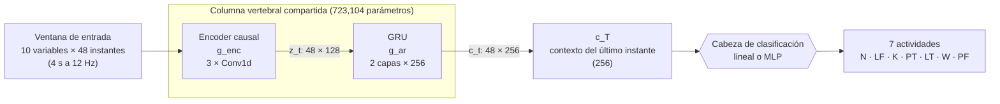
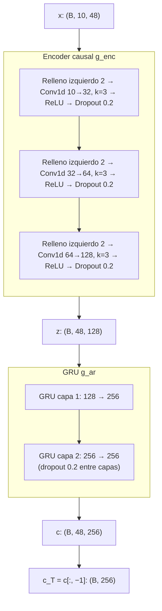
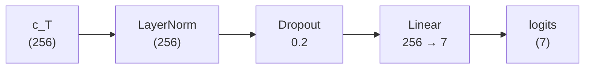
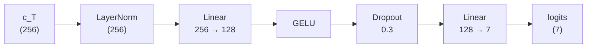
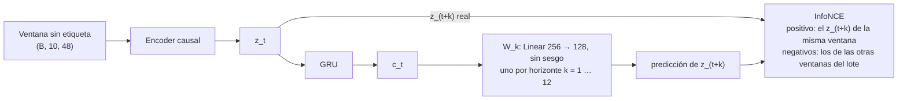
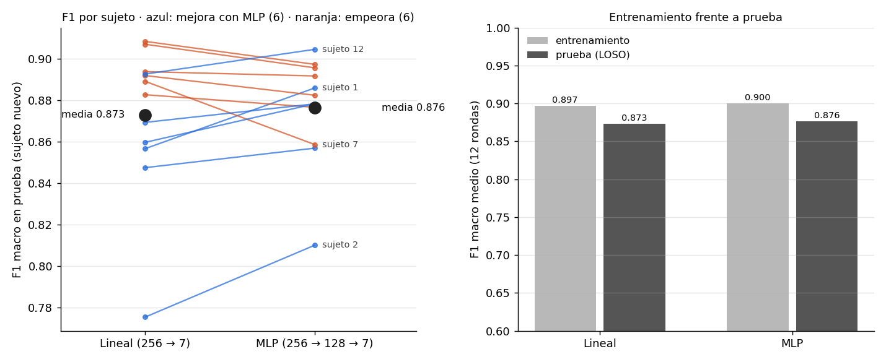

# Notebook 14: cabeza lineal contra cabeza MLP en CPC-GRU

> Documento en construcción. Contiene las arquitecturas que se compararon en [14_LOSO_cabeza_mlp_fs12.ipynb](../notebooks/14_LOSO_cabeza_mlp_fs12.ipynb) (secciones 1–6) y los resultados de la clasificación (sección 7).

**Qué se compara:**

- **Un único cambio:** se compararon dos modelos CPC-GRU que difieren solo en la **cabeza de clasificación**, la parte que convierte la representación de la ventana en una de las 7 actividades.
- **Mismas variables:** las 10 variables del subconjunto `EML` (codos, manos y piernas, 11 sensores).
- **Mismos pesos:** ambas cabezas parten de los mismos pesos CPC preentrenados en el notebook 11.

## 1. Vista general

**Tres piezas:**

- **Encoder causal (g_enc):**
  - Convierte cada instante en un vector `z_t` de 128 dimensiones.
  - Es causal: solo mira el instante actual y los anteriores.
- **GRU (g_ar):**
  - Resume la secuencia `z_1 … z_t` en un contexto `c_t` de 256 dimensiones.
  - Para clasificar se usa solo `c_T`, el contexto del **último instante** de la ventana.
- **Cabeza:** asigna la actividad a partir de `c_T`. Es la **única parte que cambia** entre los dos modelos.

## 2. Columna vertebral: encoder causal + GRU

| Bloque | Capas | Salida | Parámetros |
|---|---|---|---|
| Encoder causal | 3 × (Conv1d k=3 + ReLU + Dropout 0.2) | 48 × 128 | 31,904 |
| GRU | 2 capas, 256 unidades | 48 × 256 | 691,200 |
| **Total columna vertebral** | | | **723,104** |

- **Relleno solo a la izquierda:** cada convolución rellena 2 instantes a la izquierda, así que `z_t` nunca usa instantes futuros. Esto es lo que permite que CPC prediga el futuro sin "verlo".
- **Campo receptivo:** cada `z_t` combina 7 instantes (≈ 0.6 s). La GRU acumula el resto de la ventana.

## 3. Las dos cabezas que se compararon

**Cabeza lineal** (notebooks 10 y 11, 2,311 parámetros):

**Cabeza MLP** (notebook 14, 34,311 parámetros):

| | Cabeza lineal | Cabeza MLP |
|---|---|---|
| Capas | LayerNorm → Dropout 0.2 → Linear(256, 7) | LayerNorm → Linear(256, 128) → GELU → Dropout 0.3 → Linear(128, 7) |
| Capa oculta | no | sí, 128 unidades |
| No linealidad en la cabeza | no | GELU |
| Parámetros de la cabeza | 2,311 | 34,311 (× 15) |
| Parámetros de toda la red | 725,415 | 757,415 (+ 4.4 %) |
| Frontera de decisión sobre `c_T` | hiperplanos | curvas |

**Desglose de parámetros:**

- **Lineal:**

  | Capa | Parámetros |
  |---|---|
  | LayerNorm | 512 |
  | Linear | 256 × 7 + 7 = 1,799 |

- **MLP:**

  | Capa | Parámetros |
  |---|---|
  | LayerNorm | 512 |
  | Linear 1 | 256 × 128 + 128 = 32,896 |
  | Linear 2 | 128 × 7 + 7 = 903 |

## 4. Preentrenamiento CPC (común a las dos cabezas)

Las cabezas no existen durante el preentrenamiento. Primero se entrena la columna vertebral sin etiquetas, con predictores `W_k` que se descartan al terminar.

**Cómo se entrena:**

- **Horizontes:** de 1 a 12 pasos adelante, es decir hasta 1 s.
- **Puntos de partida:** 4 instantes al azar por lote.
- **Negativos:** cada lote contiene ventanas de **un solo sujeto**, así que los negativos son de la misma persona.
- **Predictores:** 12 × 256 × 128 = 393,216 parámetros, que solo existen durante el preentrenamiento.

## 5. Ajuste fino LP-FT (igual para las dos cabezas)

**Lo que se mantuvo igual:**

- **En las dos cabezas:** lotes de 256 ventanas, pérdida de entropía cruzada con pesos de clase, recorte de gradiente a 1.0 y parada temprana con el F1 macro del sujeto de validación interna.
- **Cabeza lineal:** no se reentrenó. Se recargaron sus pesos finales del notebook 11 y reprodujeron el 100 % de sus predicciones.
- **Cabeza MLP:** se entrenó con este mismo LP-FT, partiendo de los mismos pesos CPC.

## 6. Por qué el diseño aísla el efecto de la cabeza

| Elemento | ¿Igual en las dos? |
|---|---|
| Datos, variables `EML`, ventanas de 4 s | sí |
| Protocolo LOSO, sujeto de validación interna | sí |
| Pesos CPC de partida (encoder + GRU) | sí, los mismos del notebook 11 |
| Hiperparámetros de LP-FT | sí |
| **Cabeza de clasificación** | **no, es la única diferencia** |

---

## 7. Resultados de la clasificación

**Pregunta:** ¿a la cabeza lineal le falta capacidad para separar las 7 actividades?

**Respuesta corta:**
- **La cabeza MLP no mejora de forma significativa:**
  - En prueba, el F1 pasa de 0.873 a 0.876; la MLP mejora en 6 de 12 sujetos y la diferencia no es significativa (p = 0.62).
  - Con 15 veces más parámetros en la cabeza, tampoco sube el F1 en entrenamiento.
- **Se conserva la cabeza lineal.**

**Protocolo:**
- LOSO con los sujetos 1–12: en cada ronda se evalúa un sujeto que el modelo no vio.
- F1 macro por sujeto, y comparación pareada por sujeto con la prueba de Wilcoxon.

### 7.1 Resultado global

| | Cabeza lineal | Cabeza MLP | MLP − lineal |
|---|---|---|---|
| Parámetros de la cabeza | 2,311 | 34,311 (× 15) | |
| Parámetros de toda la red | 725,415 | 757,415 | + 4.4 % |
| **F1 en prueba (LOSO)** | **0.873** ± 0.036 | **0.876** ± 0.025 | + 0.004 · mejora en 6 de 12 sujetos · p = 0.62 |
| Peor sujeto | 0.775 (sujeto 2) | 0.810 (sujeto 2) | |
| **F1 en entrenamiento** | **0.897** ± 0.012 | **0.900** ± 0.008 | + 0.003 · mejora en 7 de 12 rondas · p = 0.52 |
| Distancia entrenamiento − prueba | 0.024 | 0.023 | |

- **Control:** la cabeza lineal no se reentrenó. Se recargaron sus pesos del notebook 11, y reprodujeron el 100 % de sus predicciones.
- **Cómo se midió el F1 en entrenamiento:** con las ventanas de ajuste fino de los 10 sujetos de entrenamiento, y con la red en modo evaluación (sin dropout).

### 7.2 F1 por sujeto

| Sujeto | Lineal | MLP | MLP − lineal | Época FT elegida (lineal / MLP) |
|---|---|---|---|---|
| 1 | 0.857 | 0.886 | + 0.029 | 3 / 11 |
| 2 | 0.775 | 0.810 | + 0.035 | 4 / 11 |
| 3 | 0.847 | 0.857 | + 0.009 | 6 / 6 |
| 4 | 0.908 | 0.897 | − 0.011 | 9 / 1 |
| 5 | 0.883 | 0.877 | − 0.006 | 19 / 18 |
| 6 | 0.907 | 0.896 | − 0.011 | 4 / 2 |
| 7 | 0.889 | 0.859 | − 0.030 | 16 / 10 |
| 8 | 0.860 | 0.878 | + 0.019 | 5 / 5 |
| 9 | 0.894 | 0.892 | − 0.002 | 20 / 22 |
| 10 | 0.869 | 0.878 | + 0.009 | 9 / 12 |
| 11 | 0.892 | 0.882 | − 0.009 | 9 / 9 |
| 12 | 0.893 | 0.904 | + 0.012 | 14 / 22 |
| **Media** | **0.873** | **0.876** | **+ 0.004** | |

**Lectura:**
- **La MLP gana en 6 sujetos y pierde en 6.**
- **La variación entre sujetos es mucho mayor que la mejora:** la diferencia por sujeto varía ± 0.019, unas cinco veces la mejora media.
- **Hay subidas y bajadas grandes en ambos sentidos:**
  - suben el sujeto 2 (+ 0.035) y el sujeto 1 (+ 0.029);
  - baja el sujeto 7 (− 0.030).
- **Es lo esperable al repetir un ajuste fino**, no una mejora sistemática.

### 7.3 F1 por actividad

F1 de las ventanas de los 12 sujetos juntas:

| Actividad | Lineal | MLP | MLP − lineal |
|---|---|---|---|
| N | 0.917 | 0.920 | + 0.003 |
| LF | 0.837 | 0.845 | + 0.008 |
| K | 0.914 | 0.915 | + 0.001 |
| PT | 0.821 | 0.828 | + 0.007 |
| LT | 0.823 | 0.823 | 0.000 |
| W | 0.933 | 0.931 | − 0.002 |
| PF | 0.889 | 0.888 | − 0.001 |

- **Las clases difíciles siguen siendo las mismas:** PT, LT y LF, con F1 de 0.82–0.85 con las dos cabezas.
- **La MLP no resuelve su confusión con N:** colocar o levantar con poca variación en las flexiones sigue siendo ambiguo.

### 7.4 Las dos cabezas fallan en las mismas ventanas

Sobre las 40,944 ventanas evaluadas:

| | % de las ventanas |
|---|---|
| Las dos cabezas predicen lo mismo | 95.7 % |
| Las dos fallan | 9.3 % |
| Solo falla la lineal | 2.2 % |
| Solo falla la MLP | 1.9 % |

Los errores dependen de las ventanas, no de la cabeza.

### 7.5 Interpretación

1. **No falta capacidad en la cabeza.**
   - Si a la cabeza lineal le faltara capacidad, la MLP clasificaría mejor al menos las ventanas con las que se entrena.
   - No lo hace: 0.897 frente a 0.900, sin diferencia significativa.
   - El límite está en la información que llega a la cabeza: el vector `c_T` y, antes, las 10 variables de la ventana.
2. **No hay sobreajuste que corregir.**
   - La distancia entre entrenamiento y prueba es pequeña (≈ 0.02) con las dos cabezas.
   - Las dos se quedan en ≈ 0.90 incluso con los sujetos de entrenamiento.
3. **Ese techo compartido apunta a los datos.**
   - Hay ventanas de 4 s que cruzan una transición entre actividades y se etiquetan con el instante final.
   - Hay actividades que, con estas variables, se ven casi iguales.
4. **Por parsimonia se prefiere la cabeza lineal.**
   - La MLP suma 32,000 parámetros y dos hiperparámetros más (ancho y dropout) sin beneficio.
   - Con la cabeza lineal, la separación de las actividades la hacen el preentrenamiento CPC y el ajuste fino. La cabeza es equivalente a una regresión logística multinomial sobre `c_T`.

**Matiz sobre el F1 en entrenamiento:** la parada temprana elige la época con mejor F1 en validación, no la de mejor ajuste en entrenamiento. El valor reportado es el del modelo que se usa, no el máximo que la red podría memorizar. La regla es la misma para las dos cabezas, así que la comparación es justa.

---

*Pendiente: respuestas a las preguntas que vayan surgiendo.*
