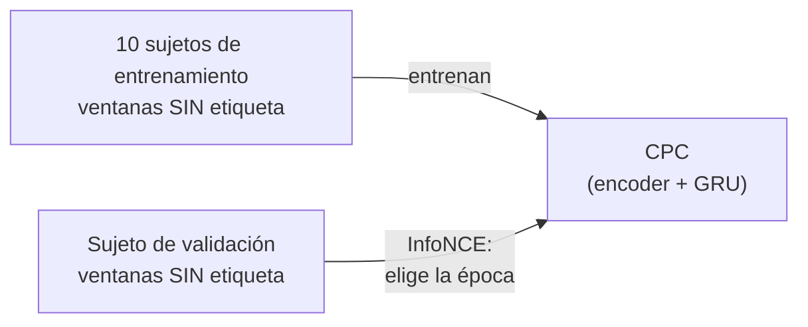
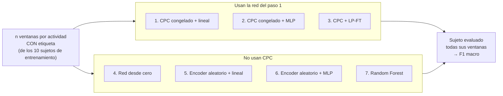

# Notebook 17: CPC-GRU frente a Random Forest con pocas etiquetas

[17_pocas_etiquetas_fs12.ipynb](../notebooks/17_pocas_etiquetas_fs12.ipynb)

## Pregunta y respuesta

**Pregunta:** cuando hay pocas ventanas etiquetadas, ¿CPC-GRU, preentrenado **sin etiquetas**, reconoce mejor las actividades de una persona nueva que un Random Forest entrenado con las mismas etiquetas?

**Respuesta:** sí, con **10 ventanas por actividad o menos**.
- **Tamaño de la ventaja:** CPC supera al Random Forest por **+0.04 a +0.11 de F1**, en 11–12 de 12 sujetos (p con Holm < 0.02).
- **Eficiencia:** equivale a necesitar ≈ la mitad de etiquetas.
- **Origen:** la ventaja viene del preentrenamiento.
- **Límite:** desde 25 ventanas por actividad deja de ser significativa. Con todas las etiquetas, el Random Forest es mejor (0.892 contra 0.873).

---

## 1. Protocolo

### Validación: LOSO con los sujetos 1–12

En cada una de las 12 rondas, los sujetos tienen tres papeles. Los sujetos 13 y 14 no se usan.

| Papel | Sujetos | Qué se usa de ellos |
|---|---|---|
| **Evaluado** | 1 (el de la ronda) | todas sus ventanas etiquetadas (≈ 2,800–4,500), **solo para medir el F1** |
| **Validación interna** | 1 (el siguiente de la lista) | solo sus ventanas **sin etiqueta**, para detener el preentrenamiento CPC. Sus etiquetas no se usan |
| **Entrenamiento** | los 10 restantes | todos sus instantes sin etiqueta (para CPC) y, de sus ≈ 34,000 ventanas etiquetadas, **solo n por actividad** |

### Datos de entrada

- **Variables:** MVNX a 12 Hz, subconjunto `EML` (10 variables: flexión de codos, muñecas, caderas y rodillas, y rapidez de manos; 11 sensores).
- **Ventanas:** 4 s (48 instantes), etiquetadas con la actividad del **instante final**.
- **Escalador:** se ajusta en cada ronda solo con los 10 sujetos de entrenamiento.

### Flujo de una ronda

Cada ronda tiene dos pasos. El diagrama muestra qué datos entran en cada uno.

**Paso 1: preentrenamiento CPC (sin etiquetas, una vez por ronda).**

**Paso 2: los 7 modelos con pocas etiquetas (por cada n y repetición).**

- **Las n ventanas etiquetadas son las mismas para los 7 modelos.**
- **Solo los modelos 1–3 aprovechan el preentrenamiento del paso 1.**
- **Los modelos 4–7 aprenden solo de las etiquetas.**
  - 4–6 son los controles.
  - 7 es el competidor.

### Muestreo de etiquetas

- **Tamaños:** **n ∈ {1, 2, 5, 10, 25, 50, 100}** ventanas por actividad, al azar entre los 10 sujetos de entrenamiento. Con 7 actividades son de 7 a 700 ventanas, frente a las ≈ 34,000 disponibles.
- **Repeticiones:** **10 por tamaño**, con distintas ventanas en cada una.
- **Las 7 variantes ven exactamente las mismas ventanas:** la muestra depende solo de (sujeto evaluado, n, repetición).

### Hiperparámetros

- **Cómo se eligen:** con **validación cruzada estratificada dentro de las n etiquetas**, con k = min(3, n) grupos.
- **Con n = 1** no se puede validar, y se usan valores fijados de antemano.
- **Ningún modelo** usa las etiquetas del sujeto de validación ni las del evaluado para elegir nada.

---

## 2. Qué datos entran a cada modelo

| Modelo | Entrada | Qué se entrena con las n·7 etiquetas | Hiperparámetro elegido por validación cruzada (valor si n = 1) |
|---|---|---|---|
| **1. CPC congelado + lineal** | `c_T` (256) del CPC preentrenado, normalizado con LayerNorm | solo una regresión logística | `C` ∈ {0.01, 0.1, 1, 10, 100} (1) |
| **2. CPC congelado + MLP del artículo** | `c_T` (256) del CPC preentrenado | solo el MLP: 256 → 256 → 128 → 7, con BatchNorm, ReLU y dropout 0.2; Adam, 150 épocas | tasa de aprendizaje ∈ {5e-4, 1e-4} (5e-4) |
| **3. CPC + LP-FT** | ventana `(10 × 48)` → encoder + GRU de CPC → cabeza lineal | la cabeza parte de la regresión logística y después se ajusta **toda la red** (encoder y GRU con LR 1e-4, cabeza con 1e-3) | épocas de ajuste fino ∈ {0 … 30}; 0 = solo la cabeza (10) |
| **4. Red desde cero** *(control)* | ventana `(10 × 48)` → la misma red **sin preentrenar** | toda la red, desde pesos aleatorios (LR 1e-3) | épocas ∈ {1 … 60} (30) |
| **5. Encoder aleatorio + lineal** *(control)* | `c_T` de la misma red **con pesos aleatorios, congelada**, normalizado con LayerNorm | solo una regresión logística | igual que el modelo 1 |
| **6. Encoder aleatorio + MLP** *(control)* | `c_T` de la misma red **con pesos aleatorios, congelada** | solo el MLP del artículo | igual que el modelo 2 |
| **7. Random Forest** | 50 características: media, desviación, mínimo, máximo y pendiente de las 10 variables en la ventana | 300 árboles | `min_samples_leaf` ∈ {1, 3} × `max_features` ∈ {√p, 0.5} (1, √p) |

**Datos sin etiqueta:** solo los usa el preentrenamiento CPC. Es uno por ronda y lo comparten los tres modelos CPC.
- **Entrenamiento:** lotes de 128 ventanas de un mismo sujeto, sacadas de los 10 sujetos de entrenamiento.
- **Parada:** se elige la época con la menor InfoNCE en ventanas sin etiqueta del sujeto de validación. Se evalúa cada 2 épocas, con un máximo de 20.

**Los controles separan dos causas posibles de la ventaja:**
- **Red desde cero:** misma arquitectura sin CPC. Si CPC le gana, la ventaja no viene de la arquitectura.
- **Encoder aleatorio:** misma cabeza sin lo aprendido por CPC. Si CPC le gana, la ventaja viene de las representaciones que aprendió.

---

## 3. Evaluación

- **Métrica:** F1 macro en **todas** las ventanas del sujeto evaluado. Se promedian las 10 repeticiones de cada sujeto y después los 12 sujetos.
- **Comparación:** prueba de Wilcoxon pareada por sujeto, con corrección de Holm sobre 21 comparaciones (3 modelos CPC × 7 tamaños).
- **Criterio fijado antes de ejecutar.** CPC es mejor que el Random Forest con n ventanas si:
  1. su F1 medio es mayor;
  2. p (Holm) < 0.05;
  3. mejora en ≥ 9 de 12 sujetos.

---

## 4. Resultados

### F1 macro en el sujeto evaluado

| Ventanas por actividad | 1 | 2 | 5 | 10 | 25 | 50 | 100 | todas* |
|---|---|---|---|---|---|---|---|---|
| CPC congelado + lineal | 0.364 | 0.470 | 0.615 | 0.702 | 0.763 | 0.792 | 0.819 | — |
| CPC congelado + MLP | 0.376 | 0.486 | 0.620 | 0.707 | 0.763 | 0.798 | 0.821 | — |
| CPC + LP-FT | 0.368 | 0.473 | **0.620** | **0.707** | 0.769 | 0.800 | 0.827 | 0.873 |
| Red desde cero | 0.317 | 0.375 | 0.500 | 0.615 | 0.717 | 0.777 | 0.812 | — |
| Encoder aleatorio + lineal | 0.349 | 0.400 | 0.485 | 0.551 | 0.621 | 0.680 | 0.722 | — |
| Encoder aleatorio + MLP | 0.344 | 0.412 | 0.487 | 0.548 | 0.623 | 0.672 | 0.721 | — |
| Random Forest | 0.323 | 0.407 | 0.513 | 0.611 | 0.722 | 0.777 | 0.816 | 0.892 |
| **CPC + LP-FT − RF** | +0.045 | +0.066 | **+0.107** | **+0.096** | +0.047 | +0.023 | +0.011 | −0.019 |
| ¿Cumple el criterio? | sí | sí | sí | sí | no | no | no | — |

\* Con todas las etiquetas, ≈ 2,000 por actividad (notebook 11).

### CPC + LP-FT frente a Random Forest

| Ventanas por actividad | 1 | 2 | 5 | 10 | 25 | 50 | 100 | todas* |
|---|---|---|---|---|---|---|---|---|
| **CPC + LP-FT** | **0.368** | **0.473** | **0.620** | **0.707** | **0.769** | **0.800** | **0.827** | 0.873 |
| **Random Forest** | 0.323 | 0.407 | 0.513 | 0.611 | 0.722 | 0.777 | 0.816 | **0.892** |
| Diferencia (CPC − RF) | +0.045 | +0.066 | +0.107 | +0.096 | +0.047 | +0.023 | +0.011 | −0.019 |
| Sujetos en que gana CPC | 12/12 | 11/12 | 11/12 | 11/12 | 10/12 | 10/12 | 9/12 | — |
| p (Wilcoxon, Holm) | 0.010 | 0.019 | 0.018 | 0.019 | 0.24 | 0.25 | 0.26 | — |
| ¿CPC es mejor según el criterio? | **sí** | **sí** | **sí** | **sí** | no | no | no | no |
| Ventanas que necesita el RF para igualar a CPC | 1 | 4 | 11 | 22 | 45 | 75 | > 100 | — |

En **negritas**, el mejor modelo de cada columna. "Ventanas que necesita el RF" interpola la curva del Random Forest; por ejemplo, para llegar al F1 que CPC logra con 10 ventanas por actividad, el RF necesita ≈ 22.

### Lo principal

1. **Ventaja con pocas etiquetas:** de 1 a 10 ventanas por actividad, los tres modelos CPC le ganan al Random Forest en 11–12 de 12 sujetos.
2. **Eficiencia:** para igualar lo que CPC logra con 5 o 10 ventanas por actividad, el Random Forest necesita ≈ 11 o ≈ 22. Es decir, **2.2 veces más etiquetas**.
3. **La ventaja viene del preentrenamiento:**
   - La red desde cero queda sobre la curva del Random Forest.
   - El encoder aleatorio queda por debajo de CPC entre 0.07 y 0.16, en 12 de 12 sujetos.
4. **Basta congelar CPC:**
   - Lineal, MLP y LP-FT difieren en ≤ 0.016.
   - Con 2 ventanas por actividad, la validación cruzada eligió 0 épocas de ajuste fino en el 76 % de los casos.
5. **Dónde gana (10 ventanas por actividad):** sobre todo en K (+0.26), PT (+0.22) y LT (+0.13). En PF gana el Random Forest (−0.04).
6. **Excepciones:** el Random Forest le gana a CPC en el sujeto 8 desde 5 ventanas por actividad, y en el sujeto 2 desde 25.

### Limitaciones

- **CPC llegó al tope de 20 épocas** en 10 de 12 rondas, con la pérdida todavía bajando.
- **El muestreo es idealizado:** exactamente n ventanas por actividad, balanceadas y repartidas entre 10 sujetos.
- **La ventaja supone datos sin etiqueta:** que existan horas de registro sin etiquetar de las personas de entrenamiento.
