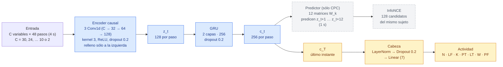
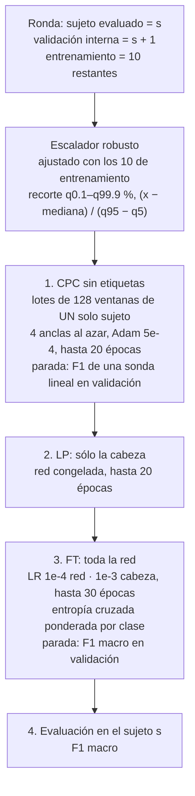
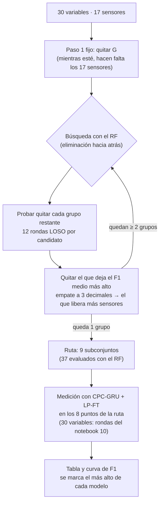
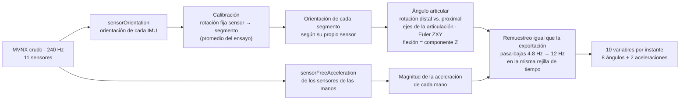

# Resumen: variables y sensores mínimos (notebooks 11 y 12)

Notebooks:
- [`notebooks/11_LOSO_variables_minimas_fs12.ipynb`](../notebooks/11_LOSO_variables_minimas_fs12.ipynb). Ejecución: 2–3 de noviembre de 2026 · 37 subconjuntos con Random Forest (1.7 h) y 8 subconjuntos × 12 sujetos con CPC-GRU (8.6 h).
- [`notebooks/12_LOSO_sensores_minimos_fs12.ipynb`](../notebooks/12_LOSO_sensores_minimos_fs12.ipynb). Ejecución: 5 de noviembre de 2026 · 3 condiciones con Random Forest y 2 condiciones × 12 sujetos con CPC-GRU (2.1 h).

Ambos en una Mac con Apple Silicon (MPS).

## 1. Las preguntas

| Notebook | Pregunta | Respuesta corta |
|---|---|---|
| **11** | ¿Cuáles son las variables mínimas que necesita el modelo para reconocer la actividad sin perder desempeño? | **Codos, manos y piernas:** 10 de las 30 variables, que necesitan 11 de los 17 sensores. F1 igual al de las 30 variables |
| **12** | Esas 10 variables las calculó Xsens con los 17 sensores. ¿Se obtiene lo mismo si se calculan **sólo con los 11 sensores**? | **Sí.** La GRU no pierde desempeño; el RF pierde 0.009, sólo por la variable de la mano |

El análisis de importancia por permutación del avance 5 ordenó las variables, pero no responde cuál es el mínimo. Ese modelo se entrenó con las 30 variables, y desordenar una variable en la prueba no equivale a un modelo diseñado sin ella. Por eso aquí **se reentrena con cada subconjunto**.

## 2. Lo común a los dos notebooks

### 2.1 Datos

Son los mismos del avance 5 y del notebook 10. Los dos notebooks lo verifican ventana por ventana.

| Elemento | Valor |
|---|---|
| Fuente | MVNX de Xsens, remuestreado de 240 a 12 Hz (pasa-bajas de 4.8 Hz) |
| Variables | Las 30 del avance 4: 14 ángulos, 6 alturas y alcances, 6 velocidades y 4 contactos de los pies. Lados fijos: izquierdo y derecho |
| Ensayos | 508 de 14 sujetos (7.8 h), incluidos los 3 ensayos recuperados del sujeto 7 |
| Ventanas etiquetadas | 4 s (48 pasos), una cada 0.5 s, con la etiqueta del **instante final**: 40,944 de los sujetos 1–12 |
| Ventanas sin etiqueta (CPC) | 4 s, una cada 2 s: 11,498 |
| Actividades | N, LF, K, PT, LT, W, PF |

### 2.2 Protocolo de evaluación

| Elemento | Decisión | Motivo |
|---|---|---|
| Validación | **LOSO** con los sujetos 1–12: 12 rondas, cada una evalúa un sujeto que el modelo no vio | Mide el desempeño con una persona nueva, que es el caso real |
| Validación interna | El sujeto siguiente de la lista (circular) decide la parada temprana; entrenan los 10 restantes | El sujeto evaluado no participa en ninguna decisión del entrenamiento |
| Sujetos 13 y 14 | Reservados, no se usan | Quedan para la evaluación final |
| Métrica | F1 macro por sujeto; se reporta la media, la desviación y el peor sujeto | Las 7 actividades pesan igual; el peor sujeto muestra el caso más desfavorable |
| Comparación | Prueba de Wilcoxon pareada por sujeto | Con 12 sujetos, compara las mismas personas en las dos condiciones sin suponer normalidad |
| Referencia de 30 variables | GRU: las rondas guardadas del notebook 10 (0.878). RF: el del avance 4 (0.894), recalculado | Misma configuración; no hace falta reentrenar |

### 2.3 Modelos

Se usan los dos modelos de referencia del proyecto, con la misma configuración que en el avance 5. Lo único que cambia es el número de variables de entrada.

**Random Forest**
- Entrada: 5 estadísticas por variable y ventana (media, desviación, mínimo, máximo y pendiente).
- 300 árboles, `max_features="sqrt"`, `min_samples_leaf=2`, pesos balanceados por clase y semilla fija.
- Es determinista y rápido. Por eso se usa para **buscar** (notebook 11).

**CPC-GRU con ajuste fino LP-FT**
- Recorre la ventana paso a paso y se preentrena sin etiquetas.
- Es más lento (≈ 4–7 min por ronda) y varía con la semilla (±0.01). Por eso se usa para **medir**.

### 2.4 Arquitectura de la red

- **Azul:** se preentrena con CPC y después se ajusta con etiquetas.
- **Gris:** sólo existe durante el preentrenamiento CPC.
- **Amarillo:** la cabeza de clasificación.
- Al cambiar el número de variables, **sólo cambia la primera convolución**: 30 → 32 canales con 30 variables (2,912 parámetros), 10 → 32 con 10 variables (992). El resto de la red (≈ 1.2 M parámetros) es idéntico. Si el F1 baja, no es porque la red sea más pequeña.

### 2.5 Entrenamiento de cada ronda (GRU)

| Decisión | Motivo |
|---|---|
| Negativos de InfoNCE **del mismo sujeto** | Si los candidatos fueran de otras personas, el modelo podría acertar reconociendo a la persona en lugar del movimiento (se decidió en el notebook 06) |
| Parada del CPC con una **sonda lineal** | La pérdida contrastiva no dice si la representación sirve para clasificar; la sonda sí |
| **LP antes de FT** | Con una cabeza aleatoria, los primeros gradientes del ajuste fino deforman la representación aprendida; con la cabeza ya entrenada, el ajuste sólo la refina |
| LP cuenta como "época 0" del FT | Si el ajuste fino no mejora en validación, se queda la versión LP; no puede empeorar el modelo |
| Una semilla (0) por ronda | Mantiene el costo en ≈ 1 h por subconjunto; el ruido de ±0.01 se declara como limitación |

## 3. Notebook 11: ¿qué variables se pueden quitar?

### 3.1 Unidad de eliminación: grupos por sensor

Quitar una variable suelta no siempre ahorra un sensor. Si se quita la altura de la mano pero se conserva su rapidez, el sensor de la mano sigue haciendo falta. Por eso las 30 variables se agrupan **según los sensores de los que dependen**: un ángulo articular necesita los dos segmentos que une, y una velocidad, el sensor de su segmento.

| Código | Grupo | Var. | Sensores que necesita |
|---|---|---|---|
| `G` | Posiciones globales: alturas de pelvis, cabeza y manos; alcance de las manos | 6 | **Los 17**: Xsens las reconstruye recorriendo la cadena del cuerpo desde el pie apoyado |
| `P` | Pelvis: velocidad horizontal y vertical, giro | 3 | Pelvis |
| `T` | Tronco: flexión, velocidad angular | 2 | Pelvis, T8 |
| `C` | Cabeza: flexión del cuello | 1 | T8, cabeza |
| `H` | Hombros: flexión y abducción | 4 | Hombros, brazos (×2) |
| `E` | Codos: flexión | 2 | Brazos, antebrazos (×2) |
| `M` | Manos: flexión de muñeca, rapidez de la mano | 4 | Antebrazos, manos (×2) |
| `L` | Piernas: flexión de cadera y rodilla | 4 | Pelvis, muslos, piernas (×2) |
| `F` | Pies: contacto de talón y punta | 4 | Piernas, pies (×2) |

- **Izquierda y derecha siempre juntas.** Hay tareas con una sola mano de cualquiera de los dos lados; quedarse con un solo lado haría depender el modelo de con qué mano carga la persona.
- **Sensores de un subconjunto** = la unión de los sensores de sus grupos. Como los grupos comparten sensores, quitar un grupo no siempre libera los suyos.

### 3.2 Procedimiento

| Decisión | Motivo |
|---|---|
| **El RF busca y la GRU mide** | Buscar con la GRU habría costado ≈ 55 h (37 subconjuntos), y su ruido de semilla podría decidir el orden por azar. El RF es determinista y es el mejor modelo del proyecto |
| **Eliminación hacia atrás** | Parte del modelo completo y pregunta "¿qué se puede quitar?". Cada grupo se evalúa junto con los demás, así que respeta las interacciones (p. ej. manos y piernas se compensan) |
| **Codiciosa**, un grupo por paso | Evita evaluar las 2⁹ = 512 combinaciones, aunque no garantiza el mejor subconjunto de cada tamaño |
| Empates a **3 decimales** | Diferencias menores a 0.001 son ruido; ante igual desempeño se prefiere ahorrar sensores |
| **Sin regla de tolerancia** | La primera versión detenía la GRU al perder 0.02 en el peor sujeto. Se cambió por medir todos los puntos y mostrar la curva completa, porque con una semilla esa regla era demasiado sensible al ruido |
| Escalador ajustado con las 30 variables y después recortado | Como es por variable, da lo mismo, y permite comprobar que es idéntico al del notebook 10 |
| Caché por subconjunto y ronda | Una corrida larga interrumpida se retoma donde se quedó |

### 3.3 Resultados

**Búsqueda con el RF.** Cada celda es el F1 medio al quitar ese grupo en ese paso; en **negritas**, el grupo que se quitó.

| Paso | Grupos antes del paso | Pelvis | Tronco | Cabeza | Hombros | Codos | Manos | Piernas | Pies |
|---|---|---|---|---|---|---|---|---|---|
| 2 | P T C H E M L F | 0.892 | 0.893 | 0.894 | **0.894** | 0.814 | 0.884 | 0.890 | 0.894 |
| 3 | P T C E M L F | 0.892 | 0.894 | 0.894 | | 0.808 | 0.883 | 0.889 | **0.896** |
| 4 | P T C E M L | 0.895 | 0.895 | **0.896** | | 0.810 | 0.885 | 0.891 | |
| 5 | P T E M L | 0.894 | **0.896** | | | 0.811 | 0.885 | 0.891 | |
| 6 | P E M L | **0.892** | | | | 0.810 | 0.882 | 0.889 | |
| 7 | E M L | | | | | 0.796 | **0.860** | 0.857 | |
| 8 | E L | | | | | 0.573 | | **0.714** | |

- **Los codos son lo único que no se puede sustituir.** Quitarlos siempre baja el F1 a ≈ 0.81; cualquier otro grupo cuesta ≤ 0.01.
- Pelvis, tronco, cabeza, hombros y pies **sobran**: su información ya está en los demás grupos.

**Ruta completa, medida con los dos modelos.** Los p son contra el mismo modelo con 30 variables.

| Paso | Se quita | Quedan | Var. | Sensores | F1 RF | F1 GRU | p GRU |
|---|---|---|---|---|---|---|---|
| 0 | — | todos | 30 | 17 | 0.894 | 0.878 | — |
| 1 | Posiciones globales | P T C H E M L F | 24 | 17 | 0.893 | 0.870 | 0.42 |
| 2 | Hombros | P T C E M L F | 20 | 15 | 0.894 | 0.875 | 0.62 |
| 3 | Pies | P T C E M L | 16 | 13 | **0.896** | 0.879 | 0.85 |
| 4 | Cabeza | P T E M L | 15 | 12 | **0.896** | 0.883 | 0.04 |
| 5 | Tronco | P E M L | 13 | 11 | **0.896** | **0.884** | 0.20 |
| 6 | Pelvis | **E M L** | **10** | **11** | 0.892 | 0.873 | 0.79 |
| 7 | Manos | E L | 6 | 9 | 0.860 | 0.861 | 0.05 |
| 8 | Piernas | E | 2 | 4 | 0.714 | 0.740 | < 0.001 |

El p es la probabilidad de ver una diferencia tan grande o mayor si en realidad no hubiera ninguna.

|p	|Lectura|
|---|---|
|Grande (p. ej. 0.79)|	La diferencia es compatible con el azar: no hay evidencia de que el subconjunto sea peor o mejor|
|Menor a 0.05	|Es poco probable que sea azar: la diferencia se considera significativa

### 3.4 Conclusiones

1. **El mínimo sin pérdida es codos, manos y piernas** (paso 6): 10 variables y 11 sensores (pelvis y, de cada lado, brazo, antebrazo, mano, muslo y pierna). Hasta ahí, ninguna diferencia es significativa. La única p < 0.05 a favor (paso 4) no resiste la corrección por 8 comparaciones.
2. **El punto de corte es quitar las manos** (paso 7): el RF pierde 0.034 (p < 0.001) y la GRU 0.017, empeorando en 10 de 12 sujetos.
3. **Quitar las variables de la pelvis no ahorra sensores.** El sensor de la pelvis sigue haciendo falta para el ángulo de la cadera, así que los pasos 5 y 6 usan los mismos 11 sensores.
4. **La GRU alcanza al RF con pocas variables.** La brecha pasa de 0.016 con todo a ≈ 0 con codos y piernas; con sólo los codos, la GRU es mejor.
5. La caída del sujeto 8 en el paso 1 (0.847 → 0.763) no se repite en los pasos siguientes: fue ruido de la semilla. Ese fue el motivo de quitar la regla de tolerancia.

## 4. Notebook 12: ¿bastan los 11 sensores?

### 4.1 Por qué hace falta

Las variables del notebook 11 vienen del **modelo del cuerpo completo** de Xsens:
- Xsens corrige la orientación de cada segmento con sus vecinos, porque los segmentos están unidos por articulaciones.
- Además, ancla el cuerpo al suelo con los pies.

El notebook 11 demuestra que la *información* de codos, manos y piernas basta. No demuestra que 11 sensores puedan *medirla* con la misma calidad.

### 4.2 Cómo se calculan las variables con los sensores

Además de las variables del modelo, el MVNX guarda lo que entrega **cada sensor por separado**:
- `sensorOrientation`: la orientación de cada IMU;
- `sensorFreeAcceleration`: su aceleración sin la gravedad.

- **Lectura:** se lee el MVNX por líneas en lugar de con un parser de XML, porque es mucho más rápido (≈ 0.7 s por ensayo, ≈ 5 min en total). Se procesan sólo los sujetos 1–12 y queda en caché.
- **Convención de los ángulos:** los ejes y el signo de cada articulación se identificaron comparando con `jointAngle` de Xsens. Aplicada a las orientaciones de los segmentos de Xsens, la fórmula reproduce sus ángulos con un error máximo de 0.0004°.

### 4.3 Tres condiciones

| Condición | Ángulos | Variable de la mano | Qué responde |
|---|---|---|---|
| `xsens` | Xsens (17 sensores) | Rapidez de Xsens | Referencia: el resultado del notebook 11 |
| `angulos_sensores` | Sólo sus 2 sensores | Rapidez de Xsens | ¿Cuánto cuesta perder la corrección del cuerpo completo en los ángulos? |
| `sensores` | Sólo sus 2 sensores | **Aceleración del sensor** | El sistema de 11 sensores completo |

La condición intermedia sirve para atribuir una pérdida: si sólo baja `sensores`, la causa es la variable de la mano; si ya baja `angulos_sensores`, son los ángulos.

### 4.4 Decisiones

| Decisión | Motivo |
|---|---|
| Sólo el subconjunto **codos, manos y piernas** | Es el mínimo del notebook 11; con pelvis no se ahorran sensores y duplicaba el tiempo de la GRU |
| **Aceleración** de la mano en lugar de rapidez | Con un solo sensor, la rapidez habría que integrarla y acumula deriva (un sesgo de 0.1 m/s² son 1 m/s de error en 10 s). La aceleración la mide el sensor directamente |
| Calibración **constante por ensayo** | Equivale a una calibración ideal antes de cada ensayo (en un sistema real, la postura N). No hay forma de verificar en los datos que todos los ensayos empiecen en la misma postura |
| Escalador ajustado con la serie de **cada condición** | Las variables de los sensores tienen otra distribución que las de Xsens |
| `xsens` **no se reentrena** con la GRU | Son exactamente las rondas `EML` del notebook 11 |
| Sin prueba de ruido simulado | Se deja descrita para después (sección 6) |

**Controles que detienen el notebook si fallan:**
- La fórmula de los ángulos reproduce a Xsens en **cada ensayo** (< 0.01°).
- Los ángulos remuestreados coinciden con la serie de Xsens del notebook (< 0.01°), lo que comprueba la rejilla de tiempo.
- El RF de `xsens` es idéntico al del notebook 11.
- Las ventanas evaluadas son las mismas que en el notebook 10.

### 4.5 Resultados

**¿Cuánto se parecen las variables de los sensores a las de Xsens?** Medido en todos los instantes de los sujetos 1–12.

| Variable | Correlación | Error mediano | Error p95 |
|---|---|---|---|
| Codos | 1.000 | 0.07° | 1.0° |
| Muñecas | 1.000 | 0.05° | 0.6° |
| Caderas | 0.997–0.998 | 0.3–0.4° | 3.8–4.5° |
| Rodillas | 0.998 | 0.3–0.4° | 3.5–4.2° |
| Aceleración vs. rapidez de la mano | 0.67 | — | — |

- El modelo del cuerpo completo **sí corrige** las orientaciones, sobre todo en las piernas. La desviación de la rotación sensor → segmento dentro del ensayo (p95, mediana entre ensayos) es de 2.8–4.1° en pelvis, muslos y piernas, 0.7–1.1° en brazos y antebrazos, y 0.2° en las manos.
- Aun así, la forma de las curvas se conserva.

**F1 macro (media de 12 sujetos).** Los p son contra `xsens`.

| Modelo | `xsens` | `angulos_sensores` | `sensores` |
|---|---|---|---|
| Random Forest | 0.892 | 0.892 (+0.001, p = 0.34) | **0.883** (−0.009, mejora en 2/12, p = 0.003) |
| CPC-GRU + ajuste fino | 0.873 | 0.876 (+0.003, p = 0.68) | **0.870** (−0.003, mejora en 7/12, p = 0.68) |

### 4.6 Conclusiones

1. **Los ángulos no necesitan el modelo del cuerpo completo.** Con los ángulos de los sensores, el F1 es igual en los dos modelos. Errores de pocos grados no cambian el reconocimiento.
2. **El único costo es cambiar la rapidez de la mano por su aceleración, y sólo en el RF.**
   - **RF:** pierde 0.009 en 10 de 12 sujetos (p = 0.002 contra `angulos_sensores`).
   - **GRU:** no pierde. Su caída aparente viene de un solo sujeto (sujeto 7: 0.889 → 0.828), que puede ser ruido de la semilla.
   - **Hipótesis:** la aceleración no ve el movimiento a velocidad constante. El RF, con 5 estadísticas por ventana, pierde esa información; la GRU recorre la ventana paso a paso y puede "integrarla". Coincide con que, en la GRU, caminar es la actividad que más baja (F1 0.933 → 0.915).
3. **Implicación práctica.** Un sistema de **11 IMU** que calcule 8 ángulos y la aceleración de las manos reconoce las 7 actividades con F1 ≈ 0.87–0.88: ≈ 0.01 menos que el traje completo con 30 variables, con 6 sensores menos.

## 5. Limitaciones

| Limitación | Notebook | Consecuencia |
|---|---|---|
| Una sola semilla por subconjunto o condición en la GRU | 11 y 12 | Diferencias de ±0.01 o caídas en un solo sujeto pueden ser ruido |
| El subconjunto se eligió con los mismos 12 sujetos con los que se reporta | 11 y 12 | El F1 del mínimo es algo optimista; la estimación honesta será con los sujetos 13 y 14 |
| Búsqueda codiciosa | 11 | No garantiza el mejor subconjunto de cada tamaño |
| `sensorOrientation` no es la señal cruda: ya pasó por la fusión de Xsens de cada sensor, y el MVNX no trae el giroscopio ni el acelerómetro | 12 | El resultado vale para IMU con una fusión de calidad comparable; no se puede descartar que esa orientación use información de otros sensores |
| Calibración ideal, estimada con el modelo de Xsens en cada ensayo | 12 | Un sistema real calibra una vez por sesión; si un sensor se mueve, el error crece |

## 6. Siguientes pasos

- **Prueba de sensibilidad al ruido** (descrita en el notebook 12, sin ejecutar). Consiste en agregar a los ángulos de la condición `sensores` errores simulados y medir el F1:
  - ruido blanco de 2°, 5° y 10°;
  - deriva lenta de 1°, 3° y 5° por minuto;
  - un desfase de calibración de 5° y 10°.

  El resultado sería una curva de F1 contra error, que dice qué precisión debe tener un sistema en planta. El notebook 12 ya da el primer punto: errores de ≈ 1–4° (p95) no cambian el F1.
- **Recuperar la información de traslación sin sensores extra**, para la pérdida del RF. Opciones: la aceleración de la pelvis, cuyo sensor ya está, o la rapidez de la mano integrada dentro de cada ventana de 4 s, donde la deriva aún es pequeña.
- **Confirmar con el ensamble de 5 semillas** el subconjunto mínimo, para quitar el ruido de una sola semilla.
- **Evaluar el sistema de 11 sensores con los sujetos 13 y 14**, junto con la evaluación final del proyecto.
